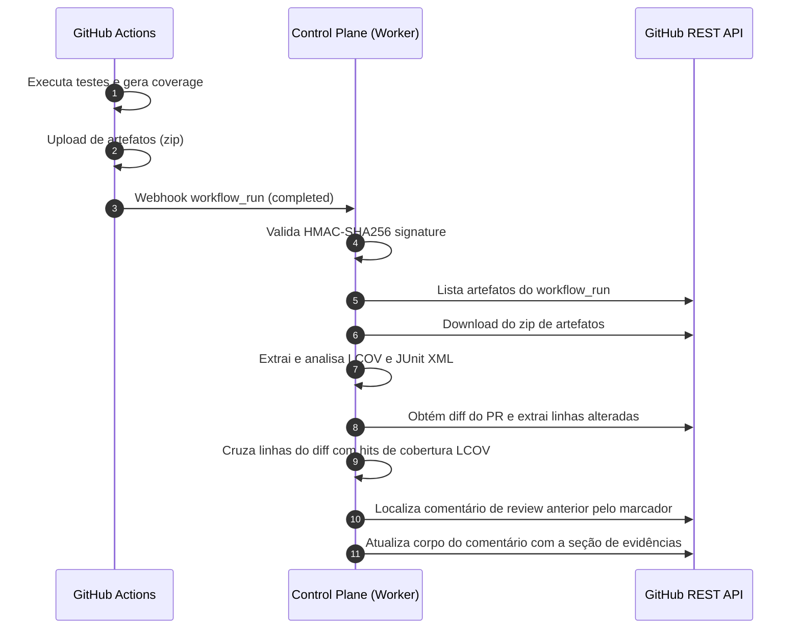

# Ingestão de Evidências de CI, Cobertura e Testes (retirada)

> Documento histórico. A [ADR-0046](../decisions/0046-use-cloudflare-think-for-pr-review.md)
> retirou este fluxo. O runtime não consome `workflow_run`, não baixa artefatos
> LCOV/JUnit nem atualiza o comentário com dados de CI. Tabelas antigas do
> ledger permanecem para preservar dados.

Este documento descreve o subsistema de ingestão e correlação determinística de evidências de Integração Contínua (CI) no Holon, abrangendo relatórios de cobertura de código (LCOV) e execução de testes (JUnit XML).

## 1. Visão Geral e Princípios

A análise de PRs por agentes de inteligência artificial torna-se significativamente mais contextual quando alimentada com os resultados concretos dos testes e medições de cobertura executados pelo pipeline de CI do repositório.

Princípios fundamentais adotados:

1. **Segurança e Privilégio Mínimo**: Holon **nunca** executa comandos arbitrários, testes, `npm test` ou scripts de lifecycle em seus contêineres/workers. A execução pertence ao pipeline de CI do projeto (GitHub Actions); o Holon apenas consome e analisa passivamente os artefatos emitidos.
2. **Sincronização Desacoplada e Sem Bloqueios**: A análise primária com IA e os Check Runs ocorrem no webhook de Pull Request. A ingestão de evidências ocorre passivamente quando o evento `workflow_run.completed` é despachado pelo GitHub, enriquecendo o comentário de review existente.
3. **Sem Poluição de Notificações no PR**: Em vez de abrir novos comentários de spam ou criar um segundo Check Run, o subsistema localiza deterministicamente o comentário de resumo de review existente através de marcadores HTML e atualiza seu conteúdo in-place (`PUT /repos/{owner}/{repo}/pulls/{pull_number}/reviews/{review_id}`).
4. **Resiliência a Zip Bomb e XXE**: Descompactação segura em memória via `fflate` com limites rígidos de bytes (<10 MB compactado, <30 MB descompactado) e parsing de XML seguro sem resolução de DTD/entidades externas.

## 2. Fluxo de Dados e Sequência

### Explicação Textual do Diagrama

1. O GitHub Actions finaliza a execução dos testes e gera arquivos de cobertura (ex: `lcov.info`) e resultados de testes (ex: `junit.xml`), submetendo-os como artefatos do workflow.
2. O GitHub emite o webhook `workflow_run` com status `completed` para o endpoint `/webhooks/github` do Holon.
3. O Control Plane autentica a assinatura do webhook.
4. Identifica os Pull Requests associados e consulta a lista de artefatos do workflow via API REST do GitHub.
5. Efetua o download do buffer zip do artefato em memória.
6. Descompacta o zip com proteções de cota e extrai relatórios LCOV e JUnit XML válidos.
7. Consulta o diff do Pull Request para isolar exatamente as linhas modificadas/adicionadas no lado `RIGHT`.
8. Cruza as linhas alteradas com os registros do LCOV, calculando a métrica exata de cobertura das linhas do PR.
9. Localiza o comentário de review emitido pelo Holon através do marcador unificado `<!-- holon;run=...;finding=summary -->`.
10. Substitui ou anexa deterministicamente o bloco delimitado `<!-- holon:ci-evidence:start -->...<!-- holon:ci-evidence:end -->` no comentário de review existente via `PUT /repos/{owner}/{repo}/pulls/{pull_number}/reviews/{review_id}`.

### 2.1 Resiliência à Ordem de Execução (Bidirectional Handshake via Ledger)

Devido à natureza assíncrona concorrente entre pipelines do GitHub Actions e workflows do Holon na Cloudflare, dois cenários de temporização ocorrem naturalmente:

- **Cenário A (CI conclui antes da análise de IA)**: O webhook `workflow_run.completed` ingere os artefatos e persiste a evidência formatada no SQLite do Durable Object (`ReviewLedger.saveCiEvidence`). Quando o `ReviewWorkflow` finaliza a análise de IA, ele consulta `loadCiEvidence` e publica o resumo inicial já incorporando a seção de evidências de CI.
- **Cenário B (Análise de IA conclui antes do CI)**: O `ReviewWorkflow` publica o comentário de resumo inicial. Quando o webhook `workflow_run.completed` chega em seguida, ele persiste a evidência no ledger, localiza o comentário de resumo publicado via marcador determinístico e atualiza-o _in-place_.

Em ambos os cenários, elimina-se qualquer condição de corrida e garante-se que a timeline do Pull Request receba o relatório consolidado sem duplicação de comentários.

## 3. Contratos e Modelagem

- **LineCoverage** (`@holon/contracts`, `packages/contracts/src/ci-evidence.ts`):
  Representa os dados de linhas executadas vs encontradas por arquivo (`filePath`, `linesFound`, `linesHit`, `lineHits: Map<number, number>`).
- **TestExecutionReport** (`@holon/contracts`):
  Registra métricas agregadas (`totalTests`, `passed`, `failed`, `skipped`, `durationMs`) e a lista detalhada de falhas (`TestFailure`: nome do teste, mensagem sanitizada, arquivo e linha de origem).
- **CiEvidence** (`@holon/contracts`):
  Envelope unificado agregando status (`available` | `not_available`), cobertura, relatório de testes, nome do workflow e id da execução.

## 4. Recomendações de Nomenclatura vs. Flexibilidade

> [!NOTE]
> **Recomendação de Boas Práticas**:
> Recomendamos que os fluxos de trabalho nos repositórios cliente nomeiem seus artefatos no GitHub Actions com padrões legíveis e convencionais, tais como:
>
> - `coverage` ou `coverage-report`
> - `test-results` ou `junit-report`
> - `lcov` ou `tests`

> [!IMPORTANT]
> **Sem Limitação Rígida (Content-Sniffing Flexível)**:
> A recomendação acima tem caráter de boa prática e **não constitui limitação técnica restritiva**. Para permitir a integração com projetos legados ou convenções corporativas pré-existentes, o extrator do Holon analisa o conteúdo interno de qualquer arquivo `.zip` enviado pelo workflow_run:
>
> - Arquivos com sufixo `.lcov`, `.info` ou cujo cabeçalho inicie com `TN:` / `SF:` são processados pelo parser LCOV.
> - Arquivos com sufixo `.xml` contendo tags `<testsuites` ou `<testsuite` são processados pelo parser JUnit XML.
>   Caso um artefato contenha formatos não reconhecidos, o processo é ignorado graciosamente sem causar falhas ou interrupções no pipeline.
