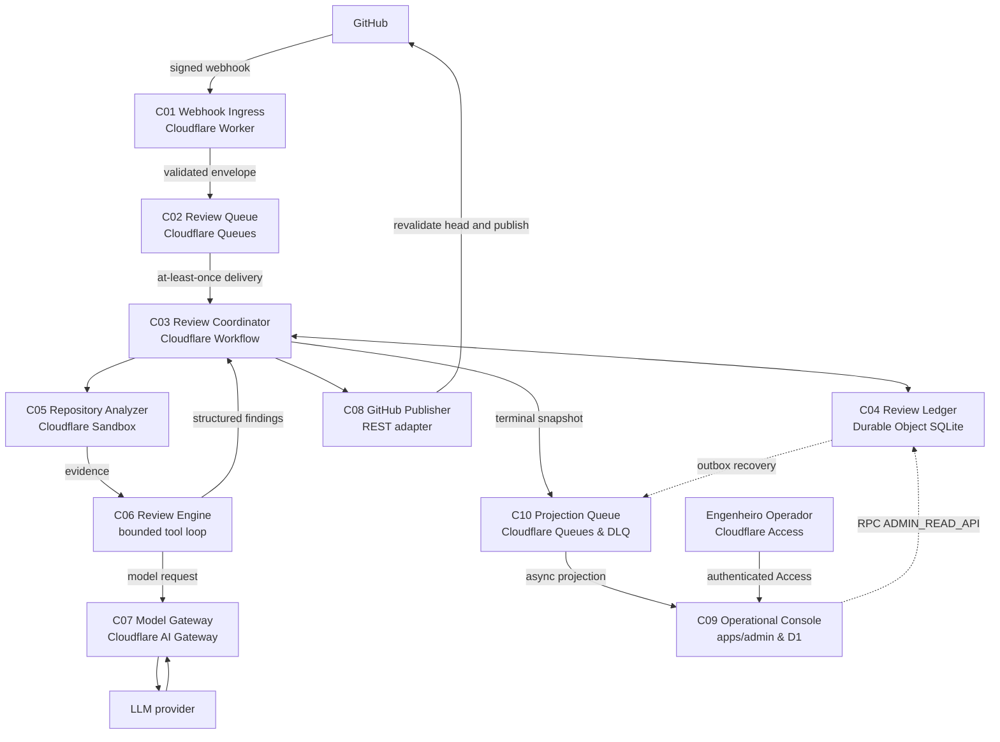

# Visão de containers

Esta visão nomeia as responsabilidades estáveis da implementação atual.

## Catálogo

| ID  | Responsabilidade                                           | Tecnologia atual                          | Estado               |
| --- | ---------------------------------------------------------- | ----------------------------------------- | -------------------- |
| C01 | Validar HMAC, normalizar evento e responder rapidamente    | Cloudflare Worker                         | Implementada         |
| C02 | Absorver bursts e aplicar backpressure                     | Cloudflare Queues                         | Implementada         |
| C03 | Executar etapas duráveis e retries delimitados             | Cloudflare Workflows                      | Implementada         |
| C04 | Registrar run, head SHA, efeitos publicados e dedupe       | Durable Object SQLite por PR              | Implementada         |
| C05 | Classificar contexto e executar buscas/parsers autorizados | Cloudflare Sandbox em deployable separado | Implementada         |
| C06 | Executar investigação em duas fases e gate de evidência    | Application/domain + Two-Phase Review     | Implementada         |
| C07 | Aplicar modelo, telemetria e políticas de custo/rate limit | Cloudflare AI Gateway                     | Adapter implementado |
| C08 | Reler head e publicar comentários/review GitHub            | GitHub REST API                           | Implementada         |
| C09 | Console operacional interno, read model exato e retenção   | Cloudflare Worker (React Router v8) + D1  | Implementada         |
| C10 | Transporte desacoplado e durável da projeção analítica     | Cloudflare Queues + DLQ                   | Implementada         |

## Alocação inicial em deployables

C01 e os handlers de C02 e C03 são hospedados pelo mesmo
`apps/control-plane`, conforme ADR-0003. Eles continuam separados neste desenho
porque possuem responsabilidades e gatilhos distintos. A Queue de C02 é um
recurso gerenciado externo ao processo; o mesmo deployable apenas contém seu
producer e consumer.

C09 é o terceiro deployable `apps/admin`, conforme ADR-0029. Ele hospeda os
handlers de SSR Web (React Router v8), o consumidor assíncrono de projeção da
Queue C10 para o Cloudflare D1 e o handler `scheduled` de retenção analítica.
O acesso de operadores humanos é restrito via Cloudflare Access. Detalhes
específicos de runs são obtidos via RPC Service Binding interno direcionado ao
ledger C04.

C05 é o deployable separado `apps/repository-executor`. Essa fronteira
preserva isolamento e política de recursos próprios para código de repositórios
sem obrigar a separar prematuramente as partes confiáveis do control plane.
O contexto potencialmente grande permanece no filesystem efêmero de C05; C03
persiste apenas checkpoints e resultados pequenos.

C05 classifica cada patch como `structural`, `textual` ou ignorado e aplica a
mesma elegibilidade a leituras e buscas posteriores. C06 recebe os modos
explicitamente: ast-grep fica restrito a JS/TS estrutural, enquanto patches
textuais elegíveis usam apenas diff, leitura e busca textual.

C06 opera em duas fases conforme ADR-0018: Fase 1 executa investigação com tools
delimitadas em texto livre; Fase 2 realiza finalização estruturada dedicada com
schema portável e validação no host.

## Componentes adiados ou rejeitados

- Agents SDK e `@cloudflare/think`: rejeitados e descomissionados após evidência
  empírica do benchmark (ADR-0018).
- Vectorize: somente após benchmark de recuperação.
- R2: somente quando snapshots ou artefatos grandes tiverem retenção definida.
- Workers AI: somente com tarefa auxiliar e benchmark explícitos.
- Tunnel: somente para executor ou MCP privado externo.
