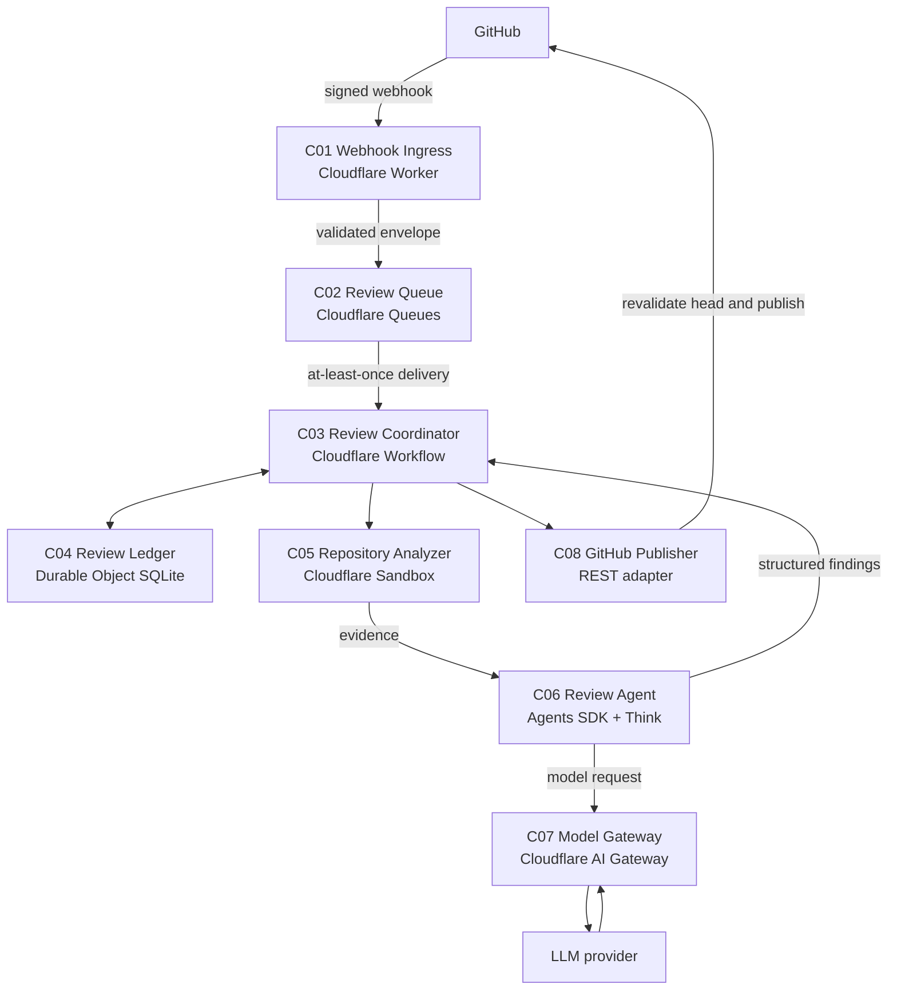

# Visão de containers

Esta visão nomeia as responsabilidades estáveis da implementação atual.

## Catálogo

| ID  | Responsabilidade                                           | Tecnologia atual                              | Estado               |
| --- | ---------------------------------------------------------- | --------------------------------------------- | -------------------- |
| C01 | Validar HMAC, normalizar evento e responder rapidamente    | Cloudflare Worker                             | Implementada         |
| C02 | Absorver bursts e aplicar backpressure                     | Cloudflare Queues                             | Implementada         |
| C03 | Executar etapas duráveis e retries delimitados             | Cloudflare Workflows                          | Implementada         |
| C04 | Registrar run, head SHA, efeitos publicados e dedupe       | Durable Object SQLite por PR                  | Implementada         |
| C05 | Classificar contexto e executar buscas/parsers autorizados | Cloudflare Sandbox em deployable separado     | Implementada         |
| C06 | Executar revisão agentiva e devolver saída estruturada     | Agents SDK + Think; gate de evidência no host | Implementada         |
| C07 | Aplicar modelo, telemetria e políticas de custo/rate limit | Cloudflare AI Gateway                         | Adapter implementado |
| C08 | Reler head e publicar comentários/review GitHub            | GitHub REST API                               | Implementada         |

## Alocação inicial em deployables

C01 e os handlers de C02 e C03 são hospedados pelo mesmo
`apps/control-plane`, conforme ADR-0003. Eles continuam separados neste desenho
porque possuem responsabilidades e gatilhos distintos. A Queue de C02 é um
recurso gerenciado externo ao processo; o mesmo deployable apenas contém seu
producer e consumer.

O admin, seu read model D1 e a fila de projeção foram retirados pela
[ADR-0040](../decisions/0040-retire-admin-and-analytical-storage.md).
O ledger permanece a autoridade funcional. Grafana ainda não foi implementado.

C05 é o deployable separado `apps/repository-executor`. Essa fronteira
preserva isolamento e política de recursos próprios para código de repositórios
sem obrigar a separar prematuramente as partes confiáveis do control plane.
O contexto potencialmente grande permanece no filesystem efêmero de C05; C03
persiste apenas checkpoints e resultados pequenos.

C05 classifica cada patch como `structural`, `textual` ou ignorado e aplica a
mesma elegibilidade a leituras e buscas posteriores. C06 recebe os modos
explicitamente: ast-grep fica restrito a JS/TS estrutural, enquanto patches
textuais elegíveis usam apenas diff, leitura e busca textual.

C06 opera por shard conforme [ADR-0049](../decisions/0049-use-cloudflare-think-for-pr-review.md).
O `ReviewShardWorkflow` usa `step.prompt` para um turno durável do Think; o
control plane valida a saída e o diff canônico no host. Tools ficam restritas
a leitura e busca via C05.

## Componentes adiados ou rejeitados

- Vectorize: somente após benchmark de recuperação.
- R2: somente quando snapshots ou artefatos grandes tiverem retenção definida.
- Workers AI: somente com tarefa auxiliar e benchmark explícitos.
- Tunnel: somente para executor ou MCP privado externo.
