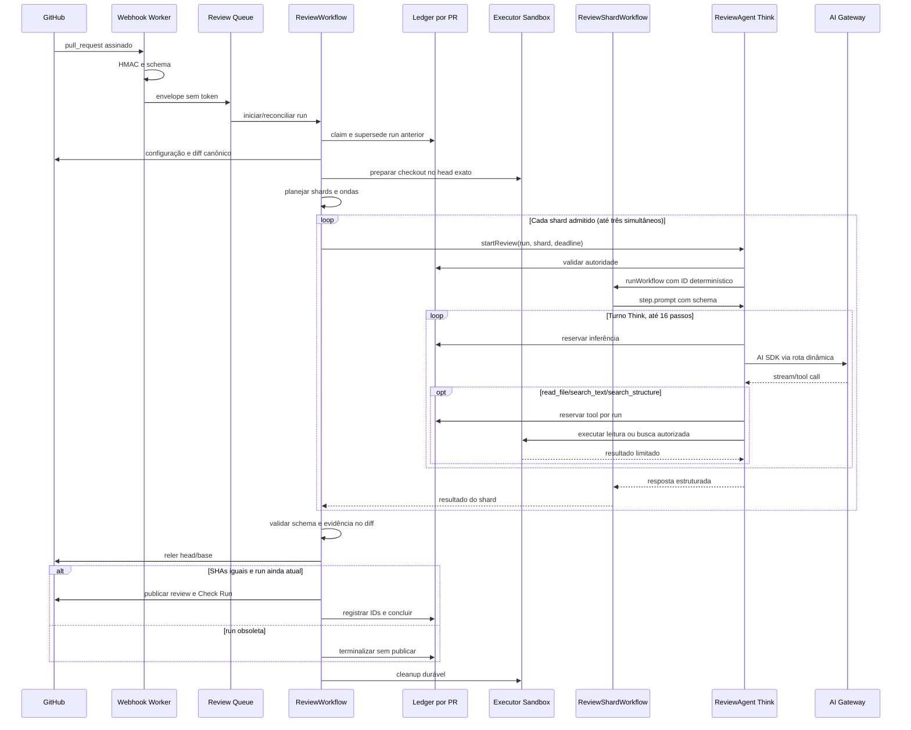

# Fluxo de execução de uma review

Uma run pertence ao par head/base SHA do PR. O ledger SQLite por PR decide qual
run é a mais recente e registra a autoridade para análise, publicação e cleanup.
O resultado de uma run obsoleta não é publicado.

O `ReviewWorkflow` continua coordenador. O Think controla o turno agentivo e a
saída estruturada; o executor controla acesso ao repositório. O ledger decide
causalidade e orçamento. A publicação permanece exclusivamente no host.

## Admissão e contexto

O webhook valida assinatura, tamanho e evento antes de normalizar a Queue.
Duplicatas e ordem de entrega não dão autoridade. A configuração do repositório
é compilada para a run e ancorada na base; o checkout ocorre no head exato. O
executor classifica patches como estruturais ou textuais e produz contexto
limitado. O plano admite até 16 arquivos, 768 linhas e 96 kB de patch por shard,
com no máximo 64 shards e três análises simultâneas. Contexto omitido gera
limitação explícita; não é tratado como cobertura.

## Agent e tools

Um `ReviewAgent` isolado por run/shard deriva de `Think`. `ReviewShardWorkflow`
usa `ThinkWorkflow.step.prompt` para a revisão. A identidade do Workflow é
estável em retries. Antes de cada turno, tool e conclusão, o Agent consulta o
ledger e o deadline. `getTools` registra somente `read_file`, `search_text` e
`search_structure`. MCP, bash e edição não são expostos. O executor revalida
path, escopo, política de egress, tamanho, deadline e autoridade no limite de
confiança próprio. Código e resultado de busca são dados não confiáveis.

O provider é AI SDK por AI Gateway Dynamic Route. `AGENT_TRACE_PAYLOADS` está
`enabled` durante o beta; **desabilitar quando o usuário solicitar**. Os spans
do Agent podem conter mensagens e outputs de tools. O Gateway mantém coleta
de payload desligada.

## Orçamento, falhas e idempotência

O ledger reserva recursos antes da inferência, incluindo chamadas, bytes de
entrada e máximo de saída. São 64 chamadas, 4.000.000 bytes e 120.000 tokens
de saída por run; uso incerto mantém a reserva. Tools compartilham 96 chamadas
por run entre todos os shards. Esses limites não são uma estimativa exata de
tokens de entrada ou custo monetário. Retry e eviction não renovam saldo.

O adapter espera o estado do Workflow do shard até o deadline da análise.
Cancelamento ou deadline terminam o Workflow filho; run obsoleta bloqueia novos
turnos e tools. Falhas terminais do shard viram resultado parcial explícito.
Falha de preparação, ledger ou Sandbox continua erro de infraestrutura do
Workflow pai. A análise nunca aprova uma área não examinada apenas porque os
shards concluídos não encontraram problemas.

O host valida a saída do Think com Zod e verifica cada finding e resolução
contra linhas RIGHT do diff canônico. Resolve um finding anterior apenas com
evidência positiva da correção. Antes de publicar, relê head/base, compara com a
run, usa claim condicional no ledger e reconcilia IDs externos após resposta
ambígua. Todos os caminhos terminais exigem cleanup durável do Sandbox.

## Funcionalidades retiradas

O control plane ignora `workflow_run`. Não baixa ZIP/LCOV/JUnit, não persiste
novas evidências de CI e não acrescenta esse bloco ao comentário. Tabelas
históricas do ledger permanecem sem leitores. A avaliação live do motor antigo
foi retirada; a avaliação offline recorded permanece. Um smoke remoto com a
rota e o modelo reais ainda é necessário para provar streaming, tool calling e
`think_final_answer`; build local e testes Workerd não comprovam essa integração.
