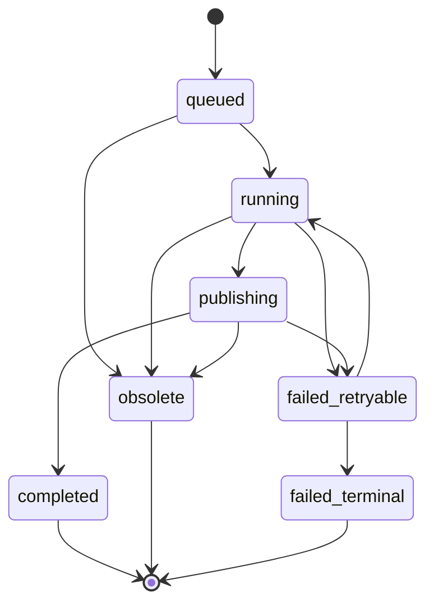

# Estado e idempotência

Queues entrega mensagens pelo menos uma vez. A arquitetura deve assumir que
qualquer etapa pode ser repetida após uma falha e que uma API externa pode ter
concluído uma operação mesmo quando a resposta não chegou.

## Identidades

| Identidade  | Forma implementada                                          | Uso                                     |
| ----------- | ----------------------------------------------------------- | --------------------------------------- |
| Delivery    | `github:<delivery_id>`                                      | Detectar redelivery literal do webhook  |
| Run         | `github:<repo_id>:pr:<number>:head:<sha>`                   | Uma análise lógica de uma revisão do PR |
| Workflow    | `review-<sha256(run-id)>`                                   | Criação idempotente e dono da execução  |
| Finding     | Hash de run + caminho + intervalo + diagnóstico normalizado | Reconciliar o mesmo finding             |
| Publication | Run + finding ou `summary`                                  | Impedir comentário duplicado            |

IDs devem ser opacos fora do domínio e nunca incluir segredo.

## Máquina de estados implementada



## Regras

- A run é imutavelmente associada a um head SHA.
- Um evento novo não altera a run antiga; cria uma nova identidade.
- A run mais nova é ordenada por `pull_request.updated_at`, depois por
  `receivedAt`; run ID apenas desempata valores idênticos.
- Somente a run mais recente do PR em estado `publishing` pode iniciar ou
  continuar publicação.
- `completed`, `obsolete` e `failed_terminal` são terminais.
- Retry de etapa não cria nova run.
- Uma instância diferente do Workflow não assume uma run ativa já pertencente a
  outra instância.
- Cada transição possui operation ID; repetir a mesma operação com os mesmos
  estados é no-op, mas reutilizar o ID com parâmetros diferentes falha fechado.
- O ledger registra o ID retornado pelo GitHub antes de marcar publicação como
  concluída sempre que a ordem for controlável.
- Após timeout ambíguo, o publicador reconcilia por ID persistido ou marcador
  determinístico antes de tentar criar outro comentário.

## Marcador de comentário

Caso a API não ofereça idempotency key, o corpo pode conter marcador invisível:

```html
<!-- holon:v1;run=<run-id>;finding=<finding-id> -->
```

O formato é versionado e o conteúdo visível não depende do marcador.

## Implementação do ledger

A escolha aceita no ADR-0004 é um Durable Object SQLite por `PrKey`. A tabela
`runs` aplica unicidade por run e registra o owner `workflow_instance_id`,
`metadata.latest_run_id` identifica o head mais novo observado,
`transition_operations` torna commits repetidos idempotentes e `publications`
persiste o claim e o ID retornado pelo GitHub. Updates usam estado esperado na
cláusula `WHERE`; quando os retries duráveis acabam, estados ativos passam a
`failed_terminal` de maneira idempotente.

Workflows executa a etapa com retries delimitados. Antes de qualquer publicação,
o caso de uso exige simultaneamente que a run ainda seja a mais recente no
ledger e que o GitHub reporte o mesmo `head.sha`; a verificação é repetida antes
de cada mutação externa. Timeout após efeito externo é reconciliado no endpoint
correspondente ao tipo de publicação. A busca tem paginação limitada e só
aceita o login exato do GitHub App com tipo `Bot`. Os `POST`s desativam
o retry interno do Octokit para que somente essa reconciliação possa decidir
por uma nova tentativa.

O schema evolui por `schema_migrations` transacional. Tarefas de cleanup ficam
em tabela própria; terminalização e criação da tarefa acontecem atomicamente.
Um alarm tenta uma tarefa pending por vez, registra tentativas e remove o
credential scope somente após o executor confirmar cleanup.
