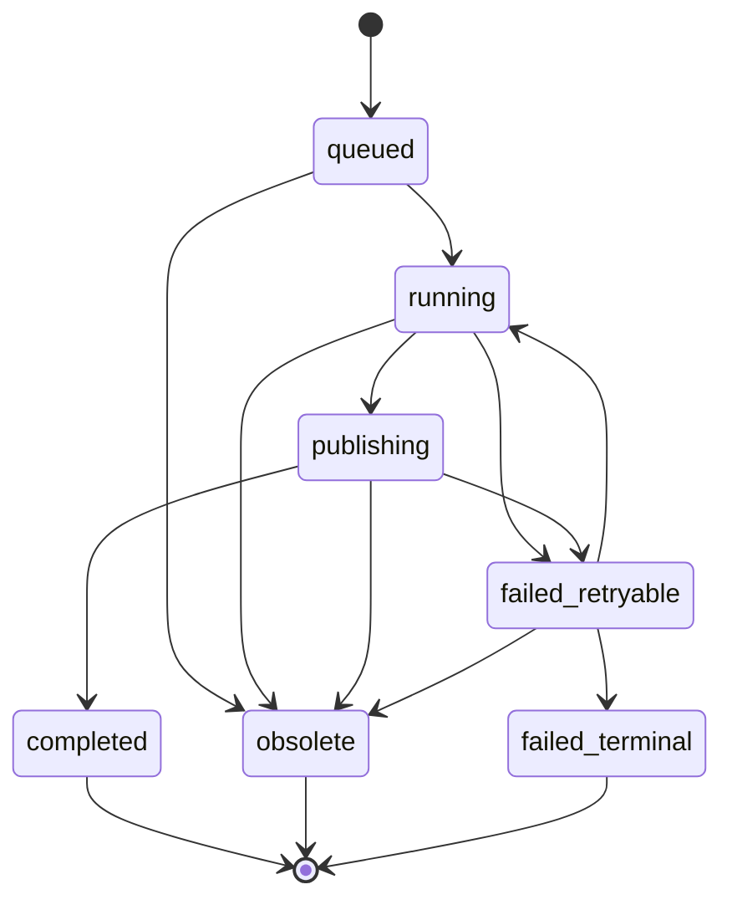

# Estado e idempotência

Queues entrega mensagens pelo menos uma vez. A arquitetura deve assumir que
qualquer etapa pode ser repetida após uma falha e que uma API externa pode ter
concluído uma operação mesmo quando a resposta não chegou.

## Identidades

| Identidade  | Forma implementada                                       | Uso                                     |
| ----------- | -------------------------------------------------------- | --------------------------------------- |
| Delivery    | `github:<delivery_id>`                                   | Detectar redelivery literal do webhook  |
| Run         | `github:<repo_id>:pr:<number>:head:<sha>:base:<sha>`     | Uma análise lógica de uma revisão do PR |
| Workflow    | `review-<sha256(run-id)>`                                | Criação idempotente e dono da execução  |
| Finding     | Hash estável de path + excerpt + diagnóstico normalizado | Reconciliar entre runs do mesmo PR      |
| Publication | Run + finding ou `summary`                               | Impedir comentário duplicado            |
| Feedback    | `github:<delivery_id>`                                   | Aplicar comando e responder uma vez     |

IDs devem ser opacos fora do domínio e nunca incluir segredo.

## Máquina de estados implementada



## Regras

- A run é imutavelmente associada ao par de refs observado; a política é
  ancorada ao `baseSha` e a análise ao `headSha`.
- Um evento novo não altera a run antiga; cria uma nova identidade.
- A run mais nova é ordenada por `pull_request.updated_at`, depois por
  `receivedAt`; run ID apenas desempata valores idênticos.
- Somente a run mais recente do PR em estado `publishing` pode iniciar ou
  continuar publicação.
- `completed`, `obsolete` e `failed_terminal` são terminais.
- Retry de etapa não cria nova run.
- Uma instância diferente do Workflow não assume uma run ativa já pertencente a
  outra instância.
- A promoção causal torna runs ativas anteriores `obsolete` e persiste as
  obrigações de cancelamento antes de qualquer chamada a `terminate`.
- Cada transição possui operation ID; repetir a mesma operação com os mesmos
  estados é no-op, mas reutilizar o ID com parâmetros diferentes falha fechado.
- O ledger registra o ID retornado pelo GitHub antes de marcar publicação como
  concluída sempre que a ordem for controlável.
- Após timeout ambíguo, o publicador reconcilia por ID persistido ou marcador
  determinístico antes de tentar criar outro comentário.

## Marcador de comentário

Caso a API não ofereça idempotency key, o corpo pode conter marcador invisível:

```html
<!-- holon;run=<run-id>;finding=<finding-id> -->
```

O formato é único e determinístico; o conteúdo visível não depende do marcador.

## Implementação do ledger

A escolha aceita no ADR-0004 é um Durable Object SQLite por `PrKey`. A tabela
`runs` aplica unicidade por run e registra o owner `workflow_instance_id`,
`metadata.latest_run_id` identifica a run causalmente mais nova observada,
`transition_operations` torna commits repetidos idempotentes e `publications`
persiste o claim e o ID retornado pelo GitHub. Updates usam estado esperado na
cláusula `WHERE`; quando os retries duráveis acabam, estados ativos passam a
`failed_terminal` de maneira idempotente.

Workflows executa a etapa com retries delimitados. Antes de qualquer publicação,
o caso de uso exige simultaneamente que a run ainda seja a mais recente no
ledger e que o GitHub reporte os mesmos `head.sha` e `base.sha`; a verificação é
repetida antes de cada mutação externa. O Check Run antigo só pode ser concluído
como `cancelled` após detectar obsolescência. Timeout após efeito externo é reconciliado no endpoint
correspondente ao tipo de publicação. A busca tem paginação limitada e só
aceita o login exato do GitHub App com tipo `Bot`. Os `POST`s desativam
o retry interno do Octokit para que somente essa reconciliação possa decidir
por uma nova tentativa.

O schema evolui por `schema_migrations` transacional. Tarefas de cleanup ficam
em tabela própria; terminalização e criação da tarefa acontecem atomicamente.
Um alarm tenta uma tarefa pending por vez, registra tentativas e remove o
credential scope somente após o executor confirmar cleanup.

O snapshot funcional de configuração preserva a política e seus digests.
O output durável do step de resolução é reutilizado em retries e reconstruções
do Sandbox, evitando depender de estado isolado em memória.

Cada run persiste o snapshot canônico usado na decisão (`headSha`, escopo,
shards analisados, degradação e Check Run ID). Findings persistem também a
confiança validada. Feedback que altera finding é autorizado antes de chegar ao
ledger e aplicado junto com seu delivery ID na mesma transação SQLite. Em
redelivery, o ledger retorna o evento já aplicado e o ID de resposta, quando
conhecido. A resposta no GitHub contém marcador determinístico para reconciliar
o intervalo entre efeito externo e persistência do ID.

A reconciliação de ciclo de vida é dependente de cobertura: um finding ausente
só vira `resolved` com confirmação explícita de correção e evidência atual
verificada em seu arquivo revisado, e só vira `obsolete` quando
uma análise completa prova que o arquivo deixou o PR. Falha de shard, resposta
degradada ou escopo parcial preservam findings fora da cobertura observada.

`workflow_supersessions` mantém uma obrigação por run substituída. A claim atual
devolve as pendências à instância causalmente mais nova para cancelamento
imediato; o alarm assume pendências com mais de 30 segundos. Os relógios de
retry de supersession e cleanup são independentes, portanto uma API de Workflow
indisponível não impede a destruição de um Sandbox. Uma conclusão de
supersession não remove o histórico da run nem sua tarefa de cleanup.

## Persistência da análise — ADR-0034

A migration 13 adiciona `pr_findings.evidence_fingerprint`,
`review_analysis_artifacts` e, originalmente, `analysis_usage`. A migration 17
substitui os contadores por reservas funcionais em `review_tool_budgets`.
A primeira gravação do artefato
é imutável por run; o manifesto do checkpoint exclui histórico e evidências.
Gravação de findings reaplica feedback na mesma transação. O matching
secundário exige unicidade; registros legados preservam o ID primário.

A migração aditiva 23 sela o plano de orçamento em `model_generation_plans.budget_json` e cria `review_budget_completions`. Perfil/pesos são imutáveis; a conclusão de uma parte é registrada somente depois do checkpoint do resultado. Reservas históricas permanecem cobradas. Um plano anterior sem snapshot exige nova run, sem reset de dívida.

Reservas de tools ocorrem atomicamente no DO. Não são persistidos tempos por
etapa nem snapshots de telemetria (ADR-0040).
Resoluções usam o mesmo protocolo de claim/marcador/reconciliação de publicação,
com identidade por fingerprint e head. Veja a
[ADR-0034](../decisions/0034-make-review-checkpoints-and-revalidation-durable.md)
para os limites de contabilidade e matching.

## Configuração selada — 2026-09-09

A [ADR-0037](../decisions/0037-compile-repository-configuration-per-run.md)
incorpora a base à identidade sem alterar a ordenação causal. `run_configurations`
retém manifesto e resumo; `run_configuration_artifacts` guarda chunks privados.
Retries carregam o snapshot selado, conferem identidade e digests e não consultam
novamente fontes mutáveis. O cleanup apaga os chunks, preservando o resumo.
A decisão de feedback conserva idioma, detalhe, cap e limiar de medium; não relê
YAML nem perde rigor após cleanup/eviction. `review_finding_artifacts` preserva
os resultados integrais da run independentemente do cap inline.

## Endurecimento do core (2026-09-27)

A [ADR-0038](../decisions/0038-harden-parallel-review-and-publication.md) definiu a execução concorrente dos shards no mesmo Sandbox, autoridade transacional de achados e reconciliação durável dos checks. A [ADR-0049](../decisions/0049-use-cloudflare-think-for-pr-review.md) retirou a ingestão de CI e substituiu o motor de review por Agent Think. Consulte também a [configuração de contexto](../operations/review-context-configuration.md).

## Estado de perguntas em findings

`finding_clarifications` usa o comment ID da pergunta como chave no ledger do PR. Guarda a decisão, o finding, head/base, prazo e estado `pending/answered/published/obsolete`. Admissão, reserva e correção são transacionais; uma pergunta não promove run nem obtém autoridade da review encerrada. `clarification_generations` conserva reservas incertas e settlements únicos; `clarification_reads` contém evidência temporária de até 64 KiB, removida ao responder, invalidar ou expirar pelo alarm. A resposta reconciliada usa `<!-- holon;clarification=<comment-id> -->`, sempre conferindo autoria do bot. Supersession de review revoga novas leituras e publicações de perguntas anteriores.
