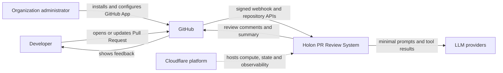

# Contexto do sistema

Holon recebe eventos e código de repositórios GitHub autorizados, usa modelos de
IA para avaliar evidências recuperadas por ferramentas e devolve comentários de
review ao GitHub.

## Relações

| Origem        | Destino            | Dados                                                    | Confiança                                            |
| ------------- | ------------------ | -------------------------------------------------------- | ---------------------------------------------------- |
| GitHub        | Holon              | Webhook assinado, metadados, diff e conteúdo autorizado  | Não confiável até autenticação e validação           |
| Holon         | GitHub             | Comentários inline, review summary e leituras de API     | Autenticado por token de instalação de curta duração |
| Holon         | Provedor de modelo | Prompt, trechos selecionados e resultados de ferramentas | Terceiro; sujeito à política de dados                |
| Administrador | GitHub App         | Repositórios e permissões autorizadas                    | Ação administrativa explícita                        |
| Desenvolvedor | PR                 | Código, comentários e atualizações de branch             | Conteúdo não confiável                               |

## Limite do produto

O GitHub continua sendo a fonte do PR, do diff e dos comentários publicados.
Holon é responsável por orquestração, investigação, decisão de publicação,
idempotência e trilha de auditoria. Provedores de modelo não recebem credenciais
do GitHub nem acesso direto ao repositório.
