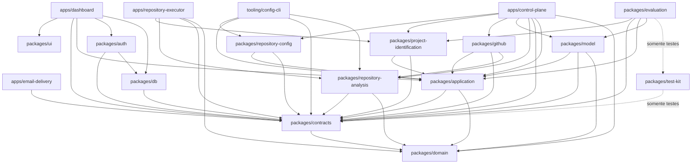

# Ecossistema tecnico e fronteiras do monorepo

Este documento descreve a estrutura materializada no repositório. Consulte o
[índice de decisões](../decisions/README.md) para distinguir ADRs aceitos de
decisões substituídas; o mapa abaixo foi conferido contra os manifests em
2026-10-06.

## Estrutura atual

```text
holon/
|-- apps/
|   |-- control-plane/
|   |   |-- src/
|   |   |   |-- github/
|   |   |   |-- ingress/
|   |   |   |-- ledger/
|   |   |   |-- project-identification/
|   |   |   `-- review/
|   |   |-- test/
|   |   `-- wrangler.jsonc
|   |-- repository-executor/
|       |-- src/
|       |-- test/
|       |-- Dockerfile
|       `-- wrangler.jsonc
|   |-- dashboard/              # app/, workers/, test/; SSR/API local
|   `-- email-delivery/         # src/, test/; Queue/DLQ e transporte privado
|-- packages/
|   |-- ui/                    # React/Lucide/tokens, exports browser
|   |-- auth/                  # Better Auth encapsulado, sessão, OAuth GitHub App
|   |-- db/                    # Drizzle/D1, subpaths servidor e migrations
|   |-- domain/
|   |-- application/
|   |-- contracts/
|   |-- evaluation/
|   |-- github/
|   |-- model/
|   |-- project-identification/
|   |-- repository-analysis/
|   |-- repository-config/
|   `-- test-kit/
|-- tooling/
|   |-- architecture/
|   |-- config-cli/
|   `-- typescript/
|-- .github/workflows/ci.yml
|-- pnpm-workspace.yaml
|-- turbo.json
|-- tsconfig.json
|-- .oxlintrc.json
`-- .oxfmtrc.json
```

`apps` contém unidades implantáveis. `packages` contém código importável e nunca
é implantado sozinho. `tooling` contém configuração compartilhada e comandos locais que invocam
os casos de uso, sem duplicar regras de negócio. Testes de composição vertical com Workerd ficam no control plane;
políticas puras ficam junto ao pacote ou app que as possui.

No control plane, `src/index.ts` compõe o Worker e exporta as classes exigidas
pelo Wrangler. `ingress` recebe HTTP e Queue; `review` coordena Workflow,
análise e publicação; `ledger` mantém o estado transacional por PR;
`project-identification` compõe identificação e seus Durable Objects; `github`
contém broker e operações específicas do host. `observability.ts` continua
compartilhado no app. Essas pastas não criam novos deploys nem packages. Os
imports entre essas pastas devem formar um grafo sem ciclos; a composição fica
em `index.ts`.

## Grafo permitido

O diagrama resume as relações principais. Os `package.json` são a fonte
exaustiva para dependências concretas de cada workspace.



Em texto: aplicações compõem casos de uso e adapters. Adapters implementam portas
definidas por `application`. `application` depende de contratos e domínio;
`contracts` usa Zod nas fronteiras e tipos puros do domínio. `evaluation`
valida corpus sintético e mede outputs por oráculos determinísticos. Os modos
mock e recorded não acessam infraestrutura; o adapter live manual usa `model`
para chamar a mesma rota autenticada do AI Gateway, sem GitHub, Sandbox ou
publicação. O domínio nunca depende de schemas runtime. `test-kit` é somente
para fixtures de teste. `repository-config` valida a AST YAML e entrega a entrada
ao compilador de `application`; `config-cli` usa o mesmo compilador com leitura
local/Git, gera schema e verifica drift, sem acesso aos deployables.

## Responsabilidades por pacote

| Pacote                          | Responsabilidade                                                                                   | Dependencias externas permitidas                     |
| ------------------------------- | -------------------------------------------------------------------------------------------------- | ---------------------------------------------------- |
| `@holon/domain`                 | Identidades, estados, findings, politicas e invariantes puras                                      | Nenhuma, salvo utilitario aprovado por ADR           |
| `@holon/application`            | Casos de uso e portas como `ReviewLedger`, `ModelClient`, `RepositoryAnalyzer` e `GitHubPublisher` | Nenhum SDK de infraestrutura                         |
| `@holon/contracts`              | Schemas Zod e mapeamento de envelopes externos                                                     | Zod                                                  |
| `@holon/evaluation`             | Corpus, recordings, runner e graders offline                                                       | Aplicação, contratos, Zod e Node no CLI              |
| `@holon/github`                 | Auth da GitHub App, releitura de PR e publicacao                                                   | Octokit modular                                      |
| `@holon/model`                  | Prompt, tools tipadas, provider AI SDK/AI Gateway e budget middleware                              | AI SDK e AI Gateway provider                         |
| `@holon/project-identification` | Identificação de tecnologias e versões a partir de evidência limitada do snapshot                  | Parsers dos formatos suportados, sem bindings        |
| `@holon/repository-analysis`    | Parser de diff, classificação de review, surface mapping e policies puras do executor              | Biblioteca `diff`; sem SDK de infraestrutura         |
| `@holon/repository-config`      | Parser YAML restrito compartilhado entre runtime e CLI                                             | YAML, contratos e erro tipado da aplicação           |
| `@holon/config-cli`             | Validação e explicação locais, geração de schema e identidade do compilador                        | Node; Ajv e YAML Language Server somente para testes |
| `@holon/auth`                   | Better Auth encapsulado, autenticação GitHub App, DTOs e validação de sessão                       | Better Auth, Drizzle Adapter, D1                     |
| `@holon/db`                     | Drizzle/D1, persistência de identidade/tenancy e projeções                                         | Drizzle ORM, D1                                      |
| `@holon/ui`                     | Componentes visuais React, tokens e ícones sem regras de servidor                                  | React, Tailwind, Lucide React                        |
| `@holon/test-kit`               | Fixtures, builders e fakes reutilizaveis                                                           | Dependencias somente de teste                        |

A avaliação offline usa recordings; a avaliação live do motor antigo foi
retirada. Um novo teste live deve exercitar Think, Gateway, Sandbox e publicação.

`ReviewEngine` comeca em `application`. Um pacote separado so deve surgir quando
existir uma fronteira publica ou um grafo de dependencias mais claro do que uma
subpasta interna.

Dashboard/UI/DB/Auth compõem as fundações locais e o primeiro recorte M2 do dashboard.
O dashboard importa `contracts`, `application`, `ui`, `auth` e `db`; email importa `contracts`;
`auth` consome `contracts` e `db` (com exceção de schema ORM restrita);
DB consome `contracts` para validação de limites e projeção de rows. O [mapa do dashboard](user-dashboard.md)
detalha interfaces, exports e futuras relações por service binding.

## Alocacao de runtime

`apps/control-plane` deve exportar um unico modulo Workers com:

- `fetch`: Hono recebe `/webhooks/github` e healthcheck;
- `queue`: consome o envelope normalizado e inicia ou reconcilia uma run;
- classe `ReviewWorkflow` com checkpoints granulares, retries e terminalização
  após esgotamento;
- `ReviewAgent` e `ReviewShardWorkflow` para turns duráveis do Think;
- composicao dos adapters reais por bindings e secrets gerados pelo Wrangler.

O handler HTTP termina depois que a Queue confirma a escrita. Clone, LLM,
analise e publicacao nao pertencem ao caminho sincrono do webhook.

O admin, a UI anterior e o pacote de observabilidade foram removidos pela
[ADR-0040](../decisions/0040-retire-admin-and-analytical-storage.md).
Logs nativos simples não mantêm projeções, custos nem dashboards.

`apps/repository-executor` recebe pedidos tipados, cria workspace isolado,
classifica patches e aplica a mesma elegibilidade a tools, persiste contexto
efêmero e retorna evidência limitada com proveniência. Nenhum token de modelo ou
autoridade de publicação GitHub deve entrar nesse deployable.

Em runtime há dois service bindings tipados: control plane -> executor para RPC
de análise e executor -> entrypoint nomeado do credential broker no control
plane. O segundo só emite token após autorização no ledger; ele não cria uma
dependência de pacote do executor sobre adapters do control plane.

## Fronteiras de validacao

| Entrada           | Validacao obrigatoria                                  | Saida interna              |
| ----------------- | ------------------------------------------------------ | -------------------------- |
| Webhook GitHub    | HMAC do body bruto, headers, tamanho, evento e schema  | `WebhookEnvelope`          |
| Queue             | Versao do envelope e tipos runtime                     | comando de caso de uso     |
| Workflow          | Schema atual de params em cada entrada externa         | tipos de aplicacao         |
| Credential RPC    | container, run, repo, instalação e ledger              | token JIT repo-scoped      |
| Ferramenta        | Schema, autorizacao, path normalizado e budget         | evidencia com proveniencia |
| Modelo            | Schema estrutural, policy e coordenadas no diff        | candidatos a `Finding`     |
| Caso de avaliação | Schema, proveniência pública/sintética e changed lines | oráculo offline versionado |
| GitHub publisher  | head SHA atual, dedupe e `line`/`side`                 | IDs externos persistiveis  |

TypeScript nao substitui essas validacoes porque payloads, filas, storage e
modelos existem fora do compilador.

## Configuração TypeScript

A base comum deve declarar explicitamente pelo menos:

- `strict`;
- `noUncheckedIndexedAccess`;
- `exactOptionalPropertyTypes`;
- `noImplicitOverride`;
- `useUnknownInCatchVariables`;
- `verbatimModuleSyntax`;
- `isolatedModules`;
- `noUncheckedSideEffectImports`;
- `moduleDetection: force`.

Workers usa uma variante com `module: ESNext` e `moduleResolution: Bundler`.
Tipos de bindings são gerados por `wrangler types`. Uma extensão manual contém
somente strings de configuração e secrets que o Wrangler não infere sem valores
versionados.

Imports entre pacotes usam `exports` e `workspace:*`. Imports internos de um
pacote podem usar caminhos relativos ou subpath imports do Node. Nao usar
`compilerOptions.paths` como mecanismo de runtime.

## Contrato de tarefas

| Tarefa              | Escopo                  | Cache Turborepo | Regra                                     |
| ------------------- | ----------------------- | --------------- | ----------------------------------------- |
| `format`            | repositorio             | Nao             | Pode escrever arquivos                    |
| `format:check`      | repositorio             | Sim, logs       | Nao altera arquivos                       |
| `lint`              | pacotes                 | Sim, logs       | Oxlint type-aware, zero warnings no CI    |
| `test:architecture` | fontes de produção      | Nao             | Direções, manifests, ciclos locais e SDKs |
| `typecheck`         | pacotes                 | Sim             | `tsc --noEmit` e `wrangler types --check` |
| `test`              | pacotes                 | Sim             | Imports, testes Node e Vitest             |
| `build`             | apps/pacotes compilados | Sim             | Outputs declarados                        |
| `dev`               | apps                    | Nunca           | Persistente e interativo                  |
| `deploy`            | apps                    | Nunca           | Efeito externo e autorizacao explicita    |

Remote cache nao faz parte do bootstrap. Secrets nunca entram em outputs, logs,
inputs globais ou artefatos de cache.

`apps/dashboard` tem overrides Turbo para outputs build/catálogos/typegen e
artefatos browser; suas suites browser não usam cache nem retries. O resto dos
workspaces conserva os outputs e limites atuais. Catálogos são compilados pelo
check de i18n antes de types/tests/build, inclusive após restauração de cache.

## Gates de CI implementados

1. Instalar com lockfile congelado.
2. Verificar marca/tokens/contraste e formatação.
3. Executar lint type-aware e falhar em disable comments nao usados.
4. Gerar ou conferir tipos Wrangler e executar typecheck.
5. Verificar as direções de import em `tooling/architecture` e executar testes puros.
6. Executar testes Workers no plugin oficial.
7. Fazer `wrangler deploy --dry-run` por deployable, sem publicar.
8. Exercitar DOM/Workers e Playwright pt-BR/en × Chromium/Firefox/WebKit com axe, zero retries e artefatos por sete dias.

Deploy real e uma pipeline separada. Um dry run nao prova bindings remotos,
secrets, GitHub App, Queue, Workflow ou modelo em producao.

## Politica de bibliotecas

| Biblioteca/capacidade        | Estado              | Limite                                             |
| ---------------------------- | ------------------- | -------------------------------------------------- |
| Hono                         | Selecionada         | Somente adapter HTTP                               |
| Zod 4                        | Selecionada         | Fronteiras; nao substituir tipos de dominio        |
| Octokit modular              | Selecionada         | Somente `@holon/github`                            |
| AI SDK + AI Gateway provider | Selecionada         | Provider em `@holon/model`; Think no control plane |
| `diff`                       | Selecionada         | Adapter proprio e fixtures obrigatorias            |
| Cloudflare Workflows         | Selecionada         | Coordenação durável com retries delimitados        |
| Cloudflare Sandbox SDK       | Selecionada `@next` | Versão exata e imagem correspondente fixadas       |
| Dependency Cruiser           | Adiada              | Gate de imports local cobre o grafo atual          |
| Knip                         | Adiada              | Introduzir quando houver massa de exports/deps     |
| Agents SDK e Think           | Selecionados        | Review Agent por shard; ADR-0049                   |
| MCP e RAG                    | Adiados             | Fora do MVP one-shot                               |

A UI/admin anterior e suas bibliotecas foram retiradas pela
[ADR-0040](../decisions/0040-retire-admin-and-analytical-storage.md). O
Agent Think substituiu o motor próprio conforme
[ADR-0049](../decisions/0049-use-cloudflare-think-for-pr-review.md).

Perguntas sobre findings usam os mesmos SDKs em
`FindingClarificationAgent`/`FindingClarificationWorkflow`, com bindings próprios
e leitura autenticada de blobs Git delimitados no control plane, conforme
[ADR-0052](../decisions/0052-answer-finding-questions-in-pr-threads.md).

## Regras para agentes de codigo

- Ler os ADRs aceitos no índice de decisões antes de alterar fronteiras do MVP.
- Nao criar novo workspace para uma simples subpasta de implementacao.
- Nao importar adapter a partir de dominio ou aplicacao.
- Nao adicionar build tool quando Wrangler ou `tsc` ja atendem o consumidor.
- Nao introduzir dependencia adiada sem evidencia e atualizacao da documentacao.
- Usar os scripts versionados no manifesto raiz; não inventar comandos
  equivalentes por conta própria.

## Identificação de versões (2026-09-05)

A [arquitetura de identificação](project-version-identification.md), governada pela [ADR-0030](../decisions/0030-identify-project-versions-from-snapshot-evidence.md), descreve o package reutilizável, coleta de metadados por SHA, cache DO por instalação/repositório, checkpoints e snapshot de auditoria no ledger. Conteúdo integral dos manifests não é persistido; versões são dados, nunca instruções de review.

### Entrega recuperável de convites (Dashboard 4)

O dashboard é dono de `invitation_delivery_intent` e `email_delivery_attempt` no D1
de identidade. O entrypoint privado `EmailDeliveryAuthority` expõe claim/start/result
apenas ao sender. Seu cron reserva/publica referências e reconcilia vencimentos.
`apps/email-delivery` recebe IDs na Queue/DLQ, obtém contexto autorizado por RPC e
usa `send_email` com templates HTML/texto. Não importa DB nem tem binding D1.
Os resultados causais e limites estão no
[runbook de email](../operations/dashboard-email-delivery.md).
Os manifests deixam efeitos desabilitados até ativação autorizada; este grafo
descreve a implementação, não prova implantação ou email real.
