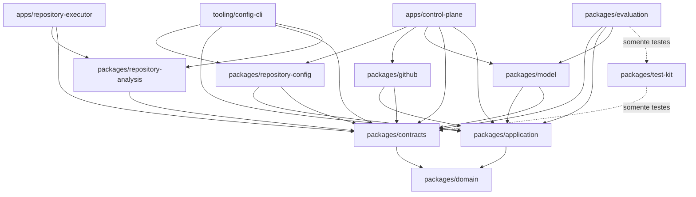

# Ecossistema tecnico e fronteiras do monorepo

Este documento descreve a estrutura materializada pelo bootstrap. ADR-0002 a
ADR-0006 são normativos; os detalhes abaixo correspondem aos manifests e
fronteiras existentes.

## Estrutura atual

```text
holon/
|-- apps/
|   |-- control-plane/
|   |   |-- src/
|   |   |-- test/
|   |   `-- wrangler.jsonc
|   |-- repository-executor/
|       |-- src/
|       |-- test/
|       |-- Dockerfile
|       `-- wrangler.jsonc
|-- packages/
|   |-- domain/
|   |-- application/
|   |-- contracts/
|   |-- evaluation/
|   |-- github/
|   |-- model/
|   |-- repository-analysis/
|   |-- repository-config/
|   `-- test-kit/
|-- tooling/
|   |-- config-cli/
|   `-- typescript/
|-- .github/workflows/ci.yml
|-- pnpm-workspace.yaml
|-- turbo.json
|-- tsconfig.json
|-- .oxlintrc.json
`-- .oxfmtrc.json
```

`apps` contém unidades implantáveis. `packages` contém código importável e nunca
é implantado sozinho. `tooling` contém configuração compartilhada e comandos locais que invocam
os casos de uso, sem duplicar regras de negócio. Testes de composição vertical com Workerd ficam no control plane;
políticas puras ficam junto ao pacote ou app que as possui.

## Grafo permitido



Em texto: aplicações compõem casos de uso e adapters. Adapters implementam portas
definidas por `application`. `application` depende de contratos e domínio;
`contracts` usa Zod nas fronteiras e tipos puros do domínio. `evaluation`
valida corpus sintético e mede outputs por oráculos determinísticos. Os modos
mock e recorded não acessam infraestrutura; o adapter live manual usa `model`
para chamar a mesma rota autenticada do AI Gateway, sem GitHub, Sandbox ou
publicação. O domínio nunca depende de schemas runtime. `test-kit` é somente
para fixtures de teste. `repository-config` valida a AST YAML e entrega a entrada
ao compilador de `application`; `config-cli` usa o mesmo compilador com leitura
local/Git, gera schema e verifica drift, sem acesso aos deployables.

## Responsabilidades por pacote

| Pacote                       | Responsabilidade                                                                                   | Dependencias externas permitidas                     |
| ---------------------------- | -------------------------------------------------------------------------------------------------- | ---------------------------------------------------- |
| `@holon/domain`              | Identidades, estados, findings, politicas e invariantes puras                                      | Nenhuma, salvo utilitario aprovado por ADR           |
| `@holon/application`         | Casos de uso e portas como `ReviewLedger`, `ModelClient`, `RepositoryAnalyzer` e `GitHubPublisher` | Nenhum SDK de infraestrutura                         |
| `@holon/contracts`           | Schemas Zod e mapeamento de envelopes externos                                                     | Zod                                                  |
| `@holon/evaluation`          | Corpus, recordings, runner, graders, relatório e adapter live manual                               | Aplicação, contratos, modelo, Zod e Node no CLI      |
| `@holon/github`              | Auth da GitHub App, releitura de PR e publicacao                                                   | Octokit modular                                      |
| `@holon/model`               | Implementacao de `ModelClient`, tools e budgets                                                    | AI SDK e AI Gateway provider                         |
| `@holon/repository-analysis` | Parser de diff, classificação de review, surface mapping e policies puras do executor              | Biblioteca `diff`; sem SDK de infraestrutura         |
| `@holon/repository-config`   | Parser YAML restrito compartilhado entre runtime e CLI                                             | YAML, contratos e erro tipado da aplicação           |
| `@holon/config-cli`          | Validação e explicação locais, geração de schema e identidade do compilador                        | Node; Ajv e YAML Language Server somente para testes |
| `@holon/test-kit`            | Fixtures, builders e fakes reutilizaveis                                                           | Dependencias somente de teste                        |
| `@holon/ui`                  | Design system: tokens semânticos Tailwind, componentes acessíveis e primitivas Base UI             | `@base-ui/react`, Tailwind CSS; sem domínio/apps     |

O adapter live usa ferramentas sintéticas indisponíveis por contrato: ele mede
prompt e modelo somente com o contexto autocontido do caso. O smoke remoto
continua responsável por provar GitHub, ferramentas reais, Sandbox e
publicação.

`ReviewEngine` comeca em `application`. Um pacote separado so deve surgir quando
existir uma fronteira publica ou um grafo de dependencias mais claro do que uma
subpasta interna.

## Alocacao de runtime

`apps/control-plane` deve exportar um unico modulo Workers com:

- `fetch`: Hono recebe `/webhooks/github` e healthcheck;
- `queue`: consome o envelope normalizado e inicia ou reconcilia uma run;
- classe `ReviewWorkflow` com checkpoints granulares, retries e terminalização
  após esgotamento;
- classe `AdminReadEntrypoint`: RPC interno `ping` e `getRunDetail` para consulta administrativa;
- composicao dos adapters reais por bindings e secrets gerados pelo Wrangler.

`apps/admin` exporta um único módulo Workers (`workers/app.ts`) compondo:

- `fetch`: SSR com React Router v8, endpoints e CSP com nonces dinâmicos;
- `queue`: consumidor at-least-once de projeções analíticas para o D1 com quarentena;
- `scheduled`: retenção temporal de registros analíticos e quarentena;
- consumo via Service Binding `ADMIN_READ_API` para RPC de detalhes do run.

O handler HTTP termina depois que a Queue confirma a escrita. Clone, LLM,
analise e publicacao nao pertencem ao caminho sincrono do webhook.

O runtime operacional adiciona `apps/admin` como terceiro deployable de produção
(ADR-0029), estritamente read-only e protegido por Cloudflare Access.

`apps/repository-executor` recebe pedidos tipados, cria workspace isolado,
classifica patches e aplica a mesma elegibilidade a tools, persiste contexto
efêmero e retorna evidência limitada com proveniência. Nenhum token de modelo ou
autoridade de publicação GitHub deve entrar nesse deployable.

Em runtime há dois service bindings tipados: control plane -> executor para RPC
de análise e executor -> entrypoint nomeado do credential broker no control
plane. O segundo só emite token após autorização no ledger; ele não cria uma
dependência de pacote do executor sobre adapters do control plane.

## Fronteiras de validacao

| Entrada           | Validacao obrigatoria                                  | Saida interna              |
| ----------------- | ------------------------------------------------------ | -------------------------- |
| Webhook GitHub    | HMAC do body bruto, headers, tamanho, evento e schema  | `WebhookEnvelope`          |
| Queue             | Versao do envelope e tipos runtime                     | comando de caso de uso     |
| Workflow          | Schema atual de params em cada entrada externa         | tipos de aplicacao         |
| Credential RPC    | container, run, repo, instalação e ledger              | token JIT repo-scoped      |
| Ferramenta        | Schema, autorizacao, path normalizado e budget         | evidencia com proveniencia |
| Modelo            | Schema estrutural, policy e coordenadas no diff        | candidatos a `Finding`     |
| Caso de avaliação | Schema, proveniência pública/sintética e changed lines | oráculo offline versionado |
| GitHub publisher  | head SHA atual, dedupe e `line`/`side`                 | IDs externos persistiveis  |

TypeScript nao substitui essas validacoes porque payloads, filas, storage e
modelos existem fora do compilador.

## Configuração TypeScript

A base comum deve declarar explicitamente pelo menos:

- `strict`;
- `noUncheckedIndexedAccess`;
- `exactOptionalPropertyTypes`;
- `noImplicitOverride`;
- `useUnknownInCatchVariables`;
- `verbatimModuleSyntax`;
- `isolatedModules`;
- `noUncheckedSideEffectImports`;
- `moduleDetection: force`.

Workers usa uma variante com `module: ESNext` e `moduleResolution: Bundler`.
Tipos de bindings são gerados por `wrangler types`. Uma extensão manual contém
somente strings de configuração e secrets que o Wrangler não infere sem valores
versionados.

Imports entre pacotes usam `exports` e `workspace:*`. Imports internos de um
pacote podem usar caminhos relativos ou subpath imports do Node. Nao usar
`compilerOptions.paths` como mecanismo de runtime.

## Contrato de tarefas

| Tarefa         | Escopo                  | Cache Turborepo | Regra                                     |
| -------------- | ----------------------- | --------------- | ----------------------------------------- |
| `format`       | repositorio             | Nao             | Pode escrever arquivos                    |
| `format:check` | repositorio             | Sim, logs       | Nao altera arquivos                       |
| `lint`         | pacotes                 | Sim, logs       | Oxlint type-aware, zero warnings no CI    |
| `typecheck`    | pacotes                 | Sim             | `tsc --noEmit` e `wrangler types --check` |
| `test`         | pacotes                 | Sim             | Vitest deterministico                     |
| `build`        | apps/pacotes compilados | Sim             | Outputs declarados                        |
| `dev`          | apps                    | Nunca           | Persistente e interativo                  |
| `deploy`       | apps                    | Nunca           | Efeito externo e autorizacao explicita    |

Remote cache nao faz parte do bootstrap. Secrets nunca entram em outputs, logs,
inputs globais ou artefatos de cache.

## Gates de CI implementados

1. Instalar com lockfile congelado.
2. Verificar formatacao.
3. Executar lint type-aware e falhar em disable comments nao usados.
4. Gerar ou conferir tipos Wrangler e executar typecheck.
5. Executar testes puros.
6. Executar testes Workers no plugin oficial.
7. Fazer `wrangler deploy --dry-run` por deployable, sem publicar.

Deploy real e uma pipeline separada. Um dry run nao prova bindings remotos,
secrets, GitHub App, Queue, Workflow ou modelo em producao.

## Politica de bibliotecas

| Biblioteca/capacidade        | Estado                    | Limite                                          |
| ---------------------------- | ------------------------- | ----------------------------------------------- |
| Hono                         | Selecionada               | Somente adapter HTTP                            |
| Zod 4                        | Selecionada               | Fronteiras; nao substituir tipos de dominio     |
| Octokit modular              | Selecionada               | Somente `@holon/github`                         |
| AI SDK + AI Gateway provider | Selecionada               | Somente `@holon/model`, atras de porta          |
| `diff`                       | Selecionada               | Adapter proprio e fixtures obrigatorias         |
| Cloudflare Workflows         | Selecionada               | Coordenação durável com retries delimitados     |
| Cloudflare Sandbox SDK       | Selecionada `@next`       | Versão exata e imagem correspondente fixadas    |
| React Router v8              | Selecionada               | Framework full-stack SSR no Worker `apps/admin` |
| `@base-ui/react`             | Selecionada               | Primitivas headless acessíveis em `@holon/ui`   |
| Tailwind CSS v4              | Selecionada               | Estilização semântica e tokens via `@holon/ui`  |
| Recharts                     | Selecionada               | Gráficos de tendências com equivalente tabular  |
| `jose`                       | Selecionada               | Validação estrita de Access JWT e JWKS          |
| Dependency Cruiser           | Adiada                    | Introduzir se regras de pacote nao bastarem     |
| Knip                         | Adiada                    | Introduzir quando houver massa de exports/deps  |
| Agents SDK e Think           | Rejeitados / Não adotados | Descomissionados após ADR-0017 / ADR-0018       |
| MCP e RAG                    | Adiados                   | Fora do MVP one-shot                            |

## Regras para agentes de codigo

- Ler os ADRs aceitos no índice de decisões antes de alterar fronteiras do MVP.
- Nao criar novo workspace para uma simples subpasta de implementacao.
- Nao importar adapter a partir de dominio ou aplicacao.
- Nao adicionar build tool quando Wrangler ou `tsc` ja atendem o consumidor.
- Nao introduzir dependencia adiada sem evidencia e atualizacao da documentacao.
- Usar os scripts versionados no manifesto raiz; não inventar comandos
  equivalentes por conta própria.

## Identificação de versões (2026-09-05)

A [arquitetura de identificação](project-version-identification.md), governada pela [ADR-0030](../decisions/0030-identify-project-versions-from-snapshot-evidence.md), descreve o package reutilizável, coleta de metadados por SHA, cache DO por instalação/repositório, checkpoints e snapshot de auditoria no ledger. Conteúdo integral dos manifests não é persistido; versões são dados, nunca instruções de review.
