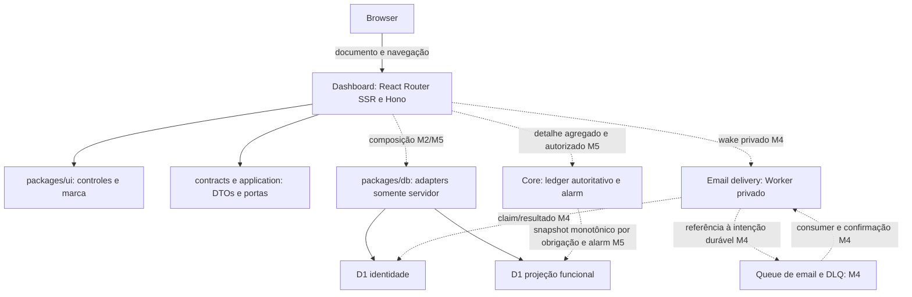

# Fronteiras do dashboard dos usuários

## Estado materializado

A [ADR-0053](../decisions/0053-establish-user-dashboard-foundations.md) estabelece
as fronteiras aprovadas. M1 materializa dois Workers **locais**, `packages/ui`,
`packages/db`, portas/contratos e gates. Há uma página mínima bilíngue de fundação,
preferências de apresentação e liveness em `/api/health`. Não há login, sessão,
workspace, dataset privado, convite, Queue ou envio implementados nesses apps.
Os dois Workers de produção do core permanecem inalterados.

Linhas contínuas representam interfaces/bases locais; pontilhadas marcam
integrações ainda não implementadas. Os D1 têm migrations separadas e somente
uma sentinela de autoridade; identidade também possui a reserva OAuth aprovada.
A composição não autoriza acesso ou cria estado de negócio por mostrar um banco
no diagrama. A fila de email não é uma nova fila de projeção.

## SSR e API

`workers/index.ts` compõe os handlers. `createDashboardHandler` valida origem,
método e tamanho de URL e aplica headers às respostas SSR/API, inclusive erros.
`/api/*` vai a Hono; demais URLs ao React Router. O wildcard de rota devolve 404
sanitizado mantendo os loaders raiz de idioma/nonce, em vez de serializar a
exceção padrão com o caminho solicitado.

- SSR/loader: lê dados autorizados para o documento e navegação; retorna DTOs.
  Futuramente invoca o mesmo caso de uso que a API. Não chama a própria API e
  não executa comandos ou SQL.
- Hono: valida método, payload, sessão, CSRF, autorização e intenção de comandos
  ou leituras explícitas. Hoje só liveness; outros caminhos retornam erro seguro.
- App: compõe providers e transporte/cache de features. Queries ficam no app.
  O snapshot e a política manual da prova M0 serão integrados com dados reais em
  M5/M6; não instalar Query só para criar um provider sem dataset.

`root.tsx` negocia idioma por request e devolve timezone UTC. Preferência `lang`
e tema na URL são transitórios nessa fundação; preservam outros parâmetros e
foco. M2 liga o perfil individual persistido à precedência preferência →
Accept-Language → en. O server nunca usa um singleton Lingui com estado de usuário. O loader importa
somente o catálogo do idioma resolvido no servidor e hidrata suas mensagens
compiladas serializáveis; módulos de catálogo não entram no JS cliente. Troca de
idioma carrega o catálogo correspondente pelo loader, sem downloads de todos
os idiomas no bootstrap.

O runtime gera nonce e o fornece ao renderer, scripts e ScrollRestoration. CSP
usa `script-src` por nonce/strict-dynamic, estilos/fontes da mesma origem, sem
unsafe-inline/eval, frames ou base URL arbitrária. HTML/API são private/no-store;
assets com hash sob `/assets/` têm cache público imutável via `_headers`.

## Autoridades e interfaces

| Capacidade                                 | Dono da implementação                                                     | Contrato/consumidor                                                        |
| ------------------------------------------ | ------------------------------------------------------------------------- | -------------------------------------------------------------------------- |
| Sessão, cookies e OAuth                    | `packages/auth`, em M2                                                    | `DashboardIdentityPort`; DTO sem segredo de sessão/OAuth                   |
| Membership e papel                         | aplicação + adapter de identidade, M2/M3                                  | `WorkspaceAccessPort`; não concede grant GitHub                            |
| Perfil, tenancy, convite e intenção/outbox | D1 identidade, migrations `packages/db/migrations/identity`               | mutação condicional por ator/estado/operação nas issues donas              |
| Reserva de authorization code              | adapter de identidade em `packages/db`                                    | fingerprint SHA-256, batch D1 atômico; plugin M0 usa a mesma implementação |
| Lista de metadados                         | D1 projeção funcional, migrations `packages/db/migrations/projection`, M5 | `ReviewReadPort`, `ReviewPage`; scope autorizado construído no servidor    |
| Detalhe e revisão funcional                | ledger/core por PR                                                        | agregado restrito de leitura em M5; sem SQL/RPC genérico                   |
| Entrega                                    | email Worker privado + Queue/DLQ, M4                                      | `EmailDeliveryPort.wake(operationId)`; bootstrap responde unavailable      |

Não existe transação entre os dois D1 ou entre D1, Queue e provider. Convite e
intenção durável serão persistidos juntos; publisher/reconciliação e consumer
condicionais recuperam falhas. Retry de resultado ambíguo pode repetir **o mesmo
convite**, como Q37 autorizou; não cria outro token ou membership. Email Worker
usa adapter específico de intenção/claim/resultado, sem exportar ORM ou auth.

DTOs runtime strict rejeitam propriedades extras, IDs inválidos, states externos
e páginas acima de 50 itens; não devolvem rows ORM. `ReviewPage` é metadata inicial,
não o contrato completo de detalhe nem uma autorização baseada em IDs. M5 evolui
produtores/consumidores juntos ao implementar filtros e projeção reais.

## Imports e bibliotecas

- Dashboard importa somente `contracts` e `ui` nessa base. M2/M5 acrescentam
  composição servidor por export restrito e atualização do grafo/manifests.
- UI tem exports por componente, ícones, marca, CSS e `cn`; React é peer core.
  Lucide/clsx/tailwind-merge ficam no package. Não há export `*` da biblioteca.
- DB exporta apenas factories `identity/server` e `projection/server`; métodos
  específicos, sem handle Drizzle, SQL livre ou `select()` devolvido ao app.
- Application define portas, contracts valida limites e domain continua puro.
  `packages/auth`/Motion/gráficos não existem por falta de consumidor nessa etapa.
- Lingui é uma exceção direta do app para catálogos/provider por request;
  React/Router/Hono e ferramentas de build mantêm seus papéis de composição.

O checker usa AST para imports static/dynamic/types, percorre src/app/workers,
confere exports/subpaths, resolve `.js` para `.ts`/`.tsx` e o alias `~/` declarado
no tsconfig **e** Vite. O alias exato `@holon/ui` aponta ao diretório de geração
para o CLI shadcn; não tem export raiz e não pode ser usado como import de
produção. Imports reais usam os subpaths de `package.json`, sem wildcard de
source ou alias Vite que contorne os exports. Rotas não importam internals de outras rotas; features
não importam rotas nem internals de outras features. Páginas/client/UI não podem
alcançar `.server` ou SDK servidor nem transitivamente por wrappers.

`route.tsx` e `root.tsx` são módulos mistos do framework; loaders podem importar
`.server`. O build real inspeciona a identidade dos módulos de cada chunk antes de minificar
para negar DB/auth/SDKs de servidor, e comprova sua remoção do cliente, complementando o gate
estático dos componentes puros. Tipos gerados usam opcionais `T | undefined`:
a composição remove campos opcionais ausentes antes de fornecer `ServerBuild`,
sem desligar `exactOptionalPropertyTypes` nem alterar arquivos da dependência.

## Qualificação e operação

- Node 24.19.0 / pnpm 11.24.0 usados na CI; engines continuam >=24.11 <25.
  jsdom 29.1.1 suporta esse intervalo, ao contrário do 30.1.2 (>24.15 no Node 24).
- Router 8.4.0, React 19.3.0, Vite 8.2.2, Cloudflare plugin 1.62.5, Lingui 6.9.0,
  Tailwind 4.3.3, Lucide 1.52.0, Drizzle 0.45.3 e Playwright 1.63.0 estão fixados.
  Better Auth 1.7.7 permanece restrito à prova M0 até integração M2.
- `compatibility_date` 2026-08-29 é comum ao core, à base e aos testes. Uma data
  2026-10-01 excedia o suporte do Workerd fixado na suite: foi removida da
  configuração real, sem usar outra data apenas nos testes. Upgrade é coordenado.
- Node cobre negociação/HTTP; DOM cobre controles; Workerd cobre HTTP/D1/RPC;
  navegador cobre SSR/hidratação/idiomas/CSP/foco/movimento/axe/layout. Não medir
  cobertura de wrappers gerados como se fosse autorização ou integração real.

Consulte [testes e evidência](../engineering/testing-and-evidence.md),
[operação](../operations/dashboard-environments-and-recovery.md) e o
[registro M1](../research/2026-10-06-dashboard-foundation-results.md) para comandos,
evidência e pendências. Não há bindings/IDs/domínios/secrets produtivos definidos
nesses manifests e não há deploy novo no pipeline automático da ADR-0048.
