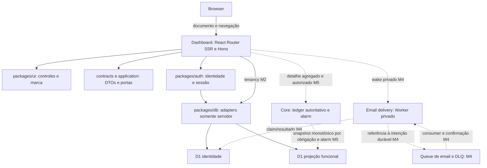

# Fronteiras do dashboard dos usuários

## Estado materializado

A [ADR-0054](../decisions/0054-establish-user-dashboard-foundations.md) estabelece
as fronteiras aprovadas. M1 materializa dois Workers, `packages/ui`,
`packages/db`, portas/contratos e gates. Há uma página mínima bilíngue de fundação,
preferências de apresentação e liveness em `/api/health`. O primeiro recorte M2
acrescenta `packages/auth`, login/logout GitHub restritos e tenancy pessoal/equipe
no D1 de identidade. Não há dataset de reviews privado, convites, Queue ou envio
implementados nesses apps. Sessões/dispositivos, governança e preferências
persistidas continuam entregas separadas.
Os manifests mantêm o ambiente local e acrescentam produção com dois D1
próprios e origem HTTPS explicitamente registrada. `AUTH_ENABLED=false` permite
publicar a fundação enquanto faltam as credenciais GitHub: auth e tenancy privadas
continuam indisponíveis. A composição passa ambiente e origens homologadas para
`packages/auth`; não os infere de Host ou de `APP_ORIGIN`. O email Worker é privado
e mantém o contrato de bootstrap. Os dois Workers de produção do core permanecem
inalterados por esta operação.

Linhas contínuas representam interfaces/bases locais; pontilhadas marcam
integrações ainda não implementadas. Os D1 têm migrations separadas e somente
uma sentinela de autoridade. Identidade possui a reserva OAuth aprovada, tabelas
nativas User/Account/Session/Verification e Workspace/Membership/receipt de criação.
A #137 acrescenta armazenamento técnico durável de rate limits na mesma autoridade,
sem quota comercial nem nova autoridade de negócio.
Projeção funcional ainda não contém dados de reviews.
A composição não autoriza acesso ou cria estado de negócio por mostrar um banco
no diagrama. A fila de email não é uma nova fila de projeção.

## SSR e API

`workers/index.ts` compõe os handlers. `createDashboardHandler` valida origem,
método e tamanho de URL e aplica headers às respostas SSR/API, inclusive erros.
`/api/*` vai a Hono; demais URLs ao React Router. O wildcard de rota devolve 404
sanitizado mantendo os loaders raiz de idioma/nonce, em vez de serializar a
exceção padrão com o caminho solicitado.

- SSR/loader: lê dados autorizados para o documento e navegação; retorna DTOs.
  Futuramente invoca o mesmo caso de uso que a API. Não chama a própria API e
  não executa comandos ou SQL.
- Hono: valida método, payload, sessão, CSRF, autorização e intenção de comandos
  ou leituras explícitas. M2 acrescenta sessão pública reduzida, login/logout,
  provisionamento pessoal, criação idempotente de equipe e leitura dos espaços
  da pessoa admitida. Convites e demais comandos permanecem indisponíveis.
- App: compõe providers e transporte/cache de features. Queries ficam no app.
  O snapshot e a política manual da prova M0 serão integrados com dados reais em
  M5/M6; não instalar Query só para criar um provider sem dataset.

`root.tsx` negocia idioma por request e devolve timezone UTC. Preferência `lang`
e tema na URL são transitórios nessa fundação; preservam outros parâmetros e
foco. Uma entrega posterior de M2 liga o perfil individual persistido à precedência preferência →
Accept-Language → en. O server nunca usa um singleton Lingui com estado de usuário. O loader importa
somente o catálogo do idioma resolvido no servidor e hidrata suas mensagens
compiladas serializáveis; módulos de catálogo não entram no JS cliente. Troca de
idioma carrega o catálogo correspondente pelo loader, sem downloads de todos
os idiomas no bootstrap.

O runtime gera nonce e o fornece ao renderer, scripts e ScrollRestoration. CSP
usa `script-src` por nonce/strict-dynamic, estilos/fontes da mesma origem, sem
unsafe-inline/eval, frames ou base URL arbitrária. Logout e comandos tenancy exigem CSRF derivado da sessão; Fetch Metadata complementa
a origem exata também no login anônimo. Conflito idempotente, reconexão e resultado
desconhecido não são confundidos com sucesso de comando. Os budgets HTTP atuais
são consumidos atomicamente em D1, sem IP/identificador cru persistido.
HTML/API são private/no-store;
assets com hash sob `/assets/` têm cache público imutável via `_headers`.

## Autoridades e interfaces

| Capacidade                                 | Dono da implementação                                                     | Contrato/consumidor                                                        |
| ------------------------------------------ | ------------------------------------------------------------------------- | -------------------------------------------------------------------------- |
| Sessão, cookies e OAuth                    | `packages/auth`, primeiro recorte M2                                      | `AuthService`; DTO sem segredo de sessão/OAuth                             |
| Membership e papel                         | porta da aplicação + adapter de identidade, M2/M3                         | `WorkspaceTenancyPort`; não concede grant GitHub                           |
| Perfil, tenancy, convite e intenção/outbox | D1 identidade, migrations `packages/db/migrations/identity`               | mutação condicional por ator/estado/operação nas issues donas              |
| Reserva de authorization code              | adapter de identidade em `packages/db`                                    | fingerprint SHA-256, batch D1 atômico; plugin M0 usa a mesma implementação |
| Lista de metadados                         | D1 projeção funcional, migrations `packages/db/migrations/projection`, M5 | `ReviewReadPort`, `ReviewPage`; scope autorizado construído no servidor    |
| Detalhe e revisão funcional                | ledger/core por PR                                                        | agregado restrito de leitura em M5; sem SQL/RPC genérico                   |
| Entrega                                    | email Worker privado + Queue/DLQ, M4                                      | `EmailDeliveryPort.wake(operationId)`; bootstrap responde unavailable      |

Não existe transação entre os dois D1 ou entre D1, Queue e provider. Convite e
intenção durável serão persistidos juntos; publisher/reconciliação e consumer
condicionais recuperam falhas. Retry de resultado ambíguo pode repetir **o mesmo
convite**, como Q37 autorizou; não cria outro token ou membership. Email Worker
usa adapter específico de intenção/claim/resultado, sem exportar ORM ou auth.

DTOs runtime strict rejeitam propriedades extras, IDs inválidos, states externos
e páginas acima de 50 itens; não devolvem rows ORM. `ReviewPage` é metadata inicial,
não o contrato completo de detalhe nem uma autorização baseada em IDs. M5 evolui
produtores/consumidores juntos ao implementar filtros e projeção reais.

### Identidade e tenancy no primeiro recorte M2

`packages/auth` mantém o Better Auth privado. Expõe somente `AuthService` e a
validação de configuração; os métodos nativos, secrets e tokens não são exports.
O handler admite GET `/api/auth/session`, POST `/api/auth/sign-in/social`
somente GitHub, GET `/api/auth/callback/github` e POST `/api/auth/sign-out`.
A sessão pública contém `user.id/name` e `session.id/expiresAt`, sem token.
Uma Session sobrevivente sem Account GitHub vinculada não admite usuário.

O plugin aprovado em M0 reserva o digest do code no D1 antes da troca por token,
após a validação nativa de state/cookie/prazo. Resultado desconhecido não libera
a reserva. Novo OAuth recupera User interrompido pelo linking nativo aprovado;
isso não transforma as escritas nativas User/Account em uma transação D1.
Tokens OAuth são criptografados pela biblioteca desde a primeira persistência.

O login identifica a pessoa. POST `/api/workspaces/personal` provisiona seu
espaço exclusivo idempotentemente; não existe grant de equipe por login/email.
POST `/api/workspaces/team` cria equipe, owner e receipt no mesmo batch,
condicionando todos os statements à admissão. Constraints protegem o espaço
pessoal e sua ownership contra conversão e inclusão de outro membro.
Operation ID pertence ao ator e payload: colisão divergente é negada, replay
não recria membership removida e devolve o papel atual.

GET `/api/workspaces` e `/api/workspaces/:id` consultam memberships atuais.
Seleção no cliente não é autoridade. Essas APIs não expõem reviews nem conectam
instalações; grants GitHub e leitura privada continuam dependências posteriores.
Os comandos usam CSRF derivado da sessão verificada e origem exata. O cookie
de CSRF é legível pelo cliente; o cookie de sessão permanece HttpOnly.

As mutações de tenancy recebem o contexto admitido do servidor e verificam a
sessão exata/subject GitHub no relógio SQLite da batch. Um marcador transitório
único captura a admissão uma vez para workspace, membership e receipt e é
removido na mesma transação; rollback não deixa resíduo. Sessão de outro
dispositivo não substitui a sessão do comando. A política de budgets e as
provas de corrida estão no [guia de segurança web](../engineering/web-security-and-data-boundaries.md).

## Imports e bibliotecas

- Dashboard importa `contracts`, `ui` e, na composição servidor, `auth`, `db`
  e a porta de aplicação. A superfície de DB/auth não entra no browser.
- UI tem exports por componente, ícones, marca, CSS e `cn`; React é peer core.
  Lucide/clsx/tailwind-merge ficam no package. Não há export `*` da biblioteca.
- DB exporta factories `identity/server` e `projection/server`; métodos
  específicos, sem handle Drizzle, SQL livre ou `select()` devolvido ao app.
  O subpath `auth-integration/server` expõe o schema físico exigido pelo adapter
  nativo exclusivamente a `packages/auth`; o grafo nega outros consumidores.
- Application define portas, contracts valida limites e domain continua puro.
  `packages/auth` encapsula Better Auth e seu adapter. Motion/gráficos continuam
  sem consumidor nessa etapa.
- Lingui é uma exceção direta do app para catálogos/provider por request;
  React/Router/Hono e ferramentas de build mantêm seus papéis de composição.

O checker usa AST para imports static/dynamic/types, percorre src/app/workers,
confere exports/subpaths, resolve `.js` para `.ts`/`.tsx` e o alias `~/` declarado
no tsconfig **e** Vite. O alias exato `@holon/ui` aponta ao diretório de geração
para o CLI shadcn; não tem export raiz e não pode ser usado como import de
produção. Imports reais usam os subpaths de `package.json`, sem wildcard de
source ou alias Vite que contorne os exports. Rotas não importam internals de outras rotas; features
não importam rotas nem internals de outras features. Páginas/client/UI não podem
alcançar `.server` ou SDK servidor nem transitivamente por wrappers.

`route.tsx` e `root.tsx` são módulos mistos do framework; loaders podem importar
`.server`. O build real inspeciona a identidade dos módulos de cada chunk antes de minificar
para negar DB/auth/SDKs de servidor, e comprova sua remoção do cliente, complementando o gate
estático dos componentes puros. Tipos gerados usam opcionais `T | undefined`:
a composição remove campos opcionais ausentes antes de fornecer `ServerBuild`,
sem desligar `exactOptionalPropertyTypes` nem alterar arquivos da dependência.

## Qualificação e operação

- Node 24.19.0 / pnpm 11.24.0 usados na CI; engines continuam >=24.11 <25.
  jsdom 29.1.1 suporta esse intervalo, ao contrário do 30.1.2 (>24.15 no Node 24).
- Router 8.4.0, React 19.3.0, Vite 8.2.2, Cloudflare plugin 1.62.5, Lingui 6.9.0,
  Tailwind 4.3.3, Lucide 1.52.0, Drizzle 0.45.3 e Playwright 1.63.0 estão fixados.
  Better Auth/core/adapter 1.7.7 estão fixados na integração M2, sem patch de SDK.
- `compatibility_date` 2026-08-29 é comum ao core, à base e aos testes. Uma data
  2026-10-01 excedia o suporte do Workerd fixado na suite: foi removida da
  configuração real, sem usar outra data apenas nos testes. Upgrade é coordenado.
- Node cobre negociação/HTTP; DOM cobre controles; Workerd cobre HTTP/D1/RPC;
  navegador cobre SSR/hidratação/idiomas/CSP/foco/movimento/axe/layout. Não medir
  cobertura de wrappers gerados como se fosse autorização ou integração real.

Consulte [testes e evidência](../engineering/testing-and-evidence.md),
[operação](../operations/dashboard-environments-and-recovery.md) e o
[registro M1](../research/2026-10-06-dashboard-foundation-results.md) para comandos,
evidência e pendências. O runbook registra os bindings/IDs e a origem de produção,
as migrations aplicadas e as credenciais pendentes. A publicação inicial desses
apps é uma operação explícita; não há deploy deles no pipeline automático da
ADR-0048. Bootstrap e liveness não provam OAuth real, envio ou dataset privado.

## Gates de conteúdo e fluxos posteriores

A reconciliação autorizada de #137 em 2026-10-07 conclui a fronteira comum nos
consumidores atuais. Convites/scanners/abuso (#148/#149), templates de email
(#152), consultas privadas e SSR/API (#157/#158), toasts de onboarding (#159) e
Markdown/tracking no detalhe (#161) demonstram seus gates ao implementar os
fluxos donos. #163 integra as jornadas antes da promoção. A fundação não é
prova de segurança de um consumidor ainda inexistente. A [revisão final M1](../research/2026-10-07-dashboard-milestone-one-final-review.md)
registra critérios, regressões e limites de evidência.
