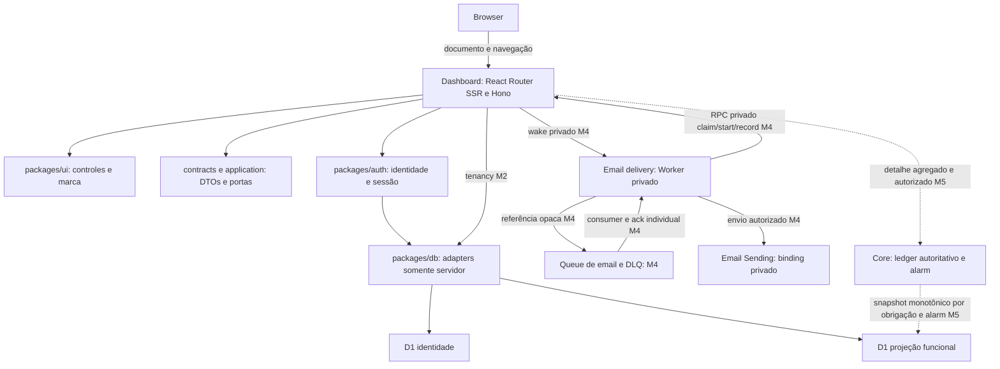

# Fronteiras do dashboard dos usuários

## Estado materializado

A [ADR-0054](../decisions/0054-establish-user-dashboard-foundations.md) estabelece
as fronteiras aprovadas. M1 materializa dois Workers, `packages/ui`,
`packages/db`, portas/contratos e gates. Há uma página mínima bilíngue de fundação,
preferências de apresentação e liveness em `/api/health`. O primeiro recorte M2
acrescenta `packages/auth`, login/logout GitHub restritos e tenancy pessoal/equipe
no D1 de identidade. M3 acrescenta credenciais coordenadas, conexões GitHub, grants limitados e
convites com intenção durável. M4 materializa entrega recuperável, autoridade RPC
privada, publisher/vigília e Queue/DLQ. Dataset privado continua em M5. O complemento M2 acrescenta sessões/dispositivos,
revogação atual/global e preferências pessoais persistidas, consumidas pelo SSR
e pelos controles mínimos da página de fundação.
Os manifests mantêm o ambiente local e acrescentam produção com dois D1
próprios e origem HTTPS explicitamente registrada. `AUTH_ENABLED=false` permite
publicar a fundação enquanto faltam as credenciais GitHub: auth e tenancy privadas
continuam indisponíveis. Após o responsável configurar os secrets, o manifest
de produção usa `AUTH_ENABLED=true` e exige a composição completa; uma leitura
anônima de sessão 200 não representa validação do OAuth real. A composição passa ambiente e origens homologadas para
`packages/auth`; não os infere de Host ou de `APP_ORIGIN`. O email Worker é privado
e implementa transporte/template sem binding D1; efeitos ficam desabilitados
até ativação autorizada. A provisão M1/M2 não alterou os Workers do core. M3 acrescenta no manifest do
control-plane um binding privado para invalidação de acesso; sua publicação
continua dependente de operação autorizada.

Linhas contínuas representam interfaces/bases locais; pontilhadas marcam
integrações ainda não implementadas. Os D1 têm migrations separadas e somente
uma sentinela de autoridade. Identidade possui a reserva OAuth aprovada, tabelas
nativas User/Account/Session/Verification e Workspace/Membership/receipt de criação.
A #137 acrescenta armazenamento técnico durável de rate limits na mesma autoridade,
sem quota comercial nem nova autoridade de negócio.
Projeção funcional ainda não contém dados de reviews.
A composição não autoriza acesso ou cria estado de negócio por mostrar um banco
no diagrama. A fila de email não é uma nova fila de projeção.
O sender acessa a autoridade do dashboard por RPC, nunca o D1 diretamente.
O binding Email Sending está composto, com efeitos desabilitados até ativação
autorizada; linhas contínuas não representam prova de envio real.

## SSR e API

`workers/index.ts` compõe os handlers. `createDashboardHandler` valida origem,
método e tamanho de URL e aplica headers às respostas SSR/API, inclusive erros.
`/api/*` vai a Hono; demais URLs ao React Router. O wildcard de rota devolve 404
sanitizado mantendo os loaders raiz de idioma/nonce, em vez de serializar a
exceção padrão com o caminho solicitado.

- SSR/loader: lê dados autorizados para o documento e navegação; retorna DTOs.
  O loader raiz recebe capabilities privadas por request e identifica a pessoa
  pelo mesmo `AuthService` da API. Lê preferências pela porta específica, sem
  chamar a própria API, executar comandos ou receber SQL livre.
- Hono: valida método, payload, sessão, CSRF, autorização e intenção de comandos
  ou leituras explícitas. M2 acrescenta sessão pública reduzida, login/logout,
  provisionamento pessoal, criação idempotente de equipe e leitura dos espaços
  da pessoa admitida. M3 acrescenta os comandos de conexão e convite descritos abaixo.
- App: compõe providers e transporte/cache de features. Queries ficam no app.
  O snapshot e a política manual da prova M0 serão integrados com dados reais em
  M5/M6; não instalar Query só para criar um provider sem dataset.

`root.tsx` negocia idioma por request: preferência pessoal persistida →
`lang` transitório na URL → Accept-Language → en. O fuso salvo prevalece; antes
de conhecê-lo o SSR usa UTC. A UI propõe o fuso válido do dispositivo depois da
hidratação e só o persiste após confirmação do POST. UTC salvo explicitamente
não é redetectado. Tema na URL continua transitório. Os controles preservam
rota, outros parâmetros e foco. O server nunca usa um singleton Lingui com estado de usuário. O loader importa
somente o catálogo do idioma resolvido no servidor e hidrata suas mensagens
compiladas serializáveis; módulos de catálogo não entram no JS cliente. Troca de
idioma carrega o catálogo correspondente pelo loader, sem downloads de todos
os idiomas no bootstrap.

O runtime gera nonce e o fornece ao renderer, scripts e ScrollRestoration. CSP
usa `script-src` por nonce/strict-dynamic, estilos/fontes da mesma origem, sem
unsafe-inline/eval, frames ou base URL arbitrária. Logout e comandos tenancy exigem CSRF derivado da sessão; Fetch Metadata complementa
a origem exata também no login anônimo. Conflito idempotente, reconexão e resultado
desconhecido não são confundidos com sucesso de comando. Os budgets HTTP atuais
são consumidos atomicamente em D1, sem IP/identificador cru persistido.
HTML/API são private/no-store;
assets com hash sob `/assets/` têm cache público imutável via `_headers`.

## Autoridades e interfaces

| Capacidade                                 | Dono da implementação                                                     | Contrato/consumidor                                                                   |
| ------------------------------------------ | ------------------------------------------------------------------------- | ------------------------------------------------------------------------------------- |
| Sessão, cookies e OAuth                    | `packages/auth`, primeiro recorte M2                                      | `AuthService`; DTO sem segredo de sessão/OAuth                                        |
| Preferências pessoais                      | porta `PersonalPreferencesPort` + adapter de identidade, M2               | `dashboard-preferences`; locale/fuso validados, sem configuração de equipe            |
| Membership e papel                         | porta da aplicação + adapter de identidade, M2/M3                         | `WorkspaceTenancyPort`; não concede grant GitHub                                      |
| Perfil, tenancy, convite e intenção/outbox | D1 identidade, migrations `packages/db/migrations/identity`               | mutação condicional por ator/estado/operação nas issues donas                         |
| Reserva de authorization code              | adapter de identidade em `packages/db`                                    | fingerprint SHA-256, batch D1 atômico; plugin M0 usa a mesma implementação            |
| Lista de metadados                         | D1 projeção funcional, migrations `packages/db/migrations/projection`, M5 | `ReviewReadPort`, `ReviewPage`; scope autorizado construído no servidor               |
| Detalhe e revisão funcional                | ledger/core por PR                                                        | agregado restrito de leitura em M5; sem SQL/RPC genérico                              |
| Entrega                                    | email Worker privado + Queue/DLQ, M4                                      | `wake` publica referência opaca; `EmailDeliveryAuthority` autoriza claim/start/record |

Não existe transação entre os dois D1 ou entre D1, Queue e provider. Convite e
intenção durável são persistidos juntos no recorte M3; M4 implementa publisher,
reconciliação e consumer condicionais para recuperar entregas. Retry de resultado ambíguo pode repetir **o mesmo
convite**, como Q37 autorizou; não cria outro token ou membership. Email Worker
usa adapter específico de intenção/claim/resultado, sem exportar ORM ou auth.

DTOs runtime strict rejeitam propriedades extras, IDs inválidos, states externos
e páginas acima de 50 itens; não devolvem rows ORM. `ReviewPage` é metadata inicial,
não o contrato completo de detalhe nem uma autorização baseada em IDs. M5 evolui
produtores/consumidores juntos ao implementar filtros e projeção reais.

### Identidade e tenancy no primeiro recorte M2

`packages/auth` mantém o Better Auth privado. Expõe somente `AuthService` e a
validação de configuração; os métodos nativos, secrets e tokens não são exports.
O handler admite GET `/api/auth/session`, POST `/api/auth/sign-in/social`
somente GitHub, GET `/api/auth/callback/github` e POST `/api/auth/sign-out`.
A sessão pública contém `user.id/name` e `session.id/expiresAt`, sem token.
Uma Session sobrevivente sem Account GitHub vinculada não admite usuário.

O plugin aprovado em M0 reserva o digest do code no D1 antes da troca por token,
após a validação nativa de state/cookie/prazo. Resultado desconhecido não libera
a reserva. Novo OAuth recupera User interrompido pelo linking nativo aprovado;
isso não transforma as escritas nativas User/Account em uma transação D1.
Tokens OAuth são criptografados pela biblioteca desde a primeira persistência.

O login identifica a pessoa. POST `/api/workspaces/personal` provisiona seu
espaço exclusivo idempotentemente; não existe grant de equipe por login/email.
POST `/api/workspaces/team` cria equipe, owner e receipt no mesmo batch,
condicionando todos os statements à admissão. Constraints protegem o espaço
pessoal e sua ownership contra conversão e inclusão de outro membro.
Operation ID pertence ao ator e payload: colisão divergente é negada, replay
não recria membership removida e devolve o papel atual.

GET `/api/workspaces` e `/api/workspaces/:id` consultam memberships atuais.
Seleção no cliente não é autoridade. Essas APIs não expõem reviews nem conectam
instalações; grants GitHub e leitura privada continuam dependências posteriores.
Os comandos usam CSRF derivado da sessão verificada e origem exata. O cookie
de CSRF é legível pelo cliente; o cookie de sessão permanece HttpOnly.

As mutações de tenancy recebem o contexto admitido do servidor e verificam a
sessão exata/subject GitHub no relógio SQLite da batch. Um marcador transitório
único captura a admissão uma vez para workspace, membership e receipt e é
removido na mesma transação; rollback não deixa resíduo. Sessão de outro
dispositivo não substitui a sessão do comando. A política de budgets e as
provas de corrida estão no [guia de segurança web](../engineering/web-security-and-data-boundaries.md).

## Sessões e preferências no complemento M2

GET `/api/auth/sessions` lista somente os dispositivos da pessoa admitida,
com ID público, datas, indicador da sessão atual e navegador em enum reduzido.
O envelope `{ sessions, currentSessionId, nextCursor }` limita cada página a
100 dispositivos. O cursor identifica uma sessão própria ainda vigente, em
ordem `createdAt/id` decrescente; cursor removido/expirado exige refresh da
primeira página. A sessão atual fica no envelope também quando não pertence
à página. A UI substitui a página por interação, sem acumulação ilimitada.
A própria consulta exige a sessão corrente ainda vigente e uma conta GitHub
vinculada; perder autoridade entre admissão HTTP e SELECT nega a leitura.
POST `/api/auth/sessions/:id/revoke` e POST `/api/auth/sign-out/all` exigem
admissão, origem, CSRF e budget; a guarda D1 revalida a sessão exata na escrita.
A limpeza de cookies usa o sign-out oficial do Better Auth e preserva todos os
`Set-Cookie`. Revogar outra sessão não remove os cookies da sessão atual.

A duração móvel é de 7 dias, com renovação depois de 24 horas. Renovação
condicional não encurta uma expiração mais nova nem ressuscita uma sessão
revogada. A guarda verifica também as 24 horas na row persistida: requests
concorrentes reutilizam a primeira renovação até a próxima janela, mesmo que
tenham lido um snapshot anterior. Uma leitura que encontrou expiração revalida
a row antes de apagá-la.
Os hooks e database hooks públicos da versão fixada implementam essa política;
não há patch nem import privado do SDK.

GET e POST `/api/preferences` operam no perfil do ator admitido. O corpo do
POST contém apenas `locale` e `timezone`; ambas as respostas usam o envelope
strict `{ preferences }`. `user_preferences` pertence ao D1 de identidade.
A ausência de perfil é representada por locale/fuso ambos nulos; falha de
storage ou perfil corrompido não se apresenta como preferência ausente.
A atualização é um único UPSERT condicionado ao User/Account/Session atual;
resposta perdida depois do commit é `command_unknown`, recuperável por leitura
ou repetição dos mesmos valores.

O documento serializa apenas identidade pública, session ID, CSRF e preferências.
As capabilities de auth/persistência permanecem no contexto servidor por request.
`features/preferences` e `features/sessions` oferecem o formulário pessoal,
login/reconexão GitHub, dispositivos e logout mínimo; o onboarding completo é
#159. Os controles cancelam requests ao perder a identidade e ignoram respostas
antigas após uma nova sessão. A autoridade é verificada na próxima leitura/intenção explícita. A listagem
compara a sessão atual com a geração renderizada; diferença fecha o contexto
anterior e revalida SSR. Não há polling nem consultas por foco/visibilidade,
renovação de aba parada ou promessa de remoção instantânea.

## Governança de membership e prova de OAuth

POST `/api/auth/reauth/init` cria uma intenção pendente de até 10 minutos.
O login GitHub recebe apenas seu ID público; o servidor obtém o contexto
admitido e usa o slot confiável de OAuth da API pública Better Auth. Após
state/cookie/PKCE e provider reais do fluxo, somente o subject original pode
confirmar a intenção, com User e sessão nova emitida no callback. A prova
dura 5 minutos desde a conclusão e não autoriza outra ação/alvo/workspace.

Os POST de `/api/workspaces/:id/members/promote`, `demote` e `remove`
exigem owner local atual; `/api/workspaces/:id/leave` opera sobre a própria
membership. Todos exigem sessão, origem, CSRF, schema strict e budget.
Consumo da prova e efeito estão na mesma batch com admissão revalidada.
Triggers bloqueiam remoção/rebaixamento do último owner; personal workspace
continua exclusivo e não participa da governança de equipe.

O adapter em `packages/db` possui SQL e invariantes duráveis. `packages/auth`
encapsula hooks, emissão/cookies e o vínculo do callback OAuth. A porta de
tenancy expõe comandos de produto; IDs de prova não são capabilities por si.
UI completa de gestão/onboarding e entrada por convite ficam nas issues donas.

## Imports e bibliotecas

- Dashboard importa `contracts`, `ui` e, na composição servidor, `auth`, `db`
  e a porta de aplicação. A superfície de DB/auth não entra no browser.
- UI tem exports por componente, ícones, marca, CSS e `cn`; React é peer core.
  Lucide/clsx/tailwind-merge ficam no package. Não há export `*` da biblioteca.
- DB exporta factories `identity/server` e `projection/server`; métodos
  específicos, sem handle Drizzle, SQL livre ou `select()` devolvido ao app.
  O subpath `auth-integration/server` expõe o schema físico exigido pelo adapter
  nativo exclusivamente a `packages/auth`; o grafo nega outros consumidores.
- Application define portas, contracts valida limites e domain continua puro.
  `packages/auth` encapsula Better Auth e seu adapter. Motion/gráficos continuam
  sem consumidor nessa etapa.
- Lingui é uma exceção direta do app para catálogos/provider por request;
  React/Router/Hono e ferramentas de build mantêm seus papéis de composição.

O checker usa AST para imports static/dynamic/types, percorre src/app/workers,
confere exports/subpaths, resolve `.js` para `.ts`/`.tsx` e o alias `~/` declarado
no tsconfig **e** Vite. O alias exato `@holon/ui` aponta ao diretório de geração
para o CLI shadcn; não tem export raiz e não pode ser usado como import de
produção. Imports reais usam os subpaths de `package.json`, sem wildcard de
source ou alias Vite que contorne os exports. Rotas não importam internals de outras rotas; features
não importam rotas nem internals de outras features. Páginas/client/UI não podem
alcançar `.server` ou SDK servidor nem transitivamente por wrappers.

`route.tsx` e `root.tsx` são módulos mistos do framework; loaders podem importar
`.server`. O build real inspeciona a identidade dos módulos de cada chunk antes de minificar
para negar DB/auth/SDKs de servidor, e comprova sua remoção do cliente, complementando o gate
estático dos componentes puros. Tipos gerados usam opcionais `T | undefined`:
a composição remove campos opcionais ausentes antes de fornecer `ServerBuild`,
sem desligar `exactOptionalPropertyTypes` nem alterar arquivos da dependência.

## Qualificação e operação

- Node 24.19.0 / pnpm 11.24.0 usados na CI; engines continuam >=24.11 <25.
  jsdom 29.1.1 suporta esse intervalo, ao contrário do 30.1.2 (>24.15 no Node 24).
- Router 8.4.0, React 19.3.0, Vite 8.2.2, Cloudflare plugin 1.62.5, Lingui 6.9.0,
  Tailwind 4.3.3, Lucide 1.52.0, Drizzle 0.45.3 e Playwright 1.63.0 estão fixados.
  Better Auth/core/adapter 1.7.7 estão fixados na integração M2, sem patch de SDK.
- `compatibility_date` 2026-08-29 é comum ao core, à base e aos testes. Uma data
  2026-10-01 excedia o suporte do Workerd fixado na suite: foi removida da
  configuração real, sem usar outra data apenas nos testes. Upgrade é coordenado.
- Node cobre negociação/HTTP; DOM cobre controles; Workerd cobre HTTP/D1/RPC;
  navegador cobre SSR/hidratação/idiomas/CSP/foco/movimento/axe/layout. Não medir
  cobertura de wrappers gerados como se fosse autorização ou integração real.

Consulte [testes e evidência](../engineering/testing-and-evidence.md),
[operação](../operations/dashboard-environments-and-recovery.md) e o
[registro M1](../research/2026-10-06-dashboard-foundation-results.md) para comandos,
evidência e pendências. O runbook registra os bindings/IDs e a origem de produção,
as migrations aplicadas e o estado de configuração de auth. A publicação inicial desses
apps é uma operação explícita; não há deploy deles no pipeline automático da
ADR-0048. Bootstrap e liveness não provam OAuth real, envio ou dataset privado.

## Gates de conteúdo e fluxos posteriores

A reconciliação autorizada de #137 em 2026-10-07 conclui a fronteira comum nos
consumidores atuais. Convites/scanners/abuso (#148/#149), templates de email
(#152), consultas privadas e SSR/API (#157/#158), toasts de onboarding (#159) e
Markdown/tracking no detalhe (#161) demonstram seus gates ao implementar os
fluxos donos. #163 integra as jornadas antes da promoção. A fundação não é
prova de segurança de um consumidor ainda inexistente. A [revisão final M1](../research/2026-10-07-dashboard-milestone-one-final-review.md)
registra critérios, regressões e limites de evidência.

## GitHub e convites: implementação M3

A porta `WorkspaceCollaborationPort` é composta por `collaboration.server.ts`,
`packages/auth` (provider humano) e adapters D1 em `packages/db`. Hono usa a
mesma porta disponível ao SSR/M5; não existe outra política baseada em cookie,
email ou role isolada. `authorizeReviews` retorna `AuthorizedReviewScope` após
interseção de sessão/account/membership atuais, conexão ativa e grants humanos.
M5 deve chamá-la **antes** de LIMIT/cursor/projeção. M3 não contém dataset privado.

Refresh usa claim/lease de 30 s e CAS na mesma autoridade que os writes nativos
OAuth, com geração causal incrementada por trigger. O par criptografado é
persistido atomicamente antes de ser usado. Os endpoints nativos de token são
privados e o refresh nativo do provider é desabilitado pelo wrapper público.
Timeout, resultado desconhecido ou claim vencido exigem novo OAuth do mesmo
subject; sessão Holon válida não substitui reconexão. Novos OAuth em sessão
ativa vinculam o subject e a sessão original antes do write nativo.

Link/unlink exigem owner Holon e prova OAuth recente escopada à ação/instalação/
workspace/sessão. Link também exige titular da conta pessoal ou admin ativo da
organização GitHub, instalação ativa da App correta e IDs estáveis. Instalações
e memberships são paginadas integralmente e a instalação é reconferida antes do
CAS D1; a consulta final da membership da organização confirma novamente ID,
state ativo e role admin. A PK da instalação arbitra duas equipes concorrentes. Revogação/unlink
conserva a alocação histórica: só o mesmo workspace pode reconectar, sem caminho
de transferência automática. A UI mostra estados retornados pela autoridade.

Cache positivo **e negativo** é por User/account/instalação e gerações de
credencial/conexão. Vence no máximo 60 s após o início da observação externa,
sem extensão em hit; paginação incompleta, total inconsistente ou falha do
provider fecha a leitura. Membership/sessão são conferidas no D1 em todo acesso,
inclusive no snapshot final, que reconfere o prazo original de todos os grants
usados e o cache ainda vigente; escrita concorrente não estende esse prazo.
Eventos assinados do core para suspensão, remoção,
repos adicionados/removidos e autorização humana revogada incrementam gerações
e invalidam o cache. O core grava a referência na REVIEW_QUEUE existente antes
do RPC privado `GitHubAccessEvents.applyEvent`; consumer repete em falha. Receipt
por delivery protege contra dupla aplicação após reconexão. A transição do
registro de identificação do core é tentada independentemente da integração do
dashboard; ambas são aguardadas antes da resposta. Unsuspend não
reconecta automaticamente: owner confirma novamente. Não há endpoint público
para aplicar eventos; o `fetch` do entrypoint privado retorna 404.

Convite de equipe e `invitation_delivery_intent` entram na mesma batch guardada
por sessão/account/owner atuais. ID opaco é referência, sem autoridade de ingresso;
operation ID por criador conserva alvo/locale/workspace no retry. GET/HEAD são
genéricos, inclusive para ID inexistente. Só POST com CSRF consulta email atual
verificado do GitHub (primário ou secundário) e fixa `accepted_by` junto da
membership member. Owner existente é preservado; replay nunca recria membership
removida. Apenas owner admitido lista/cancela e vê o destinatário no DTO de gestão.
Aceite não serializa email/workspace. Normalização limita-se a trim/lowercase.

TTL é 7 dias; job usa o mesmo ID, deadline igual à expiração, `next_action_at`
inicial na criação e orçamento total de 5 tentativas. M4 consome esses
campos sem reiniciar contadores. Criação usa budgets D1 de 10/min por ator/equipe
e 30/min por equipe, além da fronteira HTTP. Terminalização cancela intenção
pendente na mesma transação; cron a cada minuto processa até 100 expirados por
invocação. Aceite verifica prazo no relógio SQLite sem depender do cron; sender
M4 também verifica o estado antes de claim e start. A gestão lista os 100 registros
mais recentes. A UI informa que cancelar bloqueia envios futuros, sem recolher
mensagem já em voo; M3 não envia nem afirma entrega.

Migrations aditivas `0010`/`0011` preservam os dados/provas M2. A segunda recria a
tabela de intenções com cópia integral para estender o CHECK a link/unlink;
nenhuma migration aplicada é reescrita. [Resultados e rastreabilidade](../research/2026-10-08-dashboard-milestone-three-results.md)
separam prova local, dry-run e pendências remotas.

### Protocolo de entrega de Dashboard 4 — 2026-10-09

Claim incrementa budget global e cria tentativa causal; start de uso único
revalida estado/prazo/lease e libera contexto mínimo. Resultados antigos não
alteram lease nova; aceitação conhecida bloqueia novos starts. Lease expirada
exige reconciliação/backoff antes de outro claim, inclusive para mensagem
duplicada. O cron acompanha todo não terminal até deadline/budget, independentemente
de retenção Queue/DLQ ou tráfego. O [runbook](../operations/dashboard-email-delivery.md)
é dono dos limites, diagnóstico, templates e gates de ativação remota.
