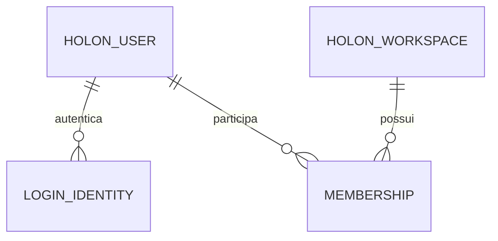

# Identidade e workspaces do dashboard

## Pergunta e estado real

Como separar login, pessoa, workspace, participação e integração GitHub sem
acoplar a estrutura SaaS ao primeiro provider?

Em 2026-10-04 o responsável propôs login via GitHub inicialmente, outros
providers depois, e workspaces/organizações com N usuários. Essa separação
é coerente com o produto; cardinalidade, governança e isolamento precisam
ser explícitos. Não há Better Auth, usuário humano, sessão, membership ou
workspace implementados nos manifests/runtime examinados. `workspace:*`
de pnpm é dependência do monorepo, não tenancy do produto.

Q25–Q34 foram confirmadas em 2026-10-04: modelo único pessoal/equipe,
organização como sinônimo de workspace, memberships N:M, criação aberta de
equipe, owner/member, convites explícitos, cardinalidade de instalações e
janela de revogação, autoridade de conexão, convite por email, múltiplos owners
e onboarding self-service. Somam-se a cadastro GitHub aberto com pessoal vazio,
pt-BR/en, sessão móvel de 7 dias/renovação após 24 h e interseção privada.
O modelo de produto está acordado; a integração física permanece proposta.
Este documento não adiciona schema, plugin, binding, endpoint ou migration.

A [revisão de robustez](../research/2026-10-04-dashboard-plan-robustness-review.md)
e o [plano de implementação](../planning/dashboard-implementation-plan.md)
delimitam gates de prontidão. O candidato auth não pode avançar com cadastro
parcial sem recuperação suportada; superfície pública de sessão tem DTOs Holon
sem segredo, e refresh perdido exige reconexão do account.

## Modelo acordado e integração pendente

| Conceito             | Responsabilidade                                      | Limite                                                                                                                      |
| -------------------- | ----------------------------------------------------- | --------------------------------------------------------------------------------------------------------------------------- |
| Holon user           | Identidade interna estável da pessoa                  | Não usar email, username GitHub ou workspace como identidade da pessoa                                                      |
| Login identity       | Vínculo comprovado com provider e identidade externa  | Uma pessoa pode vincular outros providers depois; login não concede membership nem grant privado                            |
| Session              | Autenticação de um dispositivo/navegador              | Duração de sessão não é duração de membership ou grant GitHub                                                               |
| Holon workspace      | Espaço de produto com recursos e membros              | Pessoal/equipe usam a mesma entidade; organização é sinônimo, sem nível adicional                                           |
| Membership           | Participação e papel de um usuário em um workspace    | Papel pertence ao vínculo, não globalmente ao usuário                                                                       |
| Workspace connection | Vínculo autorizado com instalação/repositórios GitHub | Várias instalações por workspace; cada instalação em um único workspace, com autoridade exigida em Q31 e mecanismo a provar |

A relação acordada é **N:M**: um usuário pode participar de vários workspaces, e cada
workspace compartilhado pode ter vários usuários. Por exemplo, a mesma pessoa
pode ser owner em A e member em B; entrar com outro provider vinculado conserva
sua identidade e memberships. Não colocar apenas `workspaceId` em User nem
`ownerUserId` como substituto de membership. Não são tabelas criadas.

Cada usuário tem um workspace pessoal exclusivo, sem convites ou conversão
silenciosa. Workspaces de equipe têm N membros. Ambos usam a mesma fronteira
de recursos/leitura; organização não é entidade acima ou abaixo de workspace.
Não há representação física implementada por esta referência.

### Governança e conexões confirmadas

- Qualquer usuário admitido pode criar workspace de equipe e se torna owner;
  criação não conecta instalações nem importa recursos GitHub automaticamente.
- Owner governa membros/conexões; member lê recursos autorizados. Papéis
  pertencem à membership. Admin delegado fica para necessidade posterior.
- Entrada na equipe ocorre por convite explícito aceito pela identidade
  autenticada alvo; domínio de email ou membership GitHub não fazem ingresso.
  Q32 confirmou destinatário com email verificado e envio automático via
  Cloudflare Email Sending. Email não serve para fundir identidades de login.
  Expiração, cancelamento e repetição são provas técnicas do fluxo.
- Workspace admite várias instalações; cada instalação é vinculada a um único
  workspace inicialmente, sem compartilhamento ou transferência silenciosa.
  Q31 exige owner do Holon e titular pessoal ou owner ativo da organização
  GitHub para conectar a instalação inteira. Restrição inicial do produto;
  admins de repo/delegados exigiriam evolução com escopo/prova próprios.
- Q33 permite vários owners por promoção explícita de membro e exige pelo menos
  um owner ativo. Bloquear saída, remoção ou rebaixamento do último, inclusive
  em concorrência; não presumir proteção automática do plugin.
- Q34 inclui onboarding self-service mínimo na primeira entrega: login/pessoal,
  criar/selecionar equipe, gestão de membros/convites e conexão GitHub.
  O domínio de review continua somente leitura; não adicionar feedback/rerun.

O fluxo auth usa uma porta servidor de entrega, sem expor binding ao browser.
Q35 confirmou transporte/renderização em `apps/email-delivery` privado;
Q36 escolheu Queue/retries duráveis. Aplicação mantém convite/intenção atômicos
e sender obtém contexto/claim/resultados por capability privada. `packages/auth`
identifica sessão; política de workspace/convite tem portas próprias na aplicação.
Topologia e recuperação foram acordadas; o protocolo de entrega segue proposta.
Integração física, domínio e entrega ainda precisam de prova. A
[pesquisa de autenticação](../research/2026-10-04-dashboard-authentication-discovery.md#cloudflare-email-sending-condições-e-discrepância--2026-10-04)
registra fontes atuais, beta, requisitos e discrepância da documentação. A
[investigação de entrega](../research/2026-10-04-dashboard-email-delivery-investigation.md)
detalha protocolo com outbox, retries e limite de idempotência externa.
Q37 aceitou retry limitado da mesma intenção após resultado externo desconhecido,
com eventual email duplicado; não cria outro convite ou membership.
Não criar um package de email separado sem outra necessidade de reutilização.

### Frescor de autorização confirmado

Sessão e membership locais são revalidadas na próxima request, sem cookie
cache de sessão inicialmente. Grants GitHub têm cache de até 60 s, com
invalidação antecipada por eventos quando recebidos. Grant desconhecido ou
expirado sem confirmação não autoriza leitura; indisponibilidade tem estado
próprio, sem ser apresentada como lista vazia ou ausência comprovada de permissão.
O limite se aplica à decisão de uma nova leitura; não apaga dados já entregues
nem promete interromper retroativamente requests previamente autorizadas.
Reautenticação de operações sensíveis ainda será definida.

Falha transitória preserva dado confirmado apenas enquanto houver autorização
válida. 401/403/revogação ou grant expirado sem confirmação fecham apresentação
privada e cache do escopo; não remover outros espaços ou uma sessão nova por
erro de request antiga. Sessão Holon pode continuar válida quando GitHub exige
reconexão, sem autorizar leitura privada dependente desse grant.

## Mapeamento de auth e nomenclatura

Better Auth distingue `user`, `account` e `session`; o plugin Organization
acrescenta memberships. `account` do adapter significa conta externa de
autenticação; não confundir com o workspace pessoal do produto. Workspace é
o nome canônico do espaço Holon. O mapeamento para `organization` era uma opção
de integração, não decisão de usar o plugin.

A [investigação do adapter e das fontes publicadas](../research/2026-10-04-dashboard-auth-persistence-investigation.md)
recomenda Better Auth para identidade/sessão e regras próprias Holon para
workspace/membership/convite. O plugin tem checks do último owner, mas a sequência
inspecionada não garante atomicidade/concorrência D1; callback de envio não garante
convite+outbox no mesmo commit. Não copiar o plugin nem espalhar seus tipos nas
páginas. Também permanece uma condição de prova no core OAuth: falha entre criar
User/Account e recuperação consistente. A recomendação não declara auth pronta.
[User/accounts](https://better-auth.com/docs/concepts/users-accounts),
[organization](https://better-auth.com/docs/plugins/organization).

O fluxo inicial é login social GitHub. SSO corporativo por IdP/OIDC/SAML é
capacidade posterior, com regras de vínculo/provisionamento próprias; usar
a palavra SSO não autoriza ativar o plugin ou sincronizar grupos automaticamente.
[SSO documentado](https://better-auth.com/docs/plugins/sso).

### Vinculação por email verificado: ajuste aprovado em 2026-10-05

O responsável aprovou o linking implícito padrão do Better Auth: quando falta
Account correspondente, o mesmo email pode vincular o subject recebido ao User
existente, exigindo verificação tanto no provider quanto no User local. Essa
aprovação substitui a proibição geral de linking por email registrada em Q32;
o aceite de convite continua sem fundir usuários. No MVP só GitHub está habilitado.

Não configurar `trustedProviders` para dispensar verificação, nem desativar a
exigência de email local verificado. Email serve como evidência para esse vínculo,
mas o identificador Holon continua sendo `User.id`; o par `(providerId, accountId)`
identifica a conta externa. Account já existente permanece ligada ao mesmo User
quando o email GitHub muda, inclusive se o novo email coincide com outro User.
Login não concede membership, instala integração nem substitui o grant GitHub.

O modelo confia no controle atual do email: reutilização/transferência de endereço
ou comprometimento do email/provider pode vincular outro subject ao User antigo.
Verificação não prova que duas contas pertencem historicamente à mesma pessoa.
Essa limitação foi debatida antes da aprovação. Outros providers e SSO corporativo
exigem revisão de suas garantias, não herdam uma confiança irrestrita por nome.
[Account linking](https://better-auth.com/docs/concepts/users-accounts#account-linking),
[forced linking](https://better-auth.com/docs/concepts/users-accounts#forced-linking).

A [prova atual](../research/2026-10-05-dashboard-auth-proof.md#resultado-da-política-aprovada-em-2026-10-05)
confirma recuperação pelo novo OAuth com mesmo email verificado em Drizzle/D1
e D1 nativo. Isso não torna User/Account atômicos: se o email muda antes de criar
Account, sobra um User sem Account/Session. Provisionamento Holon deve depender
de login concluído e identidade vinculada, nunca só de `user.create` ou de email;
um registro incompleto não pode receber workspace, membership ou efeito externo.
O linking nativo também não exige email verificado para todo signup: a verificação
é requisito do vínculo implícito e do aceite de convite. A prova negativa cobre
signup não verificado e impede outro subject de reivindicar esse User. Não usar
`User.emailVerified` antigo como confirmação atual do destinatário do convite.

A superfície pública continua sem `link-social`/gestão arbitrária de accounts.
A prova não implementa Google/Microsoft, recuperação de User local não verificado,
limpeza de órfãos ou onboarding. O [plugin aprovado em M0](../research/2026-10-05-dashboard-code-redemption-plugin.md)
satisfaz localmente a não reutilização de code por reserva atômica D1; a entrega
produtiva deve transportar a política, sua tabela e manutenção para
`packages/auth`/API, sem expor outro caminho de troca de token.

## Escopo explícito e várias abas

Workspace da leitura é explícito em URL/API; por exemplo `/w/:workspaceId/reviews`
como path ilustrativo. Servidor valida membership e vínculo do recurso antes
de consultar/retornar dados. Slug/nome são apresentação, não autoridade.

Uma preferência de último workspace pode lembrar destino, mas não substitui
o workspace da URL/request nem serve como autorização. Abas em A/B devem
permanecer independentes; trocar uma não altera silenciosamente o escopo da outra.
`activeOrganizationId` é um recurso do plugin investigado, não dependência adotada.

Query no app distingue usuário/workspace/recurso/filtros; SSR mantém contexto
por request. Logout/troca de contexto cancela e descarta dados antigos, e resposta
antiga não repovoa cache após invalidação. Retornar 403/revogação retira conteúdo
daquele escopo; não deslogar de todos os outros por remover uma membership.
Sem SSE/polling, não prometer retirar instantaneamente dados já entregues a
um browser parado; autorizar cada nova leitura/operação conforme a política.

## Fronteira com o core de revisão

Q22 confirmou: sessão válida + acesso ao espaço Holon + instalação ativa
vinculada + grant GitHub atual do usuário ao repositório. Membership, cargo
de owner ou instalação da App não amplia acesso privado por si.

O core atual identifica ledger por `github:repositoryId:pr:pullRequestNumber`
e run por head/base; **não há workspace nessa autoridade**. A definição está
em [identity](../../packages/domain/src/identity.ts) e a resolução em
[review services](../../apps/control-plane/src/review/review-services.ts).

Resultados existentes são funcionais/canônicos do repo/PR, não dados de uma
organização Holon já implementada. Filtro de D1 ou Query key sozinho não isola
a leitura RPC. A fronteira futura precisa verificar workspace→connection→repo,
instalação e grant antes de retornar snapshot autorizado; não expor DO genérico
nem aceitar somente `prKey` informado pelo browser.

Não adicionar `workspaceId` à chave do core por conveniência. Se múltiplos
espaços forem autorizados ao mesmo repo, decidir visibilidade/autoridade dos
resultados canônicos e dos dados próprios do workspace antes de mudar o core.
Preferências/memberships/convites são do espaço; grants e origem dos resultados
têm autoridades próprias. Vínculo/transferência não deve conceder dados de
outro espaço por consequência.

## Pendências e prova futura

Q25–Q34 na [entrevista](../planning/dashboard-engineering-decision-review.md)
confirmaram o modelo e os fluxos mínimos. A fronteira de produto está fechada;
restam desenho e prova de adapter/D1, cookies/origens/reauth, autoridade GitHub,
convites/envio e contratos de onboarding. Não habilitar defaults de organização/
teams, join por domínio ou SSO por disponibilidade. Q34 inclui comandos mínimos
de onboarding; exclusão de conta/workspace, transferência de instalação e
recuperação administrativa de identidade não foram incluídas nesta fatia.

A prova deve cobrir múltiplas memberships/abas, remoção com sessão ainda válida,
leitura por ID de outro espaço, resposta atrasada após logout/troca, callback
repetido de provisionamento e preservação de acesso a outros espaços. Perfis
e idiomas pessoais não se tornam configuração compartilhada da equipe.

Convites usam a [proposta de ID opaco sem autoridade de ingresso](web-security-and-data-boundaries.md#convites-sem-credencial-de-ingresso-na-url):
GET não aceita nem revela dados privados; POST protegido exige account vinculado,
email alvo verificado atualmente no provider, workspace/estado/prazo. Aceite fixa
User e é idempotente para ele, sem normalização Gmail/plus, email primário
obrigatório, bearer secret na outbox ou fusão de pessoas. Constraints/batches
precisam impedir escritas dependentes se a guarda de autorização afetou zero rows.
Aceite histórico não é grant atual: repetir o convite não recria membership
removida ou reativa acesso. Recuperar cadastro interrompido usa novo fluxo OAuth;
replay do mesmo state/code consumido é negado.

Fontes de linking revalidadas em **2026-10-05**; as demais fontes permanecem
na conferência de **2026-10-04**. Há prova isolada auth/Workerd/D1 local, descrita
no relatório; não há auth, tenancy ou isolamento implementados no produto.
Não houve benchmark, criação de recursos ou operação remota.
