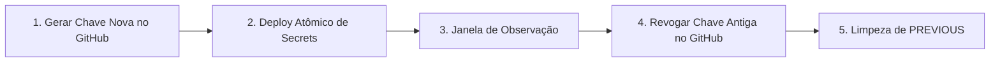

# Runbook: Rotação de Chave Privada do GitHub App

Este runbook define o procedimento operacional para rotacionar a chave privada
do GitHub App utilizado pelo Holon com as chaves atual e anterior. O fluxo foi verificado localmente, mas ainda precisa ser confirmado
por um primeiro rollout controlado contra GitHub e Cloudflare reais antes de ser
tratado como garantia de _zero downtime_.

## Pré-requisitos

1. Acesso administrativo às configurações do GitHub App no GitHub.
2. Acesso à CLI do Cloudflare (`wrangler`) com permissão de deploy e segredos no ambiente alvo.
3. `jq` disponível localmente para montar o payload sem copiar o PEM para a linha de comando.
4. Versão do Holon com suporte ao Keyring (ADR-0026) já implantada ou em processo de deploy.

## Visão Geral do Ciclo de Rotação

O GitHub App suporta até **25 chaves privadas ativas simultaneamente**. A rotação
utiliza um modelo de transição segura de cinco etapas:



---

## Procedimento Passo a Passo

### Etapa 1: Gerar a nova chave no GitHub App

1. Acesse as configurações da sua organização no GitHub > **Settings** > **Developer settings** > **GitHub Apps** > **[Nome do seu App]**.
2. Na seção **Private keys**, clique em **Generate a private key**.
3. O GitHub fará o download de um novo arquivo `.pem`. Guarde este arquivo em local seguro.
4. _Atenção_: Ambas as chaves (antiga e nova) permanecem ativas simultaneamente no GitHub.

### Etapa 2: Atualização atômica dos segredos no Cloudflare Worker

Para evitar estados intermediários desincronizados entre comandos individuais de `wrangler secret put`,
atualize as variáveis em conjunto ou via deploy versionado:

- `GITHUB_APP_PRIVATE_KEY_CURRENT`: Conteúdo PEM da **chave nova**.
- `GITHUB_APP_PRIVATE_KEY_PREVIOUS`: Conteúdo PEM da **chave antiga**.

O repositório fixa Wrangler 4.127.1, que suporta atualização de múltiplos
secrets em uma única requisição. O comando abaixo lê os PEMs sem colocá-los nos
argumentos ou persistir uma cópia adicional no repositório:

```bash
jq -n \
  --rawfile current nova-chave.pem \
  --rawfile previous antiga-chave.pem \
  '{
    GITHUB_APP_PRIVATE_KEY_CURRENT: $current,
    GITHUB_APP_PRIVATE_KEY_PREVIOUS: $previous
  }' \
  | pnpm --filter @holon/control-plane exec wrangler secret bulk
```

`wrangler secret bulk` cria uma única versão com o conjunto completo. Não
substitua esse comando por vários `wrangler secret put`: cada `put` cria e
implanta imediatamente uma versão distinta, reintroduzindo estados
intermediários.

### Etapa 3: Janela de observação e validação

1. Acompanhe a telemetria do Holon e os logs estruturados no Cloudflare:
   - Verifique a emissão regular de tokens nos quatro fluxos (review, clone broker, CI enrichment e feedback).
   - Confirme que não há eventos `github_app_auth.circuit_breaker_opened` nem `github_app_auth.all_keys_rejected`.
2. Mantenha a chave anterior em observação por pelo menos 1 a 2 horas (ou o tempo correspondente ao ciclo de vida de deploys do seu time).

### Etapa 4: Revogação da chave antiga no GitHub

1. Após constatar a estabilidade dos fluxos autenticando com a chave nova:
2. No GitHub App > **Private keys**, localize a chave antiga (identificada pela data de criação) e clique em **Delete**.
3. A partir deste momento, apenas a chave nova é válida perante a API do GitHub.

### Etapa 5: Limpeza da chave anterior

1. Remova a variável `GITHUB_APP_PRIVATE_KEY_PREVIOUS` do ambiente do Cloudflare Worker:

```bash
pnpm --filter @holon/control-plane exec wrangler secret delete GITHUB_APP_PRIVATE_KEY_PREVIOUS
```

2. O Worker atual exige somente os nomes CURRENT/PREVIOUS, conforme ADR-0036.

---

## Procedimento de Rollback Operacional

Se durante a Etapa 3 (Janela de Observação) a nova chave falhar ou apresentar rejeição:

1. **Ação Automática**: O circuit breaker em memória do Holon redireciona imediatamente as chamadas para `PREVIOUS` assim que a chave `CURRENT` falhar com HTTP 401, evitando impacto imediato aos usuários.
2. **Ação Manual de Rollback**:
   Caso deseje cancelar a rotação e retornar permanentemente para a chave antiga:
   ```bash
   jq -n \
     --rawfile previous antiga-chave.pem \
     '{
       GITHUB_APP_PRIVATE_KEY_CURRENT: $previous
     }' \
     | pnpm --filter @holon/control-plane exec wrangler secret bulk
   ```
   Em seguida, exclua a chave nova não utilizada no GitHub App.

## Fontes primárias

Verificadas em 2026-09-03:

- [GitHub: gerenciamento de chaves privadas para GitHub Apps](https://docs.github.com/en/apps/creating-github-apps/authenticating-with-a-github-app/managing-private-keys-for-github-apps)
- [Cloudflare Workers: secrets](https://developers.cloudflare.com/workers/configuration/secrets/)
- [Wrangler: comandos `secret put` e `secret bulk`](https://developers.cloudflare.com/workers/wrangler/commands/workers/#secret)
