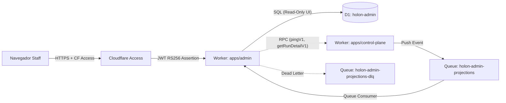

# Provisionamento do Console Operacional Interno

Este runbook documenta os requisitos de infraestrutura, procedimentos de provisionamento e configuração de bindings e segredos para o Console Operacional Interno do Holon (`apps/admin`).

> [!NOTE]
> Verificação de APIs e comportamento da Cloudflare realizada em 2026-09-04 contra a documentação primária do Cloudflare Workers, D1, Queues e Access.

## 1. Topologia de infraestrutura

O console operacional interno é um deployable estritamente para uso da equipe interna, protegido por Cloudflare Zero Trust (Cloudflare Access). Ele consome projeções normalizadas via Cloudflare Queues em um banco D1 dedicado e consulta o Durable Object do Control Plane via RPC privada para detalhes profundos sob demanda.



_Descrição textual do diagrama_: O navegador do operador autentica via Cloudflare Access, que injeta o cabeçalho `cf-access-jwt-assertion`. A requisição chega ao worker `apps/admin`, que valida a assinatura RS256 do token. Para renderizar a interface de monitoramento, o `apps/admin` consulta o banco D1 `holon-admin`. Para detalhes pontuais de uma run, realiza chamada RPC ao `apps/control-plane`. Projeções assíncronas chegam via Cloudflare Queue `holon-admin-projections` disparadas pelo `apps/control-plane`, com fallback de falhas para a DLQ `holon-admin-projections-dlq`.

---

## 2. Recursos necessários na Cloudflare

### 2.1. Banco D1 (`holon-admin`)

Criação do banco de dados relacional para projeções de runs e quarentena:

```bash
# Criação do banco D1 no ambiente de produção
wrangler d1 create holon-admin
```

O ID retornado deve ser inserido em `apps/admin/wrangler.jsonc` no bloco `d1_databases`.

Execução do schema inicial:

```bash
wrangler d1 execute holon-admin --file=migrations/0001_initial_schema.sql --remote
```

### 2.2. Filas Cloudflare Queues

Duas filas dedicadas com retenção de 4 dias (345.600 segundos):

```bash
# Fila principal de projeções
wrangler queues create holon-admin-projections --retention-period-secs=345600

# Dead Letter Queue (DLQ)
wrangler queues create holon-admin-projections-dlq --retention-period-secs=345600
```

> [!IMPORTANT]
> A DLQ não possui push consumer configurado no `wrangler.jsonc`. O consumo de reprocessamento é realizado via Pull API pelo CLI de administração (`tooling/admin-cli/replay-dlq.ts`).

### 2.3. Aplicação Cloudflare Access

1. No dashboard da Cloudflare Zero Trust:
   - Navegue até **Access** > **Applications** > **Add an application**.
   - Tipo: **Self-hosted**.
   - Application Domain: `admin.holon.internal` (ou subdomínio corporativo correspondente).
   - Session Duration: 12 a 24 horas.
2. Defina as políticas de acesso:
   - Nome: `Staff Only`.
   - Ação: `Allow`.
   - Regra: `Emails ending in @suaempresa.com`.
   - Rejeição obrigatória: Service Tokens (`type: "app"` são rejeitados pelo código da aplicação para acesso interativo).
3. Obtenha os valores para configuração:
   - **Team Name**: Subdomínio do Access (`<team>.cloudflareaccess.com`).
   - **Audience (AUD)**: Hash de audiência da aplicação gerado pelo Access.

---

## 3. Configuração de Variáveis e Segredos

### 3.1. Segredos do `apps/admin`

Execute no diretório `apps/admin`:

```bash
# Keyring de HMAC para criptografia e validação de cursores de paginação
# Formato: {"primary":{"kid":"k1","secretHex":"..."},"secondary":{"kid":"k2","secretHex":"..."}}
wrangler secret put ADMIN_CURSOR_HMAC_KEYS

# Token da API Cloudflare para consulta opcional do Analytics Engine (permissão: Account Analytics Read)
wrangler secret put CF_ANALYTICS_API_TOKEN

# Token da API Cloudflare para consulta de métricas de filas (permissão: Queue Read)
wrangler secret put CF_QUEUES_READ_TOKEN
```

### 3.2. Variáveis de ambiente (`apps/admin/wrangler.jsonc`)

- `ACCESS_TEAM_NAME`: Nome do time no Cloudflare Access.
- `ACCESS_AUD`: Audience tag da aplicação no Access.
- `AUTHORIZED_EMAIL_DOMAIN`: Domínio de email corporativo permitido (ex: `empresa.com`).
- `CF_ACCOUNT_ID`: ID da conta Cloudflare (para endpoints REST da Cloudflare).
- `PROJECTION_QUEUE_ID`: ID ou nome da fila de projeção.
- `PROJECTION_DLQ_ID`: ID ou nome da DLQ.

### 3.3. Segredo do `apps/control-plane`

Para geração das assinaturas HMAC de integridade do payload de projeção (`admin_projection_outbox`):

```bash
# Chave secreta de HMAC SHA-256 (32 bytes hexadecimais)
wrangler secret put ADMIN_PROJECTION_HMAC_KEY
```

---

## 4. Verificação Pré-Deploy e Deploy

### 4.1. Verificação local (Zero Efeitos Remotos)

Antes de efetuar qualquer alteração no ambiente remoto:

```bash
# Verificação de linting, tipos e cobertura de testes
pnpm verify
```

### 4.2. Deploy dos componentes

Seguindo a ordem de dependência:

1. **Deploy das migrações do D1**:
   ```bash
   wrangler d1 migrations apply holon-admin --remote
   ```
2. **Deploy do Control Plane** (disponibiliza a RPC `ADMIN_READ_API` e o outbox de projeção):
   ```bash
   pnpm --filter @holon/control-plane deploy
   ```
3. **Deploy do Admin Console** (registra o consumer de fila e a interface SSR):
   ```bash
   pnpm --filter @holon/admin deploy
   ```
4. **Validação de prontidão**:
   Acesse a URL `https://admin.holon.internal/readiness` e certifique-se de que todos os subsistemas essenciais (`d1`, `rpc`) reportam estado `healthy`.
