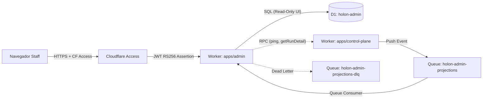

# Provisionamento do Console Operacional Interno

Este runbook documenta os requisitos de infraestrutura, procedimentos de provisionamento e configuração de bindings e segredos para o Console Operacional Interno do Holon (`apps/admin`).

> [!NOTE]
> Verificação de APIs e comportamento da Cloudflare realizada em 2026-09-04 contra a documentação primária do Cloudflare Workers, D1, Queues e Access.

## 1. Topologia de infraestrutura

O console operacional interno é um deployable estritamente para uso da equipe interna, protegido por Cloudflare Zero Trust (Cloudflare Access). Ele consome projeções normalizadas via Cloudflare Queues em um banco D1 dedicado e consulta o Durable Object do Control Plane via RPC privada para detalhes profundos sob demanda.



_Descrição textual do diagrama_: O navegador do operador autentica via Cloudflare Access, que injeta o cabeçalho `cf-access-jwt-assertion`. A requisição chega ao worker `apps/admin`, que valida a assinatura RS256 do token. Para renderizar a interface de monitoramento, o `apps/admin` consulta o banco D1 `holon-admin`. Para detalhes pontuais de uma run, realiza chamada RPC ao `apps/control-plane`. Projeções assíncronas chegam via Cloudflare Queue `holon-admin-projections` disparadas pelo `apps/control-plane`, com fallback de falhas para a DLQ `holon-admin-projections-dlq`.

---

## 2. Recursos necessários na Cloudflare

### 2.1. Banco D1 (`holon-admin`)

Criação do banco de dados relacional para projeções de runs e quarentena:

```bash
# Criação do banco D1 no ambiente de produção
wrangler d1 create holon-admin-d1
```

O ID retornado deve ser inserido em `apps/admin/wrangler.jsonc` no bloco `d1_databases`.

Execução do schema inicial:

```bash
pnpm --filter @holon/admin d1:migrate:remote
```

### 2.2. Filas Cloudflare Queues

Duas filas dedicadas com retenção de 4 dias (345.600 segundos):

```bash
# Fila principal de projeções
wrangler queues create holon-admin-projections --message-retention-period-secs=345600

# Dead Letter Queue (DLQ)
wrangler queues create holon-admin-projections-dlq --message-retention-period-secs=345600
```

> [!IMPORTANT]
> A DLQ não possui push consumer configurado no `wrangler.jsonc`. O consumo de reprocessamento é realizado via Pull API pelo CLI de administração (`tooling/admin-cli/replay-dlq.ts`).

### 2.3. Dataset do Analytics Engine

O `apps/control-plane/wrangler.jsonc` declara o binding writer
`ANALYTICS_ENGINE` para o dataset `holon_telemetry_events`. O binding deve
permanecer no control plane; o admin consulta o dataset pela SQL API com um
token separado e somente de leitura. Depois de alterar o binding, regenere os
tipos com `wrangler types` e valide o deploy com `wrangler deploy --dry-run`.

### 2.4. Aplicação Cloudflare Access

1. No dashboard da Cloudflare Zero Trust:
   - Navegue até **Access** > **Applications** > **Add an application**.
   - Tipo: **Self-hosted**.
   - Application Domain: `admin-holon.crepequer.dev`.
   - Session Duration: 12 a 24 horas.
2. Defina as políticas de acesso:
   - Nome: `Staff Only`.
   - Ação: `Allow`.
   - Regra obrigatória: seletor **Email** com o endereço Hotmail exato do operador autorizado.
   - Não use `Emails ending in @hotmail.com`: essa regra permitiria que qualquer conta Hotmail autenticada satisfizesse a política do Access.
   - Rejeição obrigatória: o Worker exige identidade humana positiva, com `email` válido e `sub` não vazio. Não use `type: "app"` como discriminador: a Cloudflare atribui esse claim tanto a sessões humanas quanto a service tokens. O payload documentado de service token não possui `email`, possui `sub` vazio e é rejeitado pelo middleware.
3. Obtenha os valores para configuração:
   - **Team Name**: Subdomínio do Access (`<team>.cloudflareaccess.com`).
   - **Audience (AUD)**: Hash de audiência da aplicação gerado pelo Access.

---

## 3. Configuração de Variáveis e Segredos

### 3.1. Segredos do `apps/admin`

Execute no diretório `apps/admin`:

```bash
# Keyring de HMAC para assinatura e validação de cursores de paginação
# Formato: {"primary":{"kid":"k1","secretHex":"..."},"secondary":{"kid":"k2","secretHex":"..."}}
wrangler secret put ADMIN_CURSOR_HMAC_KEYS

# Token da API Cloudflare para consulta opcional do Analytics Engine (permissão: Account Analytics Read)
wrangler secret put CF_ANALYTICS_API_TOKEN

# Token da API Cloudflare para consulta de métricas de filas (permissão: Queues Read)
wrangler secret put CF_QUEUES_READ_TOKEN
```

`ADMIN_CURSOR_HMAC_KEYS` está declarado em `secrets.required` no `wrangler.jsonc`; `wrangler deploy` e `wrangler versions upload` devem falhar antes da publicação quando o segredo obrigatório não estiver configurado. Os tokens de observabilidade são opcionais e habilitam apenas os respectivos painéis.

### 3.2. Variáveis de ambiente (`apps/admin/wrangler.jsonc`)

- `ACCESS_TEAM_NAME="crepequer"`: nome do time no Cloudflare Access.
- `ACCESS_AUD="50a52aa572751e54ac02ac6dd61ccba516e042229700067910456ec80419163c"`: Audience tag da aplicação Access que protege `admin-holon.crepequer.dev`.
- `AUTHORIZED_EMAIL_DOMAIN="hotmail.com"`: segunda camada de validação do domínio do e-mail. O valor não inclui `@`; a política primária do Access deve continuar restrita ao endereço completo do operador.
- `CF_ACCOUNT_ID="4be6ae7d1bb4a3b2a395c6d30e2671a5"`: conta que contém os recursos do Holon.
- `PROJECTION_QUEUE_ID="3519ca1fd3e8481ba54280be80a1ea85"`: ID da fila `holon-admin-projections` usado pela Metrics API.
- `PROJECTION_DLQ_ID="1ee489d546aa4789a9439bfe66956987"`: ID da fila `holon-admin-projections-dlq` usado pela Metrics API.

Esses três identificadores não concedem acesso e são variáveis não secretas.
Somente os tokens `CF_ANALYTICS_API_TOKEN` e `CF_QUEUES_READ_TOKEN` autorizam as
consultas às APIs.

### 3.3. Workers Logs

O `wrangler.jsonc` habilita persistência de logs, logs de invocação e amostragem de 100% enquanto o console possui baixo volume. Consulte-os em **Workers & Pages > holon-admin > Observability > Logs** ou acompanhe eventos em tempo real:

```bash
pnpm --filter @holon/admin exec wrangler tail holon-admin --format pretty
```

Falhas das integrações opcionais emitem somente o evento allowlisted
`holon.admin.integration_unavailable`, com `integration`, `reason` e, quando
existir, o código HTTP numérico `upstreamStatus`. Os logs não incluem URL,
account ID, corpo da resposta, exception message, JWTs, cookies, tokens,
prompts, diffs ou conteúdo de repositórios privados.

### 3.4. Flag de rollout do `apps/control-plane`

O rollout inicial manteve `ADMIN_PROJECTION_ENABLED="false"` enquanto D1,
consumer da Queue e RPC privada eram provisionados. O inventário remoto
confirmou os bindings/recursos e o dashboard confirmou a leitura do D1. A
configuração versionada atual usa `"true"`; portanto, novos estados terminais
criam tarefas no outbox e projeções para o D1. Runs concluídas antes do cutover
não são retroativamente preenchidas. A prova ponta a ponta permanece obrigatória
depois do deploy, conforme a seção 4.2.

O `payloadHash` da projeção é SHA-256 não chaveado e não exige segredo
compartilhado; ele serve para identidade/idempotência e detecção de corrupção.
A autenticidade do produtor é garantida pelo binding da Queue configurado na
conta Cloudflare. Para rollback operacional, publique temporariamente uma
versão com a flag `"false"`; tarefas já persistidas no outbox podem terminar o
envio, mas nenhuma tarefa nova será criada.

---

## 4. Verificação Pré-Deploy e Deploy

### 4.1. Verificação local (Zero Efeitos Remotos)

Antes de efetuar qualquer alteração no ambiente remoto:

```bash
# Verificação de linting, tipos e cobertura de testes
pnpm verify
```

### 4.2. Deploy dos componentes

Seguindo a ordem de dependência:

1. **Deploy das migrações do D1**:
   ```bash
   pnpm --filter @holon/admin d1:migrate:remote
   ```
2. **Deploy do Admin Console** (registra o consumer antes de habilitar novos producers):
   ```bash
   pnpm --filter @holon/admin deploy
   ```
3. **Validação da prontidão essencial**:
   Acesse `https://admin-holon.crepequer.dev/readiness` e confirme `d1` e `rpc`
   como `healthy`. O estado global `partial` é aceitável antes de configurar os
   dois tokens opcionais; `degraded` não é.
4. **Deploy do Control Plane** (ativa producer, outbox e writer do Analytics Engine):
   ```bash
   pnpm --filter @holon/control-plane deploy
   ```
5. **Validação ponta a ponta**:
   - execute uma nova review real depois do deploy;
   - confirme a atualização de `lastReceivedAt` e a presença da run no console;
   - confirme que Analytics Engine e Queue Metrics ficam `healthy` depois de
     configurar seus tokens, ou `unknown`/`partial` enquanto forem omitidos;
   - confirme que não existem mensagens antigas acima do SLO nem mensagens na DLQ.

O middleware rejeita requisições quando `ACCESS_TEAM_NAME`, `ACCESS_AUD` ou `AUTHORIZED_EMAIL_DOMAIN` estão ausentes ou vazios. `ADMIN_CURSOR_HMAC_KEYS` também é obrigatório; não existe chave padrão para desenvolvimento no runtime.

Após verificar assinatura, issuer, audience e vigência temporal, o middleware exige `email` e `sub` de usuário não vazios. Conforme a [estrutura oficial do application token](https://developers.cloudflare.com/cloudflare-one/access-controls/applications/http-apps/authorization-cookie/application-token/) verificada em 2026-09-04, `type: "app"` identifica o token da aplicação e aparece tanto em autenticação humana quanto em service tokens; portanto, ele não identifica sozinho uma credencial automatizada.
