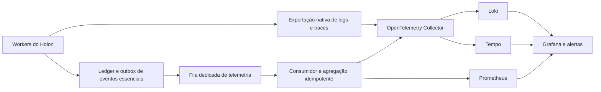

# Migrar a observabilidade do Holon para uma stack especializada

## Objetivo e estado da proposta

Separar observabilidade da persistência funcional do Holon: substituir o console
operacional próprio e suas projeções analíticas em D1 por logs, traces, métricas
e alertas em uma stack Grafana. Preservar D1 onde houver necessidade funcional
e o ledger SQLite dos Durable Objects como autoridade das revisões.

Este documento registra a direção solicitada e um plano de implementação. Não
registra migração executada, escolha de hospedagem, aprovação de despesas ou
validação remota. Não autoriza exclusão de dados, deploy ou criação de recursos.
A retirada prévia do admin foi aprovada pela
[ADR-0040](../decisions/0040-retire-admin-and-analytical-storage.md).
A implementação da stack especializada continua proposta.

A ADR-0040 cobre a limpeza antes da nova stack, com perda autorizada de histórico
administrativo. A implementação futura parte de um runtime sem
`packages/observability`, admin, D1 analítico, projeções ou Analytics Engine.
Permanecem logs nativos simples. A biblioteca futura será uma implementação nova,
sem compatibilidade com o pacote removido. As propostas abaixo descrevem o destino,
não componentes atualmente instalados.

## Ponto de partida histórico (anterior à retirada)

Inspeção local de 2026-09-27, commit `b6b01de` da branch
`codex/large-review-waves`; isso não comprova o estado implantado em produção.

- [Telemetria do control plane](../../apps/control-plane/src/telemetry-emitter.ts):
  porta `TelemetryEmitter`, adapters para Analytics Engine e logs estruturados,
  composição com isolamento e registro de falha de destino.
- [Pacote de observabilidade](../../packages/observability/src/index.ts):
  `ErrorReporter`, `safeErrorDetails`, contexto enumerado e wrappers de fronteira
  que preservam a exceção original. O catálogo em `diagnostics.ts` fornece
  mensagens conhecidas, sem emitir mensagens arbitrárias de exceção.
- [Read model do admin](../../apps/admin/migrations/0001_initial_admin_read_model.sql):
  execuções terminais, tokens, custo estimado, cobertura, metadados e quarentena.
  Isso é uma projeção operacional, não um armazenamento genérico de logs.
- [Consulta interna](../../apps/control-plane/src/admin-read-entrypoint.ts):
  detalhes sanitizados por run obtidos diretamente do ledger.
- [Runbook de erros](../operations/error-observability.md): diagnóstico atual,
  segurança, cobertura e limites conhecidos dos registros.

Lacunas observadas: o `eventId` de `holon.step_timing` contém etapa e tentativa,
mas não run ou shard; o contexto compartilhado de erros não possui campos
explícitos de trace/span/shard; a serialização de logs informativos e erros usa
formas distintas. Esses pontos devem ser corrigidos com testes de regressão,
sem afirmar que já causaram perdas em produção.

## Escopo e invariantes

| Responsabilidade                                                    | Destino proposto                                                  |
| ------------------------------------------------------------------- | ----------------------------------------------------------------- |
| Estado causal, idempotência, achados, publicação, retries e cleanup | Persistência do core existente                                    |
| Logs de diagnóstico                                                 | Loki                                                              |
| Traces e spans                                                      | Tempo                                                             |
| Séries temporais e histogramas                                      | Prometheus; avaliar Mimir somente se escala/retenção justificarem |
| Dashboards e alertas                                                | Grafana e um fluxo definido de encaminhamento de alertas          |
| Transporte e processamento de telemetria                            | Exportação Cloudflare e OpenTelemetry Collector                   |
| Inspeção pontual de estado real                                     | Consulta interna autenticada e sanitizada por run                 |
| Projeção D1 exclusiva do admin                                      | Retirada após validação e tratamento do histórico                 |

A indisponibilidade do destino de observabilidade não pode impedir publicação,
alterar ack/retry da revisão ou atrasar cleanup. Falha na transação autoritativa
do ledger continua sendo falha do core; não deve ser mascarada como falha de log.
O Sandbox mantém o egress restrito e não recebe credenciais da stack. O executor
confiável emite metadados seguros das ferramentas, nunca stdout bruto.

Não transferir regras de veredito, cálculo de custo ou autoridade de run para
queries Grafana. Métricas de custo são estimativas, não comprovantes de cobrança.
Não criar um segundo histórico funcional completo dentro da observabilidade.

## Arquitetura proposta

O caminho nativo atende ao diagnóstico detalhado. O caminho durável preserva um
conjunto pequeno de eventos essenciais e alimenta agregações. Ambos compartilham
identidades para correlação, mas apenas um caminho alimenta cada contador.
O Collector opera fora dos isolates dos Workers. Avaliar uma oferta gerenciada
ou infraestrutura existente antes de assumir a operação de novos servidores.
Grafana Alloy é uma alternativa ao Collector upstream; escolher uma distribuição,
sem manter dois pipelines equivalentes por conveniência.

A exportação nativa suporta logs e traces, mas não métricas na documentação
consultada. O caminho de métricas do produto exige uma prova específica de
agregação e exportação. Métricas de infraestrutura Cloudflare exigem integração
separada, validando datasets, permissões, atraso e amostragem; não inventar gauges
de backlog a partir da ausência de logs.

## Evolução de `@holon/observability`

Manter o pacote existente e separar módulos por responsabilidade conforme o
código crescer: contexto, diagnóstico, eventos, instrumentação e adapters. Não
criar uma hierarquia de interfaces sem consumidores reais.

### Contratos e fronteiras

- Manter políticas no domínio e portas de telemetria na aplicação. Schemas de
  payload externo pertencem a `contracts`; adapters concretos não entram no domínio.
- Adotar um envelope estruturado consistente com timestamp UTC, evento, severidade,
  serviço, ambiente, versão implantada, resultado e identidade da ocorrência.
- Adicionar contexto explícito e validado: run, Workflow, PR, shard, etapa,
  tentativa, rodada quando aplicável, `traceId` e `spanId`. Não usar estado global
  mutável compartilhado entre invocações.
- Delimitar tamanho em bytes, quantidade de atributos, tipos, enumerações e
  profundidade. Definir o teto antes de implementar, abaixo do menor limite de
  transporte validado; nunca truncar silenciosamente a identidade do evento.
- Manter um contrato interno atual, atualizado junto de produtores e consumidores,
  sem `schemaVersion`, aliases ou caminhos de compatibilidade antigos.

### Erros que explicam a causa sem expor conteúdo

- Normalizar erros no adapter que conhece o protocolo: código, fase, status,
  timeout, origem, retryability e identificador seguro da requisição externa.
- Expandir o catálogo além de GitHub para modelo, executor, contratos, persistência,
  publicação e exportação. Separar motivo conhecido de `unknown`; nunca inventar causa.
- Preservar cadeia de causas tipadas com profundidade limitada e detecção de ciclo.
  Mensagens vêm do catálogo, não de `error.message`, bodies ou stacks brutas.
- Tornar a extração defensiva contra objetos arbitrários e getters que lançam;
  falha do diagnóstico não substitui a exceção original.
- Distinguir falha recuperada, retry agendado, resultado degradado e falha terminal.
  Severidade segue o impacto e a disposição, não apenas a existência de um `catch`.
- Uma fronteira registra a ocorrência; outras acrescentam contexto sem multiplicar
  a mesma falha em contadores. Alertas agrupam por causa e operação controladas.
- Registrar callbacks de resultado parcial explicitamente: instrumentação global
  não consegue inferir `evidence_rejected` a partir de uma resposta HTTP 200.

### Identidade e contexto assíncrono

Separar `errorId` de ocorrência, `eventId` lógico e identidade de entrega. Replay
ou reentrega do mesmo evento preserva `eventId`; uma tentativa real nova recebe
identidade distinta. A identidade deve incorporar run, etapa, shard quando houver,
tentativa e tipo de evento; eventos repetidos dentro da tentativa precisam de
sequência ou identidade própria. O evento terminal deriva da transição causal
confirmada. Testar colisões entre runs, shards, rodadas e versões implantadas.

Propagar contexto nos envelopes de Queue, Workflow e RPC sob validação. Contexto
recebido de fora não concede autoridade nem altera a política de amostragem.
Usar spans curtos por tentativa e links entre operações assíncronas, mantendo
`runId` como correlação estável durante a vida da revisão. Validar a interoperabilidade
entre instrumentação nativa e manual; não assumir propagação automática completa.

### Tempos e budgets

Medir webhook, espera de admissão/fila, preparação de repositório, análise por
shard/fase, chamada ao modelo, ferramenta, GitHub, publicação, reconciliação e
cleanup. Registrar orçamento inicial, consumido e restante quando disponível.

Separar tempo ativo de espera/backoff e duração total; somar shards paralelos não
produz duração da run. Usar relógio adequado ao runtime e timestamps persistidos
para atravessar suspensões. Operações sem I/O podem apresentar duração zero no
Workers; não interpretar isso como custo computacional nulo. Timeouts abruptos
podem impedir o evento de término: reconciliar com estado persistido/histórico
operacional, sem depender de `finally` para detectar toda execução interrompida.

## Entrega, agregação e limites de garantia

### Diagnóstico detalhado

Exportar logs/traces nativamente quando a prova de compatibilidade demonstrar os
campos necessários. Não fazer um HTTP síncrono por log nem depender de timers
periódicos ou buffers em memória no isolate para entrega. `waitUntil` não é fila
durável. SDK/exporter manual só entra para lacuna comprovada, com limite de tempo,
flush e comportamento de falha testados.

Começar o piloto com coleta integral em volume controlado e limites de custo.
Depois definir amostragem de traces de sucesso. Uma decisão de amostragem no início
pode descartar uma falha futura; tail sampling não recupera spans que nunca foram
enviados. Eventos essenciais seguem fora dessa amostragem. Não prometer retenção
integral de erros apenas configurando severidade no logger.

### Eventos essenciais duráveis

Propor registro atômico de um evento pequeno junto à transição já persistida no
ledger: admissão, resultado terminal, confirmação de publicação e obrigação ou
falha definitiva de cleanup. Não persistir cada log, span ou chamada de ferramenta.

Uma outbox limitada envia esses eventos para fila dedicada, fora da fila de jobs
de revisão, com lease, backoff, retry, quarentena/DLQ e retenção definidos. Cleanup
mantém prioridade. Não reexecutar análise para reenviar telemetria. Falha de envio
remoto mantém a obrigação pendente; falha de storage não é sucesso de transação.
Definir capacidade, idade máxima, alertas e tratamento explícito de saturação.
Nenhum buffer finito garante entrega durante indisponibilidade ilimitada.

A proposta troca a projeção do admin por transporte mínimo. Não manter dois
outboxes equivalentes permanentemente. Reutilizar mecanismos existentes quando
compatíveis, sem misturar payloads antigos e novos em um consumidor.

### Agregação de métricas

Não expor `/metrics` com contadores isolados na memória de Workers. Agregar fora
desses isolates, com identidade de produtor, temporality e reinício definidos.
Selecionar scrape de um agregador persistente ou exportação OTLP compatível com
Prometheus após uma prova de comportamento, não apenas de conexão.

A prova deve demonstrar atomicidade entre deduplicação e atualização do agregado,
recuperação de checkpoints e reexportação após crash. Deduplicar antes de enviar
um incremento não basta: pode perder o incremento; deduplicar depois pode duplicá-lo.
IDs nos logs não oferecem exactly-once no Prometheus. Preferir snapshots cumulativos
reconstituíveis com timestamp/identidade estáveis quando o backend suportar a
semântica necessária. Caso a prova não sustente exatidão, documentar as métricas
como operacionais aproximadas e preservar a consulta ao ledger para auditoria.
O armazenamento mínimo desse agregador é parte da stack, não um read model D1
para dashboards. Backend, retenção de deduplicação e janela de replay estão pendentes.

### Collector e monitoramento da coleta

Habilitar batches, limites de memória, filas persistentes em volume durável,
retries com backoff e autenticação TLS. Definir comportamento de erros permanentes,
429, timeout e disco cheio. Não assumir que um ACK HTTP representa persistência
em disco: verificar a fronteira de confirmação de cada receiver/exporter escolhido.
Uma WAL no Collector protege o trecho posterior à recepção, não perdas anteriores.

Alertar sobre atraso, capacidade/idade de fila, retries, descarte, quarentena,
disco e ausência de sinais. Usar um sinal sintético e monitor externo ao pipeline
para não depender exclusivamente da stack quebrada para avisar de sua falha.
Evitar recursão: erro no exporter usa sinal limitado e independente, não reenvio
infinito pelo próprio exporter. Estabelecer RPO/RTO e custo com volume medido.

## Métricas, dashboards e proteção dos dados

| Sinal proposto                             | Semântica necessária                                                                                       |
| ------------------------------------------ | ---------------------------------------------------------------------------------------------------------- |
| Runs por resultado                         | Separar complete, partial_by_policy, partial_by_failure, unsupported e falha terminal; obsoletas separadas |
| Revisões completas                         | Denominador explícito e janela por admissão ou término; não confundir com sucesso do Workflow              |
| Latência por operação                      | Histogramas em segundos; buckets adequados a chamadas curtas e análises longas                             |
| Rejeição de evidência                      | Contador por motivo controlado, sem trecho ou caminho                                                      |
| Limites de análise                         | Contexto omitido, budgets, rodadas e ferramentas em categorias distintas                                   |
| Publicação                                 | Tentativas, confirmações e pendências separadas                                                            |
| Tokens e custo estimado                    | Modelo e política de preço identificados; ausência não vira zero                                           |
| Execuções sem progresso e cleanup atrasado | Estado/obrigações e deadlines; ausência de log sozinha não confirma falha                                  |

Usar labels de baixa cardinalidade: serviço, ambiente, operação e resultado
controlados. `runId`, PR, SHA, `eventId` e IDs externos ficam em atributos/metadados
estruturados de logs/traces, não labels Prometheus nem índices Loki. Modelo/rota
precisam de conjunto limitado. Exemplars podem vincular histogramas a traces.

Sanitizar antes da emissão e novamente na ingestão como defesa adicional.
Bloquear prompts, diffs, arquivos, argumentos/resultados de tools, bodies, URLs
com query sensível, headers, tokens, PEM e mensagens arbitrárias. Revisar também
atributos automáticos e exceções não tratadas da plataforma. Restringir acesso,
segregar ambientes e decidir região, retenção e exclusão dos dados. Não publicar
receivers sem autenticação nem compartilhar credenciais da stack com repositórios.

Dashboards mínimos: saúde e qualidade das revisões, investigação por run, latência
e custo, publicação/cleanup e saúde da telemetria. Cada alerta deve ter dono,
severidade, janela, agrupamento, destino e runbook. Evitar alertar cada tentativa
transitória; alertar esgotamento, atraso sustentado ou impacto. Requests de alteração
por defeito encontrado são resultado esperado, não incidente operacional.

## Sequência revisada após a retirada

1. Concluir a retirada aprovada na ADR-0040 e validar o core sem admin.
2. Decidir hospedagem, retenção, transporte e budgets da stack especializada.
3. Implementar contratos e biblioteca novos com testes de privacidade e não interferência.
4. Validar logs/traces, métricas e dashboards em um piloto autorizado.
5. Introduzir eventos essenciais e comparar a stack com o estado funcional e cenários
   sintéticos. Não existe projeção admin para comparação paralela.

Não há rollback ao console que recupere os históricos apagados. Exclusão de recursos
remotos remanescentes segue o runbook de retirada. Os critérios de resiliência abaixo
continuam válidos para a stack futura.

## Sequência original (substituída pela ADR-0040)

A tabela e o rollback desta seção são históricos; não executar essa sequência.

| Etapa                    | Entrega                                                                                                                    | Condição para avançar                                                                |
| ------------------------ | -------------------------------------------------------------------------------------------------------------------------- | ------------------------------------------------------------------------------------ |
| 1. Inventário e ADR      | Mapear todos os consumidores D1/admin, Analytics Engine, bindings, filas, links e permissões; decidir hospedagem e budgets | ADR proposto revisado, responsabilidades e fronteiras de dados claras                |
| 2. Contratos e pacote    | Contexto, catálogo, identidade, medições e adapters consistentes                                                           | Regressões locais, privacidade e não interferência comprovadas                       |
| 3. Piloto da stack       | Logs/traces em ambiente autorizado, métricas com semântica testada e dashboards como código                                | Correlação entre componentes e testes de indisponibilidade demonstrados              |
| 4. Eventos essenciais    | Outbox limitada, consumidor, checkpoints e monitoramento                                                                   | Replay, concorrência, falha de ACK e reinício sem alteração no resultado da revisão  |
| 5. Comparação temporária | Confrontar projeção atual, ledger e stack para a mesma população                                                           | Janela definida previamente cobrindo todos os cenários abaixo; diferenças explicadas |
| 6. Retirada do admin     | Remover UI, rotas, bindings e projeções exclusivos; substituir links operacionais                                          | Operação consegue investigar uma run e responder aos alertas sem o admin             |
| 7. Encerramento          | Remover transporte/Analytics Engine redundantes e tratar histórico D1                                                      | Retenção/exportação aprovadas, rollback encerrado e custos medidos                   |

A comparação temporária não é compatibilidade permanente de contratos. Definir
marco de ativação e política para backlog antigo; drenar/quarentenar sem interpretar
payload antigo como atual. Não reescrever migrações aplicadas. Exclusão de recursos
e histórico requer autorização operacional explícita e ocorre por último.

Preservar inspeção interna autenticada do estado do ledger por run. Revisar textos
como “todos os achados permanecem no console”, URLs em checks/comentários, runbooks,
CI/deploy, inventário de Workers e consumidores de `packages/ui` antes de removê-los.
Não apagar pacotes compartilhados sem confirmar ausência de consumidores.

Rollback antes da retirada: desativar novos destinos/consumidores, preservar backlog
e retomar operação anterior sem reexecutar reviews. Após retirada: usar artefato e
configuração conhecidos com storage preservado durante a janela acordada. Testar
replay sem dupla contagem; não presumir rollback viável depois de destruir dados.

## Matriz de validação

| Cenário                                                     | Evidência exigida                                                         |
| ----------------------------------------------------------- | ------------------------------------------------------------------------- |
| Revisão pequena completa e PR grande com shards paralelos   | Uma identidade por run/tentativa, tempos coerentes e resultado correto    |
| PEM/auth GitHub inválidos                                   | Motivo e fase seguros, sem credencial ou mensagem arbitrária              |
| Evidence rejected e contexto omitido                        | Revisão degradada identificada mesmo sem exceção                          |
| Timeout de modelo ou interrupção abrupta                    | Orçamento/etapa identificáveis; ausência de término detectada             |
| Retry, replay e duas runs concorrentes                      | Sem colisão de eventos ou contagem duplicada do resultado lógico          |
| GitHub aceita publicação, mas resposta se perde             | Reconciliação não publica de novo nem conta dois resultados               |
| Collector/backend indisponível, 429 e credencial expirada   | Revisão continua; atraso/retry/descarte ficam detectáveis                 |
| Reinício do agregador entre persistir, exportar e confirmar | Garantia de contagem demonstrada ou aproximação explicitamente registrada |
| Fila cheia, disco cheio, DLQ e falha da própria stack       | Limites respeitados e alerta independente; recuperação ensaiada           |
| Payload hostil e exceção com getter/ciclo/conteúdo privado  | Sanitização segura, sem vazamento nem alteração do erro original          |
| Remoção do admin                                            | Investigação, links de saída e operação continuam utilizáveis             |

Testes locais de políticas e schemas; plugin oficial Workers para fronteiras de
runtime; integração com Collector/Loki/Tempo/Prometheus para ingestão e agregação;
smoke remoto autorizado para Cloudflare/GitHub/modelo reais. Uma suíte local ou um
trace visível não comprova retenção, durabilidade, alertas ou ausência de duplicação.

## Decisões ainda necessárias

- Stack existente, gerenciada ou hospedagem própria; responsável operacional.
- Distribuição do Collector, autenticação, região, disponibilidade e armazenamento.
- Retenção por sinal, limites de custo/volume e política de amostragem.
- Backend e semântica do agregador; exatidão exigida por cada métrica.
- Capacidade e retenção de outbox/fila/deduplicação, RPO/RTO e resposta à saturação.
- Integração de métricas Cloudflare e cobertura real de tracing por entrypoint.
- SLOs, destinos de alerta, janela de comparação e retenção/rollback do D1 existente.

## Fontes externas e limites da pesquisa

Verificadas em 2026-09-27; reconfirmar antes da implementação:

- [Cloudflare: exportação OpenTelemetry](https://developers.cloudflare.com/workers/observability/exporting-opentelemetry-data/):
  logs/traces, exportação em beta e métricas ainda não suportadas nesse caminho.
- [Cloudflare: Grafana Cloud](https://developers.cloudflare.com/workers/observability/exporting-opentelemetry-data/grafana-cloud/):
  configuração de destino OTLP; não equivale a prova de ingestão da conta Holon.
- [Cloudflare: limitações de tracing](https://developers.cloudflare.com/workers/observability/traces/known-limitations/):
  limitações de propagação externa, atributos e duração de operações sem I/O.
- [OpenTelemetry: resiliência do Collector](https://opentelemetry.io/docs/collector/resiliency/):
  queues, WAL, retry e situações em que ainda pode haver perda.
- [Prometheus: backend OpenTelemetry](https://prometheus.io/docs/guides/opentelemetry/):
  recepção e semântica OTLP a validar na versão escolhida.
- [Loki: metadados estruturados](https://grafana.com/docs/loki/latest/get-started/labels/structured-metadata/):
  campos de alta cardinalidade fora dos labels indexados.

Os mecanismos de outbox, agregação e migração deste plano são propostas para o
Holon, não garantias atribuídas aos fornecedores. Não houve benchmark, deploy,
smoke remoto ou medição de custo da stack nesta documentação.
