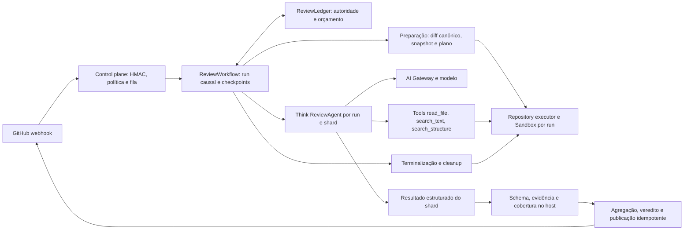

# Migrar a revisão de PRs para Cloudflare Agents SDK e Think

## Objetivo e estado

Este é o plano histórico que antecedeu a implementação da
[ADR-0049](../decisions/0049-use-cloudflare-think-for-pr-review.md). O
[fluxo atual](../architecture/review-runtime-flow.md) e o código são as fontes
para o runtime implementado. O objetivo era substituir o loop de investigação
e geração de review mantido pelo Holon por `@cloudflare/think`, usando `agents`
como runtime do agente. O Holon
continua responsável pelas regras do produto: identidade do PR, autorização,
escopo da análise, evidência, orçamento agregado, veredito e publicação.

A [auditoria dos exemplos e do runtime de Agents](../research/2026-10-03-cloudflare-agents-examples-and-runtime-audit.md),
verificada em 2026-10-03, identificou gates de integração abaixo. Os cinco
exemplos oficiais demonstram canais e capacidades, mas não uma arquitetura de
review de PR com Think; seu código não deve ser transposto diretamente.

A [ADR-0018](../decisions/0018-adopt-two-phase-decoupled-review-generator.md)
aceita explicitamente a retirada do Think com base em três trials datados. A
migração exige um novo ADR que a substitua, preservando seu histórico. Também
exigirá revisar as partes das ADRs 0038, 0043 e 0045 afetadas pela troca do
loop. O objetivo desta branch é entregar o melhor uso viável do Think para a
review do Holon. Avaliação comparativa de qualidade e custo entre motores fica
para uma etapa posterior; o benchmark antigo não é gate desta migração.

## Desenho proposto

O webhook continua entrando no control plane. O Workflow mantém a autoridade
da run, prepara o snapshot e agenda os shards. Cada shard chama uma instância
Think identificada por `runId + shardId`, sem histórico de outro PR ou outra
run. O agente usa o AI Gateway existente e acessa código exclusivamente por
tools de leitura que encaminham chamadas ao executor. O host valida o resultado
de todos os shards, agrega, revalida head/base e publica. O Sandbox continua
pertencendo à run, não ao agente ou ao projeto: “por projeto” serve para
configurar escopo e isolamento lógico, não para reutilizar um checkout mutável
entre PRs. Essa fronteira evita que memória de um PR influencie outro.

O diagrama representa o limite de responsabilidades, não um protocolo já
validado entre `ReviewWorkflow` e Think. O Workflow atual nasce no control
plane; `ThinkWorkflow.step.prompt()` só recebe contexto do Agent quando nasce
por `agent.runWorkflow()`. O corte vertical deve decidir como o Workflow atual
espera e obtém um resultado terminal durável do shard sem transferir a
autoridade causal para a sessão do Agent. Uma chamada `chat()` que retorna após
`onInterrupted` não é conclusão. `submitMessages()` oferece idempotência,
inspeção e cancelamento duráveis, mas exige mecanismo explícito de espera e
leitura do resultado. Não expor `routeAgentRequest` publicamente para executar
reviews; usar apenas binding/RPC interno com identidade validada.

### Responsabilidades

| Componente                  | Responsabilidade                                                                                                                                                               |
| --------------------------- | ------------------------------------------------------------------------------------------------------------------------------------------------------------------------------ |
| `ReviewWorkflow`            | Admissão causal, retries, preparação, paralelismo limitado, revalidação e publicação. Não executa loop de modelo.                                                              |
| `ReviewAgent extends Think` | Prompt de review, turnos de investigação/finalização, histórico isolado, tools permitidas, limites por turno, recuperação limitada e tracing. Não publica nem decide veredito. |
| `RepositoryToolGateway`     | Adapta as três operações atuais ao contrato de tools do Think. Valida entrada, identidade da run, SHA, política, paths, cotas, prazo, saída e redaction no limite do executor. |
| `ReviewLedger`              | Autoridade da run, reservas agregadas, checkpoint de resultado e idempotência de efeitos externos. O SQLite de sessão do Think não substitui o ledger.                         |
| Host de review              | Verifica schema e âncoras literais no patch canônico, classifica cobertura, agrega findings, deriva veredito e publica no GitHub.                                              |

### Política de shards

O planner atual conserva os patches elegíveis e pode gerar até 64 shards,
executados até cinco por vez. Os limites atuais por shard são oito arquivos,
384 linhas alteradas e 48.000 bytes de patch. Esse teto de 64 protege a
cobertura de PRs grandes; não é uma meta de quantidade. No Think, cada shard
também cria sessão, turnos e chamadas ao modelo. Por isso, **não copiar a
granularidade atual sem medir**.

A meta inicial é uma única investigação para PRs pequenos e poucos shards
semanticamente coesos para os demais: agrupar arquivo e teste, contratos e
consumidores relacionados, e hunks do mesmo arquivo quando couberem. Dividir
somente quando o prompt, as janelas de evidência, o tempo ou a capacidade de
investigação do agente ultrapassarem limites medidos. O planner continua
determinístico e conserva linhas/âncoras; não reduzir o teto global para obter
menos shards por truncamento. O alvo experimental é de um a três shards nos
PRs comuns, com concorrência inicialmente menor que os cinco atuais; os
valores finais dependem do corpus e do smoke real.

Menos shards reduzem repetição de prompt, sínteses e sessões, e preservam mais
relações causais dentro da mesma investigação. Shards excessivamente grandes
podem perder detalhes, gastar mais tokens por turno e ampliar o impacto de
uma falha. A tolerância desejada vem de retries limitados do shard afetado,
checkpoint do resultado concluído e sinalização explícita de cobertura.
Falha ou omissão em qualquer área necessária mantém o review incompleto e
impede `APPROVE`; resultados dos demais shards podem fundamentar um
`COMMENT` com achados verificados e limites de cobertura. Se nenhum shard
produzir resultado utilizável, a run falha e o Check Run termina com
`failure`, sem review vazia que pareça concluída.

### Continuidade entre commits

O Think persiste a conversa e permite novos turnos na mesma sessão. Isso é útil
para investigação e recuperação **dentro da mesma run**, mas não torna fatos,
âncoras, respostas de tools ou conclusões do SHA anterior válidos no novo head.
Reutilizar o transcript integral também pode aumentar o contexto enviado ao
modelo; a persistência da sessão, por si só, não demonstra economia de tokens.

Manter uma sessão por `runId + shardId`. Ao chegar um commit novo,
o ledger promove a nova run, cancela o Workflow anterior e impede tools e
publicação da run obsoleta. A nova run usa o snapshot do novo head e recebe os
findings anteriores persistidos, com seus fingerprints e diagnósticos, apenas
como hipóteses limitadas de revalidação. Uma resolução exige evidência positiva
no diff novo; ausência de finding ou memória do modelo não a comprova. Se a
revisão anterior ainda não publicou achados, a nova run começa sem transferir
uma investigação parcial do agente. Essa política foi acordada em 2026-10-03.

### Turno de review

1. O Workflow constrói um envelope pequeno com `runId`, `shardId`, SHA exato,
   digest da configuração, patches canônicos selecionados, alvos de análise,
   limites e referências de evidência. A instância valida a identidade e não
   recebe credenciais do GitHub. O agente não busca PRs por conta própria.
2. O Think investiga com um número limitado de passos. `read_file`,
   `search_text` e `search_structure` são as únicas ferramentas que alcançam o
   repositório. O diff fornecido é a fonte inicial; buscas servem para conferir
   contratos, callers e testes relevantes. Resultados são limitados e tratados
   como dados não confiáveis.
3. A investigação produz uma síntese concisa de conclusões verificadas,
   pendências e cobertura. A opção inicial de finalização é um segundo turno
   sem tools e com schema por `Output.object` em `beforeTurn`. Preservar essa
   separação pode evitar a serialização complexa dentro do loop observada na
   ADR-0018, mas ainda não foi provada no Think atual. Comparar no corte
   vertical com `ThinkWorkflow.step.prompt()`, que retorna objeto Zod usando a
   tool interna `think_final_answer`. Este caminho exige Workflow iniciado pelo
   Agent, tool call forçada em streaming suportada pelo modelo e cuidado para
   não bloquear a tool interna ou sobrescrever `toolChoice`. Se o segundo turno
   herdar contexto excessivo, testar sessão isolada para a finalização com
   apenas a síntese e os excertos canônicos necessários. Escolher um único
   protocolo de resultado após a prova, sem afirmar equivalência entre eles.
4. O host valida o objeto, descarta anchors sem linha `RIGHT` e excerto literal,
   marca a análise como incompleta quando evidência ou cobertura faltar, e
   somente então agrega os shards. O veredito continua determinístico. Nenhuma
   mensagem do modelo, tool ou MCP é aceita como autorização para publicar.

### Tools e acesso ao repositório

| Tool                                                             | Disponibilidade                                                    | Limite                                                                                                                      |
| ---------------------------------------------------------------- | ------------------------------------------------------------------ | --------------------------------------------------------------------------------------------------------------------------- |
| `read_file`                                                      | Construir um adaptador fino sobre a operação existente             | Apenas snapshot no head fixado, path elegível, intervalo e bytes limitados.                                                 |
| `search_text`                                                    | Construir um adaptador fino                                        | Roots elegíveis, resultado limitado e sem egress.                                                                           |
| `search_structure`                                               | Construir um adaptador fino                                        | Apenas linguagens/paths estruturais suportados.                                                                             |
| `write`, `edit`, `delete`, `bash`, execução genérica, instalação | Não expor ao modelo de review                                      | Bloquear também no hook anterior à execução; o Sandbox não recebe RPC de escrita.                                           |
| Tools de workspace do Think (`read`, `list`, `find`, `grep`)     | Desativar no turno de review, salvo uso comprovadamente necessário | Workspace SQLite do Think nunca contém checkout, diff integral ou credenciais.                                              |
| MCP, extensões, scripts de skills e client tools                 | Desativados no review inicial                                      | Eventual cadastro exige política e validação próprias por servidor/tool; nenhum MCP privado entra implicitamente no review. |

O cadastro de MCPs fica para depois desta migração; não é requisito desta branch.

O Think disponibiliza ferramentas de workspace por padrão, incluindo escrita,
remoção e `bash`; `workspaceBash = false` remove apenas o `bash`. Configurar
também `includeMcpTools = false` no agente de review. Portanto a
restrição deve ser aplicada em camadas: `activeTools` com allowlist exata em
cada turno, `beforeToolCall` bloqueando qualquer nome não autorizado, nenhuma
montagem do checkout no workspace do Think e validação da operação no executor.
Uma instrução de prompt sozinha não é controle de acesso. Confirmar em teste
que ferramentas embutidas ou adicionadas por versão nova não escapam da
allowlist. A escrita legítima no GitHub pertence apenas ao publisher, após o
gate do host.

Não anexar `ctx.container` ao `ReviewAgent`: isso associaria um Sandbox a cada
instância de shard e o exemplo oficial oferece `run_command` genérico. O
Sandbox permanece por run no executor. Testar também colisões de nomes de
tools e, se `step.prompt()` for escolhido, a passagem controlada de
`think_final_answer` sem expor novas capacidades de acesso ao repositório.

A sessão do Think pode conter o prompt, os patches selecionados e respostas de
tools daquela run; ela deve permanecer isolada por run/shard. Isso é diferente
do workspace virtual de arquivos, que não recebe um checkout do repositório.
Evitar memória editável, busca entre sessões e `withCachedPrompt()` com política
mutável: o prompt em cache fica congelado após o primeiro uso, inclusive após
hibernação. Identidade e digest da configuração da run devem permanecer
estáveis durante toda a sessão.

### Modelo e AI Gateway

O Think aceita um `LanguageModel` do AI SDK retornado por `getModel()`; não
obriga o uso de Workers AI. A rota atual do Holon usa o provider compatível com
OpenAI do AI SDK através de `dynamic/pr-review` no AI Gateway. O valor
`AI_MODEL_ID=openrouter/free` **não é aceito pelo adapter atual**: ele exige
`dynamic/{route}`. Para testar o router gratuito sem mudar o contrato de
configuração, a rota dinâmica precisaria selecionar OpenRouter com modelo
`openrouter/free` e BYOK configurado. A compatibilidade dessa combinação
específica deve ser comprovada com um smoke; as fontes documentam as peças,
mas não uma execução integrada do Holon.

O OpenRouter afirma que `openrouter/free` escolhe modelos gratuitos por
requisição e filtra modelos conforme recursos pedidos, como tool calling e
structured outputs. Isso permite um experimento, mas não fixa o mesmo modelo
em todos os passos de investigação e finalização. A variabilidade dificulta
regressão, calibração do orçamento e garantia de qualidade. O serviço gratuito
também tem cotas de requisições; cada passo, retry e shard consome uma chamada.
Usar `openrouter/free` somente para testes de desenvolvimento sem custo de
inferência quando o router gratuito estiver disponível. O candidato
inicial para review principal é DeepSeek V4.1 Flash; a rota e o identificador
dependem do provider escolhido. A API da DeepSeek usa `deepseek-flash` para a
versão atual, enquanto o OpenRouter identifica o modelo como
`deepseek/deepseek-v4.1-flash`. Antes de configurar a rota principal, provar
streaming, tools e saída estruturada no caminho AI SDK → AI Gateway → provider.
Revisar política de dados do provider antes de enviar código privado.

O provider beta `agents/models/ai-sdk` é outra opção oficial para acessar
Workers AI e modelos de terceiros pelo binding `AI` e pelo AI Gateway. Sua
documentação requer AI SDK v7/ProviderV4, mas não demonstra suporte à Dynamic
Route usada pelo Holon nem a composição com o middleware de orçamento. Avaliar
essa opção no corte vertical sem substituir a rota atual por suposição; fixar
versões compatíveis de `agents`, Think, AI SDK e Workers runtime antes de
alterar dependências.

### Custos, recuperação e observabilidade

O orçamento deve continuar existindo, mas a política atual não deve ser
transplantada integralmente. Hoje a ADR-0045 limita por run 64 chamadas,
4.000.000 bytes serializados de entrada e 120.000 tokens de saída reservados;
o loop ainda impõe blocos de quatro consultas, 24 tools, 25 rodadas e
checkpoints periódicos. Esses números foram calibrados para o motor atual.
Bytes de prompt limitam exposição, mas não medem tokens faturados nem custo
monetário. Shards maiores também mudam o custo de cada passo.

A diretriz de teto duro agregado, saldo compartilhado e reserva para
finalização foi acordada em 2026-10-03. Os novos valores numéricos ainda não
foram definidos: serão escolhidos com o corpus e a medição do Think no mesmo
modelo/rota. Os limites da ADR-0045 continuam descrevendo o motor atual até
a migração do código e a nova decisão arquitetural.

- **Manter o teto duro agregado e durável por run.** Reservar atomicamente no
  ledger antes de cada chamada ao provider, incluindo investigação,
  finalização, compaction que usar modelo e recuperação. Contabilizar uso
  conhecido; uma chamada de resultado incerto conserva a reserva. Limitar
  também tempo absoluto, passos, tools e tamanho dos resultados. O teto
  evita gasto descontrolado, não determina quando uma review está boa.
- **Substituir cotas fixas por shard por um fundo compartilhado.** O plano
  separa uma reserva para finalizar cada shard pendente; o restante pode ser
  usado onde houver investigação produtiva, sem que o primeiro shard paralelo
  consuma a capacidade dos outros. Uma meta inicial menor orienta o agente a
  concluir; o teto duro só interrompe quando não há capacidade segura para
  continuar. Ajustar os valores pelo corpus e pelo uso remoto no mesmo modelo.
- **Remover as regras do loop antigo.** Checkpoint obrigatório após quatro
  consultas, encerramento após contagem de rodadas estagnadas e cota rígida
  de 24 tools por shard não devem entrar no Think. Usar limites de turno e
  recuperação do Think, com parada por trabalho sem progresso e cobertura
  registrada pelo host. Não exigir que o agente gaste toda a reserva.
- **Implementar o limite no caminho de streaming.** O middleware atual
  `withGenerationBudget` cobre somente `wrapGenerate` (`doGenerate`), enquanto
  o Think executa `streamText`. Implementar reserva e liquidação também em
  `wrapStream` (`doStream`), e testar chamadas, erro durante o stream, retry,
  compaction e concorrência. `onStepFinish` mede uso após o passo; sozinho não
  impede uma chamada acima do teto. `shouldKeepRecovering` pode consultar o
  saldo, mas não substitui a reserva anterior à inferência.
- **Exaustão preserva honestidade.** Se o teto impedir investigação ou
  finalização necessárias, o resultado é incompleto e não pode aprovar o PR.
  Interrupção por supersession cancela o turno e impede novas tools/publicação;
  retries usam identidade determinística e não renovam o orçamento.
- Usar recuperação de turno e compaction do Think somente com política
  explícita. A recuperação básica é automática, mas overflow de contexto
  requer compaction e classificação de erro configuradas; tool interrompida
  pode ser reparada como erro sem reexecução. Cancelamento de fiber é
  cooperativo. Conferir autoridade da run antes de cada tool e publicação, e
  não deixar um agente retomar trabalho após a run perder autoridade.
- Habilitar Agent tracing do Think por configuração. A primeira entrega precisa
  provar o fluxo e a qualidade da review; políticas detalhadas de retenção de
  logs ficam fora deste plano.

### Agent tracing

Ativar `observability.traces.enabled` no Worker do agente. O Think instrumenta
automaticamente `invoke_agent`, chamadas `chat` ao modelo e `execute_tool`; não
envolver novamente suas chamadas com `wrapAISDK()`. Usar nome lógico estável
para o agente e identidade de instância/sessão associada à run e ao shard, sem
criar um nome de agente distinto por PR. Inspecionar duração, status, passos,
tools e uso de tokens na visão Agents/Workers Observability.

Durante esta fase beta, habilitar também `storeMessages` e `storeTools` no
`ReviewAgent`, conforme solicitado em 2026-10-03, para permitir session replay
com mensagens, argumentos e resultados das tools. Prever uma configuração
explícita que desligue as duas opções quando o responsável solicitar. Credenciais
e tokens de instalação continuam fora das mensagens e tools do agente.

> **Alerta temporário:** com `storeMessages` e `storeTools` habilitados, o Agent
> tracing pode registrar prompts, patches e trechos de código privado. Antes de
> usar o agente com repositórios privados, confirmar quem tem acesso aos traces
> na conta Cloudflare. Desabilitar a captura de payloads quando solicitado;
> `observability.traces.enabled` pode continuar ativo para preservar a linha do
> tempo operacional.

Acrescentar correlação técnica mínima e métricas numéricas do Workflow/ledger
aos eventos próprios do Holon. Verificar no corte vertical se os traces
atravessam Workflow, Durable Object e executor como uma única árvore; se não
atravessarem, correlacionar os registros por identificador técnico limitado,
sem declarar que há um trace distribuído único. Agent tracing ajuda a
diagnosticar a execução, mas não substitui resultados e estado durável da run.

## Sequência de migração

Cada etapa deve deixar o contrato interno único, com produtores e consumidores
alterados juntos. Não manter dois motores em produção por tempo indeterminado.

1. **Decisão e corte vertical.** Criar ADR substituta da 0018; fixar versões
   compatíveis de `agents`, `@cloudflare/think` e AI SDK; provar localmente
   um shard real com resultado terminal durável, duas opções de saída
   estruturada (`Output.object` e `step.prompt()`), tools restritas, AI Gateway,
   reserva anterior a cada chamada em streaming, cancelamento e schema de saída.
   Exercitar hibernação/recovery, `onInterrupted`, retry idempotente, novo head
   durante a execução e a tool final interna antes de escolher o protocolo.
   A avaliação
   comparativa com o corpus da ADR-0018 ocorrerá depois desta branch. Não
   confundir aprovação local com smoke real.
2. **Integração do runtime.** Adicionar o Durable Object `ReviewAgent` e sua
   migração, encaminhamento interno do Workflow, sessão por run/shard e tool
   gateway no control plane. Preservar executor, Sandbox, ledger, filtros de
   paths, verificador de evidência e publisher. Testar rejeição de tools de
   escrita mesmo com prompt injection no diff.
3. **Troca da geração.** Substituir `AiSdkReviewGenerator`/
   `GatewayModelReviewer` e o loop em `packages/model` pela chamada ao Think.
   Reconciliar shards e síntese sem duplicar inferências. Remover prompts,
   checkpoints de investigação, caches e budgets que só existiam para operar
   o motor antigo; manter a política de cobertura, orçamento agregado e
   contratos que ainda representam o produto. Atualizar o fluxo de arquitetura
   e testes de regressão.
4. **Prova de entrega.** Rodar `pnpm verify`, testes Workers/DO e executor,
   cenários de integração focados no comportamento da review e na política de
   shards; depois smoke autorizado com GitHub App, AI Gateway e Cloudflare reais.
   Confirmar PR pequeno/grande, force-push, shard falho, retry, orçamento,
   cancelamento, zero findings legítimo e comentário idempotente. Sem essa
   evidência remota, não declarar a integração remota comprovada. Comparação de
   precisão, recall e custo entre motores fica para a avaliação posterior.

### Retirada da atualização de comentário por artefatos de CI na mesma branch

A ingestão `workflow_run.completed` de ZIP/LCOV/JUnit e o bloco de CI no
comentário não fazem parte da função central de revisão. A remoção integra o
escopo desta branch, em commits separados da migração do agente. A
[ADR-0038](../decisions/0038-harden-parallel-review-and-publication.md)
atualmente os exige; um novo ADR deve revogar essa parte antes da remoção.

1. Desligar a emissão do bloco de CI e a atualização tardia do comentário,
   eliminando a dependência do publisher/review de `loadCiEvidence`. O review
   permanece estável mesmo quando CI termina antes ou depois.
2. Remover a admissão/consumo do evento `workflow_run`, serviço de enrichment,
   downloads de artifacts, parsers, contratos e testes exclusivos da função.
   Revisar permissões e subscriptions da GitHub App. Manter `pull_request` e
   os eventos necessários a feedback/review.
3. Retirar métodos e tarefas de CI do ledger por migração aditiva segura; não
   editar migrações já aplicadas nem apagar dados automaticamente. Atualizar
   arquitetura e roadmap para registrar a retirada. Uploads de artefatos no
   CI do próprio Holon só saem se nenhuma outra finalidade os usar.

## Fontes verificadas em 2026-10-03

- [Think: API, `runTurn`, AI SDK e tracing](https://developers.cloudflare.com/agents/harnesses/think/)
- [Agents: spans, configuração e privacidade do tracing](https://developers.cloudflare.com/agents/runtime/operations/observability/tracing/)
- [Think: tools embutidas, `workspaceBash` e `getTools`](https://developers.cloudflare.com/agents/harnesses/think/tools/)
- [Think: `beforeTurn`, `beforeStep` e `beforeToolCall`](https://developers.cloudflare.com/agents/harnesses/think/lifecycle-hooks/)
- [Think: configuração e MCP habilitado por padrão](https://developers.cloudflare.com/agents/harnesses/think/configuration/)
- [Think: recuperação e compaction](https://developers.cloudflare.com/agents/harnesses/think/recovery/)
- [AI SDK: middleware `wrapGenerate` e `wrapStream`](https://ai-sdk.dev/docs/ai-sdk-core/middleware)
- [AI Gateway: Dynamic Routes e BYOK](https://developers.cloudflare.com/ai-gateway/features/dynamic-routing/usage/)
- [AI Gateway: provider OpenRouter](https://developers.cloudflare.com/ai-gateway/usage/providers/openrouter/)
- [OpenRouter: `openrouter/free`](https://openrouter.ai/openrouter/free)
- [OpenRouter: tool calling](https://openrouter.ai/docs/guides/features/tool-calling)
- [OpenRouter: structured outputs](https://openrouter.ai/docs/guides/features/structured-outputs)
- [OpenRouter: limites do plano gratuito](https://openrouter.ai/pricing/)
- [DeepSeek: anúncio e identificador de API do V4.1 Flash](https://api-docs.deepseek.com/updates/)
- [OpenRouter: identificador do DeepSeek V4.1 Flash](https://openrouter.ai/deepseek/deepseek-v4.1-flash)
- [Think: submissões duráveis e cancelamento](https://developers.cloudflare.com/agents/harnesses/think/programmatic-submissions/)
- [Think: Workflow, `step.prompt()` e `think_final_answer`](https://developers.cloudflare.com/agents/harnesses/think/workflows/)
- [Think: RPC, `chat()` e `onInterrupted`](https://developers.cloudflare.com/agents/harnesses/think/sub-agents/)
- [Agents: sessões, prompt em cache e compaction](https://developers.cloudflare.com/agents/runtime/lifecycle/sessions/)
- [Agents: Sandbox anexado ao Agent](https://developers.cloudflare.com/agents/tools/sandbox/)
- [Agents: provider AI SDK beta e AI Gateway](https://developers.cloudflare.com/agents/models/ai-sdk/)
- [Agents: roteamento HTTP e WebSocket](https://developers.cloudflare.com/agents/runtime/communication/routing/)
