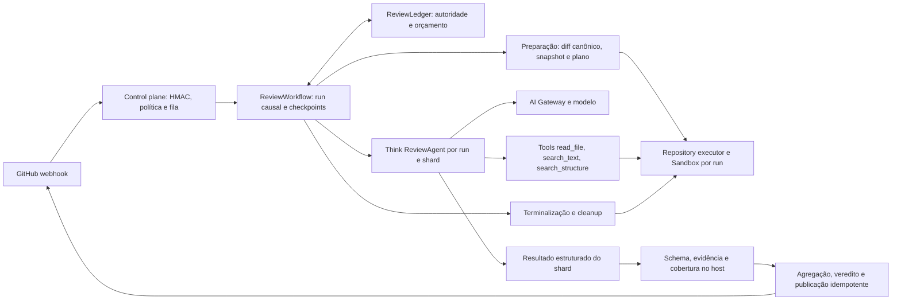

# Migrar a revisão de PRs para Cloudflare Agents SDK e Think

## Objetivo e estado

Este é o desenho da migração, ainda não a descrição do runtime implementado. O
objetivo é substituir o loop de investigação e geração de review mantido pelo
Holon por `@cloudflare/think`, usando `agents` como runtime do agente. O Holon
continua responsável pelas regras do produto: identidade do PR, autorização,
escopo da análise, evidência, orçamento agregado, veredito e publicação.

A [ADR-0018](../decisions/0018-adopt-two-phase-decoupled-review-generator.md)
aceita explicitamente a retirada do Think com base em três trials datados. A
migração exige um novo ADR que a substitua, preservando seu histórico e o gate
de evidências. Também exigirá revisar as partes das ADRs 0038, 0043 e 0045
afetadas pela troca do loop. O benchmark anterior é uma regressão a superar,
não uma garantia de que a biblioteca atual produzirá reviews melhores ou mais
baratos.

## Desenho proposto

O webhook continua entrando no control plane. O Workflow mantém a autoridade
da run, prepara o snapshot e agenda os shards. Cada shard chama uma instância
Think identificada por `runId + shardId`, sem histórico de outro PR ou outra
run. O agente usa o AI Gateway existente e acessa código exclusivamente por
tools de leitura que encaminham chamadas ao executor. O host valida o resultado
de todos os shards, agrega, revalida head/base e publica. O Sandbox continua
pertencendo à run, não ao agente ou ao projeto: “por projeto” serve para
configurar escopo e isolamento lógico, não para reutilizar um checkout mutável
entre PRs. Essa fronteira evita que memória de um PR influencie outro.

### Responsabilidades

| Componente | Responsabilidade |
| --- | --- |
| `ReviewWorkflow` | Admissão causal, retries, preparação, paralelismo limitado, revalidação e publicação. Não executa loop de modelo. |
| `ReviewAgent extends Think` | Prompt de review, turnos de investigação/finalização, histórico isolado, tools permitidas, limites por turno, recuperação limitada e tracing. Não publica nem decide veredito. |
| `RepositoryToolGateway` | Adapta as três operações atuais ao contrato de tools do Think. Valida entrada, identidade da run, SHA, política, paths, cotas, prazo, saída e redaction no limite do executor. |
| `ReviewLedger` | Autoridade da run, reservas agregadas, checkpoint de resultado e idempotência de efeitos externos. O SQLite de sessão do Think não substitui o ledger. |
| Host de review | Verifica schema e âncoras literais no patch canônico, classifica cobertura, agrega findings, deriva veredito e publica no GitHub. |

### Política de shards

O planner atual conserva os patches elegíveis e pode gerar até 64 shards,
executados até cinco por vez. Os limites atuais por shard são oito arquivos,
384 linhas alteradas e 48.000 bytes de patch. Esse teto de 64 protege a
cobertura de PRs grandes; não é uma meta de quantidade. No Think, cada shard
também cria sessão, turnos e chamadas ao modelo. Por isso, **não copiar a
granularidade atual sem medir**.

A meta inicial é uma única investigação para PRs pequenos e poucos shards
semanticamente coesos para os demais: agrupar arquivo e teste, contratos e
consumidores relacionados, e hunks do mesmo arquivo quando couberem. Dividir
somente quando o prompt, as janelas de evidência, o tempo ou a capacidade de
investigação do agente ultrapassarem limites medidos. O planner continua
determinístico e conserva linhas/âncoras; não reduzir o teto global para obter
menos shards por truncamento. O alvo experimental é de um a três shards nos
PRs comuns, com concorrência inicialmente menor que os cinco atuais; os
valores finais dependem do corpus e do smoke real.

Menos shards reduzem repetição de prompt, sínteses e sessões, e preservam mais
relações causais dentro da mesma investigação. Shards excessivamente grandes
podem perder detalhes, gastar mais tokens por turno e ampliar o impacto de
uma falha. A tolerância desejada vem de retries limitados do shard afetado,
checkpoint do resultado concluído e sinalização explícita de cobertura.
Falha ou omissão em qualquer área necessária mantém o review incompleto e
impede `APPROVE`; resultados dos demais shards podem fundamentar um
`COMMENT` com limitações, conforme a política existente.

### Turno de review

1. O Workflow constrói um envelope pequeno com `runId`, `shardId`, SHA exato,
   digest da configuração, patches canônicos selecionados, alvos de análise,
   limites e referências de evidência. A instância valida a identidade e não
   recebe credenciais do GitHub. O agente não busca PRs por conta própria.
2. O Think investiga com um número limitado de passos. `read_file`,
   `search_text` e `search_structure` são as únicas ferramentas que alcançam o
   repositório. O diff fornecido é a fonte inicial; buscas servem para conferir
   contratos, callers e testes relevantes. Resultados são limitados e tratados
   como dados não confiáveis.
3. A investigação produz uma síntese concisa de conclusões verificadas,
   pendências e cobertura. A finalização é um turno sem tools e com schema
   estruturado. Preservar a separação evita repetir o problema da serialização
   complexa dentro do loop de ferramentas observado na ADR-0018. A capacidade
   de executar essa separação via `beforeTurn` e `Output.object` no Think atual
   precisa ser provada no primeiro corte vertical antes de remover o gerador
   antigo. Se o segundo turno herdar contexto excessivo, usar sessão isolada
   para a finalização com apenas a síntese e os excertos canônicos necessários.
4. O host valida o objeto, descarta anchors sem linha `RIGHT` e excerto literal,
   marca a análise como incompleta quando evidência ou cobertura faltar, e
   somente então agrega os shards. O veredito continua determinístico. Nenhuma
   mensagem do modelo, tool ou MCP é aceita como autorização para publicar.

### Tools e acesso ao repositório

| Tool | Disponibilidade | Limite |
| --- | --- | --- |
| `read_file` | Construir um adaptador fino sobre a operação existente | Apenas snapshot no head fixado, path elegível, intervalo e bytes limitados. |
| `search_text` | Construir um adaptador fino | Roots elegíveis, resultado limitado e sem egress. |
| `search_structure` | Construir um adaptador fino | Apenas linguagens/paths estruturais suportados. |
| `write`, `edit`, `delete`, `bash`, execução genérica, instalação | Não expor ao modelo de review | Bloquear também no hook anterior à execução; o Sandbox não recebe RPC de escrita. |
| Tools de workspace do Think (`read`, `list`, `find`, `grep`) | Desativar no turno de review, salvo uso comprovadamente necessário | Workspace SQLite do Think nunca contém checkout, diff integral ou credenciais. |
| MCP, extensões, scripts de skills e client tools | Desativados no review inicial | Eventual cadastro exige política e validação próprias por servidor/tool; nenhum MCP privado entra implicitamente no review. |

O Think disponibiliza ferramentas de workspace por padrão, incluindo escrita,
remoção e `bash`; `workspaceBash = false` remove apenas o `bash`. Configurar
também `includeMcpTools = false` no agente de review. Portanto a
restrição deve ser aplicada em camadas: `activeTools` com allowlist exata em
cada turno, `beforeToolCall` bloqueando qualquer nome não autorizado, nenhuma
montagem do checkout no workspace do Think e validação da operação no executor.
Uma instrução de prompt sozinha não é controle de acesso. Confirmar em teste
que ferramentas embutidas ou adicionadas por versão nova não escapam da
allowlist. A escrita legítima no GitHub pertence apenas ao publisher, após o
gate do host.

A sessão do Think pode conter o prompt, os patches selecionados e respostas de
tools daquela run; ela deve permanecer isolada por run/shard. Isso é diferente
do workspace virtual de arquivos, que não recebe um checkout do repositório.

### Custos, recuperação e observabilidade

O orçamento deve continuar existindo, mas a política atual não deve ser
transplantada integralmente. Hoje a ADR-0045 limita por run 64 chamadas,
4.000.000 bytes serializados de entrada e 120.000 tokens de saída reservados;
o loop ainda impõe blocos de quatro consultas, 24 tools, 25 rodadas e
checkpoints periódicos. Esses números foram calibrados para o motor atual.
Bytes de prompt limitam exposição, mas não medem tokens faturados nem custo
monetário. Shards maiores também mudam o custo de cada passo.

- **Manter o teto duro agregado e durável por run.** Reservar atomicamente no
  ledger antes de cada chamada ao provider, incluindo investigação,
  finalização, compaction que usar modelo e recuperação. Contabilizar uso
  conhecido; uma chamada de resultado incerto conserva a reserva. Limitar
  também tempo absoluto, passos, tools e tamanho dos resultados. O teto
  evita gasto descontrolado, não determina quando uma review está boa.
- **Substituir cotas fixas por shard por um fundo compartilhado.** O plano
  separa uma reserva para finalizar cada shard pendente; o restante pode ser
  usado onde houver investigação produtiva, sem que o primeiro shard paralelo
  consuma a capacidade dos outros. Uma meta inicial menor orienta o agente a
  concluir; o teto duro só interrompe quando não há capacidade segura para
  continuar. Ajustar os valores pelo corpus e pelo uso remoto no mesmo modelo.
- **Remover as regras do loop antigo.** Checkpoint obrigatório após quatro
  consultas, encerramento após contagem de rodadas estagnadas e cota rígida
  de 24 tools por shard não devem entrar no Think. Usar limites de turno e
  recuperação do Think, com parada por trabalho sem progresso e cobertura
  registrada pelo host. Não exigir que o agente gaste toda a reserva.
- **Implementar o limite no caminho de streaming.** O middleware atual
  `withGenerationBudget` cobre somente `wrapGenerate` (`doGenerate`), enquanto
  o Think executa `streamText`. Implementar reserva e liquidação também em
  `wrapStream` (`doStream`), e testar chamadas, erro durante o stream, retry,
  compaction e concorrência. `onStepFinish` mede uso após o passo; sozinho não
  impede uma chamada acima do teto. `shouldKeepRecovering` pode consultar o
  saldo, mas não substitui a reserva anterior à inferência.
- **Exaustão preserva honestidade.** Se o teto impedir investigação ou
  finalização necessárias, o resultado é incompleto e não pode aprovar o PR.
  Interrupção por supersession cancela o turno e impede novas tools/publicação;
  retries usam identidade determinística e não renovam o orçamento.
- Usar recuperação de turno e compaction do Think somente com política
  explícita. Não deixar um agente retomar trabalho após a run perder autoridade.
- Habilitar tracing do Agent/Think por configuração, mantendo atributos
  numéricos e identificadores técnicos mínimos; prompts, diffs, conteúdos de
  arquivo, respostas de tools e segredos não entram em logs/spans. A primeira
  entrega precisa provar o fluxo e a qualidade da review; políticas detalhadas
  de retenção de logs ficam fora deste plano.

## Sequência de migração

Cada etapa deve deixar o contrato interno único, com produtores e consumidores
alterados juntos. Não manter dois motores em produção por tempo indeterminado.

1. **Decisão e corte vertical.** Criar ADR substituta da 0018; fixar versões
   compatíveis de `agents`, `@cloudflare/think` e AI SDK; provar localmente
   um shard real com dois turnos, tools restritas, AI Gateway, reserva anterior
   a cada chamada em streaming, cancelamento e schema de saída. Comparar com
   o corpus da ADR-0018 no mesmo modelo/rota. Não confundir aprovação local
   com smoke real.
2. **Integração do runtime.** Adicionar o Durable Object `ReviewAgent` e sua
   migração, encaminhamento interno do Workflow, sessão por run/shard e tool
   gateway no control plane. Preservar executor, Sandbox, ledger, filtros de
   paths, verificador de evidência e publisher. Testar rejeição de tools de
   escrita mesmo com prompt injection no diff.
3. **Troca da geração.** Substituir `AiSdkReviewGenerator`/
   `GatewayModelReviewer` e o loop em `packages/model` pela chamada ao Think.
   Reconciliar shards e síntese sem duplicar inferências. Remover prompts,
   checkpoints de investigação, caches e budgets que só existiam para operar
   o motor antigo; manter a política de cobertura, orçamento agregado e
   contratos que ainda representam o produto. Atualizar o fluxo de arquitetura
   e testes de regressão.
4. **Prova de entrega.** Rodar `pnpm verify`, testes Workers/DO e executor,
   corpus de reviews com precisão, recall, conclusão, latência e tokens por
   caso, incluindo variações de tamanho e quantidade de shards; depois smoke
   autorizado com GitHub App, AI Gateway e Cloudflare reais.
   Confirmar PR pequeno/grande, force-push, shard falho, retry, orçamento,
   cancelamento, zero findings legítimo e comentário idempotente. Sem essa
   evidência remota, não declarar a migração pronta para produção.

### Retirada gradual da atualização de comentário por artefatos de CI

A ingestão `workflow_run.completed` de ZIP/LCOV/JUnit e o bloco de CI no
comentário não fazem parte da função central de revisão. A
[ADR-0038](../decisions/0038-harden-parallel-review-and-publication.md)
atualmente os exige; um novo ADR deve revogar essa parte antes da remoção.

1. Desligar a emissão do bloco de CI e a atualização tardia do comentário,
   eliminando a dependência do publisher/review de `loadCiEvidence`. O review
   permanece estável mesmo quando CI termina antes ou depois.
2. Remover a admissão/consumo do evento `workflow_run`, serviço de enrichment,
   downloads de artifacts, parsers, contratos e testes exclusivos da função.
   Revisar permissões e subscriptions da GitHub App. Manter `pull_request` e
   os eventos necessários a feedback/review.
3. Retirar métodos e tarefas de CI do ledger por migração aditiva segura; não
   editar migrações já aplicadas nem apagar dados automaticamente. Atualizar
   arquitetura e roadmap para registrar a retirada. Uploads de artefatos no
   CI do próprio Holon só saem se nenhuma outra finalidade os usar.

## Fontes verificadas em 2026-10-03

- [Think: API, `runTurn`, AI SDK e tracing](https://developers.cloudflare.com/agents/harnesses/think/)
- [Think: tools embutidas, `workspaceBash` e `getTools`](https://developers.cloudflare.com/agents/harnesses/think/tools/)
- [Think: `beforeTurn`, `beforeStep` e `beforeToolCall`](https://developers.cloudflare.com/agents/harnesses/think/lifecycle-hooks/)
- [Think: configuração e MCP habilitado por padrão](https://developers.cloudflare.com/agents/harnesses/think/configuration/)
- [Think: recuperação e compaction](https://developers.cloudflare.com/agents/harnesses/think/recovery/)
- [AI SDK: middleware `wrapGenerate` e `wrapStream`](https://ai-sdk.dev/docs/ai-sdk-core/middleware)
