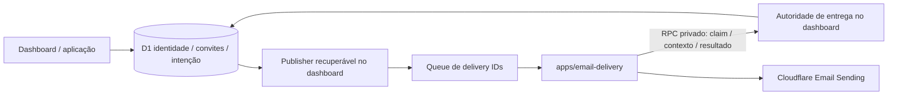

# Entrega durável de emails do dashboard

## Pergunta e conclusão

Como cumprir Q35/Q36 — Worker especializado, fila e retries — sem perder envio
entre banco e fila, reenviar convites inválidos ou prometer exatamente um email?

**Direção acordada:** `apps/email-delivery` com Cloudflare Queues e Email Sending.
**Proposta técnica:** convite e intenção de entrega no mesmo D1; publisher
recuperável; fila de referências; consumer com claim condicional e resultado
persistido antes do ack. Isso ainda não está implementado; os bindings atuais
são de review/executor, sem sender, fila de email ou D1 de identidade.

Fila e outbox não tornam o efeito externo exatamente uma vez. A API examinada
não documenta chave de idempotência: se o provider aceitar e o processo falhar
antes de registrar o resultado, retry pode enviar outro email. Esse trade-off
é explícito ao fim, não uma garantia omitida.

A [revisão de robustez](#revisão-de-robustez--2026-10-04) completa a vigília após
publicação, falha/DLQ, resultado tardio e limites de cancelamento. Ela qualifica
as simplificações da primeira sequência abaixo; publicação não é terminalidade.

## Responsabilidades e composição proposta

Dashboard/aplicação decide quem pode convidar e conserva ciclo de convite e
membership. O publisher pertence à mesma autoridade da intenção. O Worker de
email recebe referência, obtém contexto autorizado por RPC, renderiza template
pt-BR/en e chama o provider. A proposta mantém a base de identidade acessível
pela autoridade, sem binding D1 amplo no sender. `contracts` valida payload/RPC;
`auth` cuida de identidade/sessão e a aplicação de política de convite.

Esse RPC é capability estreita de entrega, sem acesso genérico a ORM/session
nem endpoint HTTP de HTML/remetente arbitrários. Contrato verifica job, estado,
lease e deadline; não concede membership nem grants GitHub. Corpo da Queue
contém ID opaco e responsabilidade tipada, sem email, corpo ou token/link.
Service binding/RPC é privado; o transporte de trabalho durável é a Queue.
[Service bindings](https://developers.cloudflare.com/workers/runtime-apis/bindings/service-bindings/).

## Persistir antes de publicar

1. Validar owner, alvo e dados do convite no servidor.
2. Gravar convite e intenção de envio atomicamente no mesmo banco, com unicidade
   e deadline. `D1.batch()` oferece transação da sequência; a integração deve
   realmente usar esse caminho. Hook posterior do plugin não demonstra atomicidade.
3. Após commit, tentar publicar rapidamente o ID na Queue. Persistir confirmação
   somente após aceitação da publicação; falha deixa obrigação recuperável.
4. Publisher periódico encontra intenções devidas, com lease/updates condicionais,
   e repete publicação. Proposta de scheduled handler no dashboard; intervalo
   e lotes serão definidos pelo prazo útil de envio/carga, sem cron criado agora.
5. O ID da intenção permanece estável em republicação; o ID da mensagem Queue
   não é identidade do email. Consumo e confirmação toleram referência repetida.

Não há transação D1+Queue. Marcar publicado antes de publicar perde trabalho em
crash; publicar antes de confirmar pode duplicar a mensagem. Co-locar convite e
intenção preserva atomicidade local, enquanto publisher recuperável resolve a
janela distribuída. `waitUntil` sozinho não substitui essa obrigação.
[D1 batch](https://developers.cloudflare.com/d1/worker-api/d1-database/#batch).

## Consumir e confirmar

O consumer valida mensagem e solicita claim exclusivo de uma tentativa. A
capability retorna somente o contexto mínimo de template/locale/alvo/origem
após verificar convite ainda pendente, não cancelado/aceito/expirado e deadline
útil. O sender usa remetente configurado, não aceito do browser.

Registrar resultado por tentativa/lease e persistir `provider_accepted` com
`messageId` antes de `ack()` individual. Redelivery de job já aceito/descartado
recebe ack sem reenviar. Resultado de tentativa antiga não pode sobrescrever
claim atual ou terminalidade. Lease impede execução concorrente conhecida, mas
não desfaz chamada externa iniciada antes de expirar.

| Janela de falha                                | Recuperação proposta                           | Limite                                              |
| ---------------------------------------------- | ---------------------------------------------- | --------------------------------------------------- |
| Convite+intenção persistidos, publicação falha | Publisher retoma intenção                      | Depende de wake-up durável independente da request  |
| Queue aceitou, confirmação da publicação falha | Republicar mesmo ID                            | Mensagens duplicadas são esperadas                  |
| Claim obtido, provider não chamado             | Recuperar lease e repetir                      | Provar que a tentativa não atingiu o provider       |
| Provider aceitou, resultado não persistido     | Retry limitado da mesma intenção, conforme Q37 | Repetição pode produzir email duplicado             |
| Resultado persistido, ack falha                | Deduplicar pelo estado persistido e dar ack    | Não repetir chamada ao provider                     |
| Convite cancelado/expirado antes da chamada    | Persistir descarte e dar ack                   | Cancelamento posterior não recolhe email já enviado |

Confirmação do provider, entrega na caixa e aceite do convite são estados
diferentes. Não repetir envio aceito só por ausência de evento de entrega.
O próprio provider trata certos retries SMTP; `deferred` não deve criar outro job.
[Lifecycle](https://developers.cloudflare.com/email-service/concepts/email-lifecycle/),
[Workers API](https://developers.cloudflare.com/email-service/api/send-emails/workers-api/).

## Retries, limites e falhas finais

| Categoria                                            | Tratamento inicial proposto                                                       |
| ---------------------------------------------------- | --------------------------------------------------------------------------------- |
| Rate limit/quota                                     | Delay/backoff, limitados por deadline útil e orçamento total de tentativas        |
| Payload/header inválido ou configuração de remetente | Persistir falha e interromper repetição cega; reparar causa antes de recuperar    |
| Destinatário suprimido                               | Interromper job; não contornar supressão                                          |
| Timeout/transporte/erro interno                      | Registrar possível resultado desconhecido; não assumir ausência de efeito         |
| `E_DELIVERY_FAILED`                                  | Código genérico; não inferir bounce permanente/temporário sem evidência adicional |
| Job obsoleto                                         | Descartar duravelmente e dar ack, também na recuperação da DLQ                    |

Queue entrega pelo menos uma vez. Usar ack/retry individual: falha posterior no
batch não deve repetir envios já confirmados. Persistir tentativas totais no job;
republicação não pode reiniciar infinitamente o orçamento baseado apenas nas
tentativas da mensagem. Com retries esgotados, DLQ e estado de falha persistido;
recuperação preserva validade/estado do convite e usa procedimento explícito.
[Garantias](https://developers.cloudflare.com/queues/reference/delivery-guarantees/),
[ack/retry/delay](https://developers.cloudflare.com/queues/configuration/batching-retries/).

DLQ não é arquivo permanente. Fonte de configuração/limites: retenção padrão
4 dias, Paid configurável até 14 dias, mensagem até 128 KB, delay até 24 h.
A página de DLQ diz 4 dias sem consumidor, sem esclarecer configuração customizada;
confirmar retenção efetiva no rollout. São limites da plataforma, não parâmetros
escolhidos para Holon. O D1 mantém falha/estado e o reconciliador detecta pendências
mesmo se uma mensagem desaparecer por retenção.
[DLQ](https://developers.cloudflare.com/queues/configuration/dead-letter-queues/),
[configuração](https://developers.cloudflare.com/queues/configuration/configure-queues/),
[limites](https://developers.cloudflare.com/queues/platform/limits/).

## Segurança, privacidade e operação

- Sender possui `send_email` restrito ao remetente autorizado; produtores só
  publicam operações previstas, sem endpoint público universal.
- Queue transporta referências. D1/RPC com contexto de envio contém dados
  privados; acesso estreito, sem conteúdo/email/link/token em logs do Holon.
- Novos sending domains habilitam email preview por padrão, com conteúdo/raw/
  headers disponíveis por cerca de 7 dias na conta. Proposta: desabilitar preview
  no onboarding de produção, verificar configuração e acesso. Não afirmar que
  o provider não processa dados pessoais por reduzir logs locais.
- Simulador local pode registrar conteúdo; usar somente fixtures sintéticas e
  evitar captura de links/endereços reais. Binding remoto envia email real.
- Métricas: idade de intenção pendente, falha/resultado desconhecido, retries,
  DLQ e aceitação. Eventos de delivered/bounced são capacidade futura específica,
  não necessária para provar recuperação até aceitação do provider.

[Bindings](https://developers.cloudflare.com/email-service/configuration/send-bindings/),
[email logs/preview](https://developers.cloudflare.com/email-service/observability/logs/),
[desenvolvimento local](https://developers.cloudflare.com/email-service/local-development/sending/).
Beta, Workers Paid, domínio e discrepância de envio a novos destinatários estão
na [descoberta de auth](2026-10-04-dashboard-authentication-discovery.md#cloudflare-email-sending-condições-e-discrepância--2026-10-04).
Nenhuma configuração foi alterada nem conta/credencial inspecionada.

## Trade-off de resultado desconhecido

**Q37 acordada em 2026-10-04:** recuperar automaticamente a mesma intenção,
com limite/deadline, aceitando possível repetição da mensagem após resultado
externo desconhecido. Isso não cria outro convite nem membership e não pode
ser generalizado para emails com efeitos financeiros/outros produtos.
Alternativa: interromper resultados desconhecidos para reconciliação/reenvio
explícitos, sacrificando recuperação automática nesse caso.

Q36 confirmou fila/retries robustos. A investigação explicitou o trade-off de
duplicação externa e o responsável confirmou a opção de recuperação automática
limitada em Q37. Essa foi a única decisão de produto nova nesta investigação.
Não usar `messageId` ou header `Message-ID` como idempotency key: a API/schema
examinados não demonstram essa garantia.
[REST schema](https://developers.cloudflare.com/api/resources/email_sending/methods/send/),
[headers](https://developers.cloudflare.com/email-service/reference/headers/).

## Evidência e provas restantes

Fontes verificadas em **2026-10-04** e código atual consultado. Não foi feito
build/auth/spike de sender, envio, migration, criação de recursos ou smoke remoto.
Na implementação, injetar crashes em todas as janelas da tabela; consumer
concorrente, stale lease, deadline/revogação, falha de publicação, exaustão/DLQ,
republicação e supressão. Provar convite+intenção atômicos no caminho concreto
escolhido e resultado durável antes do ack. Depois, smoke autorizado de domínio,
remetente restrito e destinatário de teste não registrado na conta.

## Revisão de robustez — 2026-10-04

### Toda intenção não terminal mantém uma próxima ação

Estado de publicação é separado do resultado do envio. Um job publicado pode
ficar sem consumer, perder mensagem pela retenção ou ficar preso em claim.
Portanto o reconciliador periódico acompanha **todos os jobs não terminais**,
com `next_action_at`, prazo e orçamento persistidos. Considera publicação não
confirmada, publicada sem conclusão, lease vencido e retry devido. Não depende
de nova request, `waitUntil`, próxima mensagem ou retenção da Queue.

Republicação usa o mesmo ID; não reinicia tentativas de transporte/efeito nem
ignora `next_action_at`. Claim legítimo conta tentativa externa antes do envio;
reentrega que só encontra job ocupado/terminal não conta novo envio. Trabalho
por execução é limitado e reagendado. Aceitação confirmada, descarte e falha
final encerram novas tentativas; falha final não some só por ter ido à DLQ.
Definir índices de vencimento e medir batches sem disputar indefinidamente
requests de identidade no mesmo D1.

### DLQ não escreve estado de negócio

Retries nativos e orçamento do job são coisas distintas. A plataforma pode
esgotar transporte sem o consumer conseguir gravar D1. O reconciliador é dono
da reconciliação dessa ausência de conclusão; o procedimento de DLQ consulta
a autoridade antes de recuperar/confirmar mensagem. Recuperação registra
estado condicional no D1 e conserva ID, prazo e orçamento. Não assumir atomicidade
Queue/DLQ/D1 nem que esgotar `message.attempts` já persistiu falha do envio.
Mensagem inválida é classificada/quarentenada sem inventar job ou ID de negócio.

### Resultado tardio e cancelamento

Registrar resultado por **tentativa legítima**, sem permitir que lease antigo
sobrescreva o claim atual. Aceitação externa tardia é evidência útil: conservar
message ID/código/instante mínimos e impedir novos envios ainda não iniciados.
Não descartar sucesso só porque outra tentativa assumiu a lease. Estado do
convite e efeito físico de email são separados: convite cancelado pode ter
email já aceito, sem ressuscitar ingresso ou trocar alvo.

Revalidar estado/revisão do convite imediatamente antes do efeito. Isso reduz
a janela, mas não há transação D1+provider: cancelamento bloqueia novos claims/
retries/aceites, sem garantir interrupção de uma chamada concorrente já autorizada.
Qualquer janela sem prova de que o provider não foi chamado é resultado
potencialmente desconhecido; Q37 autoriza retry limitado da mesma intenção.
Provider não recebe fencing token capaz de revogar um envio em andamento.

URL proposta contém apenas ID opaco; não é bearer credential de ingresso.
O [aceite autenticado](../engineering/web-security-and-data-boundaries.md#convites-sem-credencial-de-ingresso-na-url)
confere alvo e estado. Recuperação/reenvio não precisa guardar token bruto em
Queue/outbox nem alterar o convite para gerar outra mensagem.

### Provas adicionais

- Publicação confirmada, consumer ausente, mensagem expirada: reconciliador retoma
  automaticamente sem request e sem reset de orçamento.
- Outage D1, esgotamento nativo/DLQ, falha antes/depois de persistir terminalidade
  e expiração da própria DLQ: falha continua identificável e recuperável.
- Duas leases, tentativa antiga aceita depois, claim ocupado e resultado antes
  de ack: reduzir duplicação conhecida e não sobrescrever estado indevidamente.
- Cancelar antes do claim, entre permissão e envio, durante I/O e após aceitação:
  bloquear ingresso, registrar realidade do envio, não prometer recolher email.
- Deadline/backoff/quota e replay obsoleto não entram em loop infinito.

Fontes reconsultadas em **2026-10-04**: [retenção/limites Queue](https://developers.cloudflare.com/queues/platform/limits/),
[ack/retries](https://developers.cloudflare.com/queues/configuration/batching-retries/),
[DLQ](https://developers.cloudflare.com/queues/configuration/dead-letter-queues/)
e [API de envio](https://developers.cloudflare.com/email-service/api/send-emails/workers-api/).
Protocolo é proposta Holon; não foi reproduzido em Workers nem enviado email.

## Revalidação durante Dashboard 4 — 2026-10-09

A [Workers API atual](https://developers.cloudflare.com/email-service/api/send-emails/workers-api/)
documenta builder estruturado e acknowledgement com `messageId`. A versão de tipos
presente no repositório suporta essa assinatura, e build/dry-run local aceitou o
binding `send_email`; isso não comprova capacidade da conta ou envio real.

A página de [limites](https://developers.cloudflare.com/email-service/platform/limits/)
(atualizada em 2026-09-25, consultada em 2026-10-09) explicita que onboarding de
domínio de envio permite qualquer destinatário. A página de
[send bindings](https://developers.cloudflare.com/email-service/configuration/send-bindings/)
ainda descreve destino verificado sem esse contexto. A condição documentada
agora está mais clara que no snapshot desta investigação: configurar domínio e
provar destinatário novo na conta escolhida continua necessário na ativação.
Não houve alteração de domínio, DNS ou envio para provar isso.

A implementação e seus limites locais estão no
[runbook de Dashboard 4](../operations/dashboard-email-delivery.md).
