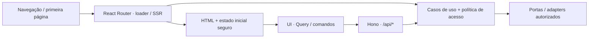

# Coletânea de bibliotecas para um futuro dashboard do Holon

## Atualização de escopo — 2026-10-04

A [investigação após Q35/Q36](#investigações-após-q35q36--2026-10-04) registra
Worker/fila de emails confirmados, limites do adapter D1 e experimento SQLite.
As recomendações anteriores de topologia síncrona foram superadas por Q36.

A [revisão completa de robustez](2026-10-04-dashboard-plan-robustness-review.md)
e o [plano de implementação](../planning/dashboard-implementation-plan.md)
completam as condições de suporte, segurança, recuperação e testes. O radar
continua uma lista de candidatos, não uma lista de dependências a instalar.

[Q31–Q34 e email Cloudflare](#sexta-rodada-onboarding-e-cloudflare-email--2026-10-04)
encerram a entrevista de produto; provas técnicas são tratadas no plano consolidado.

O [registro após a quinta rodada](#quinta-rodada-workspace-e-revogação--2026-10-04)
atualiza identidade/governança/frescor; as rodadas anteriores são preservadas
como evidência datada.

O usuário esclareceu que o dashboard é **produto para os usuários do Holon**,
sem finalidade de administração interna. A direção escolhida para aprofundar
é **React Router em Framework Mode com SSR + API Hono**, com responsabilidades
explícitas. A preferência pelo ecossistema TanStack orienta a próxima comparação.

A primeira coleta abaixo foi preservada como registro, inclusive sua
priorização SPA/API e a pergunta sobre público. Essas duas hipóteses foram
superadas pelo esclarecimento acima. A [composição híbrida](#composição-híbrida-proposta--2026-10-04)
e o [radar ampliado](#radar-ampliado--2026-10-04) registram a atualização.
A [análise dos anexos](2026-10-04-dashboard-ui-motion-references.md) relaciona
as bibliotecas às referências; o [guia de movimento](../brand/motion.md) é a
fonte normativa de animações da marca. Nada disso cria runtime ou substitui ADR.

A atualização de [packages e organização](#packages-organização-e-autenticação--2026-10-04)
registra a preferência por dependências encapsuladas, ícones Lucide e Better Auth
com Drizzle/D1. O debate Q1–Q37 foi concluído; autenticação continua sem
implementação e depende de viabilidade/recuperação comprovadas.

A [segunda rodada de engenharia](#segunda-rodada-queries-no-app-e-sse-posterior--2026-10-04)
supera a hipótese inicial de polling e a preferência por package de queries:
Query fica no app; atualização automática será adicionada via SSE depois.
Histórico/backfill não fazem parte da primeira entrega.

A [terceira rodada](#suporte-bilíngue-e-identidade-confirmados--2026-10-04)
confirmou leitura apenas, filtros, perfil/carga sintética e **pt-BR + inglês
desde o início**, com login GitHub e uso individual/organizações Holon.
A hipótese de começar somente com pt-BR foi rejeitada.

A [quarta rodada](#quarta-rodada-e-modelo-de-workspace--2026-10-04) confirmou
idioma/fuso/busca e acesso/cadastro/sessão. O modelo de Workspace foi separado
em referência própria. Governança e vínculo GitHub foram acordados em Q25–Q34;
as seções históricas preservam como as recomendações evoluíram.

## Pergunta e alcance da primeira coleta

Quais bibliotecas e composições de frontend/backend vale investigar para um
dashboard React, Tailwind e shadcn/ui no Cloudflare Workers, alinhado à marca
do Holon e a uma experiência moderna, minimalista e fluida?

Primeira coleta, verificada em **2026-10-04**, a partir de documentação oficial
e repositórios dos mantenedores. As capacidades citadas são documentadas;
as avaliações de adequação ao Holon são **inferências**, não benchmarks ou
decisões de adoção. `status: current` significa pesquisa atual nesta data,
não arquitetura aprovada. Não foram instaladas dependências, criados
workspaces, executados protótipos ou alterados recursos remotos.

O objetivo é reunir candidatos, alternativas e perguntas para aprofundamento.
Esta coleta não define telas, novas regras de motion, funcionalidades de
produto ou contratos do backend. Versões exatas, licenças dos artefatos
distribuídos e compatibilidade da composição ficam para a prova de conceito.
Links `latest` precisam ser conferidos novamente nessa etapa.

## Ponto de partida confirmado no repositório

- A [ADR-0040](../decisions/0040-retire-admin-and-analytical-storage.md)
  retirou `apps/admin`, `packages/ui`, o read model D1 e a persistência
  analítica. Não há dashboard atual a ampliar nem histórico analítico
  equivalente garantido pelo core. O retorno dessas responsabilidades exige
  nova decisão; esta coleta não reescreve a anterior.
- O [control plane](../../apps/control-plane/package.json) já depende de
  Hono e Zod. O [handler HTTP](../../apps/control-plane/src/ingress/webhook-handler.ts)
  compõe schema, health checks e webhook GitHub; isso não constitui API de
  dashboard, login humano ou autorização por organização.
- A [arquitetura de containers](../architecture/container-view.md) mantém
  o ledger por PR como autoridade funcional e o executor isolado. A UI
  não deve se tornar outro coordenador da review ou acessar o Sandbox.
- O [design system](../brand/README.md) é independente de framework:
  Semente oficial, papel mineral, tinta azul profunda, núcleo violeta,
  Manrope para UI, Instrument Serif editorial e IBM Plex Mono para código.
  Há temas claro/escuro, fontes locais, tokens semânticos e SVGs próprios.
- [Ícones](../brand/foundations.md#ícones-e-camadas) usam grade 24 × 24,
  traço 1,75 px e pontas arredondadas. As
  [diretrizes de movimento](../brand/layout-and-patterns.md#movimento)
  já têm tokens de 120/180/280 ms e preferência por continuidade discreta,
  com redução de movimento. São referências vigentes, não novas definições.
- O [manifest raiz](../../package.json) pede Node `>=24.11 <25` e
  pnpm `11.24.0`. Node é o toolchain local; o código servidor precisa ser
  compatível com Workers, não presumir um servidor Node completo.

A [pesquisa do console anterior](2026-09-04-internal-operational-console-toolchain.md)
é precedente histórico. Seus workspaces, contratos administrativos,
persistência e afirmações de performance não são fatos atuais deste
dashboard.

## SSR e API: perguntas diferentes

SSR determina **onde se produz o HTML inicial**. API determina **como a UI
consulta dados e solicita ações autorizadas**. Um dashboard SSR normalmente
continua usando React no navegador e requests depois da hidratação. Ambas
as opções precisam de backend, autenticação, validação e autorização.

Uma API pode estar no mesmo Worker e domínio do frontend; não exige serviço
externo nem CORS. Um backend de UI, ou BFF, pode concentrar sessão,
autorização e composição de dados sem copiar regras de negócio do core.
Se houver deployables separados, os
[Service Bindings](https://developers.cloudflare.com/workers/runtime-apis/bindings/service-bindings/)
permitem comunicação entre Workers. Isso é capacidade da plataforma,
não binding de dashboard já existente no Holon.

### Composições a comparar

| Composição candidata                               | Capacidade documentada                                                | Ganho possível para o Holon                                                                                       | Custo ou limite a investigar                                                                    |
| -------------------------------------------------- | --------------------------------------------------------------------- | ----------------------------------------------------------------------------------------------------------------- | ----------------------------------------------------------------------------------------------- |
| React + Vite + router + API Hono                   | Assets de SPA e endpoints JSON; integração oficial Workers            | Boa candidata para painel autenticado com tabelas, filtros e atualização frequente; backend HTTP familiar ao repo | Primeira tela de dados depende de JS e requests; verificar waterfalls, sessão e rotas profundas |
| React Router em Framework Mode + plugin Cloudflare | SSR, loaders/actions, hidratação e integração com entrypoint/bindings | Primeira candidata SSR pela integração direta documentada e composição por rota                                   | CPU de renderização, TTFB quando dados são lentos, hidratação e revalidação                     |
| TanStack Start + plugin Cloudflare                 | SSR/streaming, server functions e TanStack Router                     | Alternativa SSR para rotas/search params tipados e composição com Query                                           | Overview consultado ainda identifica Release Candidate; conferir release e APIs antes de adotar |
| Next.js via vinext                                 | Reimplementação da superfície Next.js sobre Vite para Workers         | Investigar se surgir requisito específico do ecossistema Next/RSC                                                 | Cloudflare identifica beta; conferir compatibilidade, sem presumir equivalência integral        |
| Next.js via OpenNext                               | Adapta saída do build Next.js para Workers                            | Alternativa quando houver necessidade real de Next e compatibilidade comprovada                                   | Matriz própria de suporte; guia Cloudflare consultado recomenda vinext para apps novos          |

Fontes verificadas em 2026-10-04:
[React/Vite](https://developers.cloudflare.com/workers/framework-guides/web-apps/react/),
[React Router](https://developers.cloudflare.com/workers/framework-guides/web-apps/react-router/),
[TanStack Start no Workers](https://developers.cloudflare.com/workers/framework-guides/web-apps/tanstack-start/),
[Overview do Start](https://tanstack.com/start/latest/docs/framework/react/overview),
[Next.js/vinext](https://developers.cloudflare.com/workers/framework-guides/web-apps/nextjs/),
[OpenNext no Workers](https://developers.cloudflare.com/workers/framework-guides/web-apps/opennext/)
e [Hono no Workers](https://hono.dev/docs/getting-started/cloudflare-workers).

**Discrepâncias:** resultados de busca para Next.js ainda apresentaram
OpenNext como caminho principal; as páginas Cloudflare abertas diretamente
recomendam vinext e o classificam como beta. A integração oficial de Start
não elimina o aviso de Release Candidate em seu Overview. Revalidar esses
sinais quando houver escolha de versão.

O guia React Router consultado diz que SPA mode e prerendering não são
suportados nessa integração com o plugin Cloudflare. Para SPA, orienta o
template React e o router como biblioteca. Não assumir que desligar `ssr`
no template SSR resulta na mesma composição suportada.

### Leitura preliminar para este produto

**Inferência:** para dashboard privado, interativo e sem requisito conhecido
de SEO, SPA + API é candidata forte pela simplicidade da entrega de assets.
Se primeira tela com dados, sessão no servidor e composição por rota
trouxerem ganhos concretos, React Router SSR merece a primeira prova, com
TanStack Start como comparação. A escolha permanece aberta.

SSR pode retirar uma etapa do caminho HTML → JS → request de dados, mas
pode atrasar o HTML enquanto espera consultas. SPA pode servir o shell
rapidamente e ainda demorar para mostrar informação útil. Ambos precisam de
paginação, cancelamento de consultas obsoletas, pré-carregamento criterioso e
estabilidade de layout. Fluidez depende sobretudo do trabalho no navegador
e da continuidade dos estados, não da escolha de SSR.

Não há evidência para declarar uma opção “a mais performática” no Holon.
Uma futura comparação deve usar a mesma lista de reviews e detalhe de PR,
com os mesmos dados, autenticação e latência, medindo:

- Tempo até informação útil e TTFB, no acesso inicial e navegação subsequente.
- JS transferido/comprimido por rota, hidratação e tarefas longas.
- Responsividade durante filtros, painéis e atualização de dados.
- CPU por request Workers, consultas e comportamento sob carga.
- Isolamento entre usuários/organizações em cache, SSR e consultas.

## React, Tailwind e shadcn como base

[shadcn/ui](https://ui.shadcn.com/docs) distribui código de componentes que o
projeto passa a manter. Sua
[instalação](https://ui.shadcn.com/docs/installation) contempla Vite,
React Router e TanStack Start; não obriga Next.js. Isso favorece adaptar
componentes ao Holon, com a responsabilidade de revisar código copiado e
atualizações upstream.

O catálogo atual expõe variantes com Base UI, Radix UI e React Aria. Comparar
primitivas por teclado, foco, overlays, composição e SSR, além da aparência.

| Camada                  | Candidato                                                                          | O que investigar                                                                       |
| ----------------------- | ---------------------------------------------------------------------------------- | -------------------------------------------------------------------------------------- |
| Estilos                 | [Tailwind CSS, tema via CSS](https://tailwindcss.com/docs/theme)                   | Mapear utilitários aos tokens Holon; preservar uma fonte de verdade para valores/temas |
| Componentes             | shadcn/ui                                                                          | Trazer os necessários e adaptar fontes, cores, espaçamento, forma e estados ao kit     |
| Primitivas              | [Base UI](https://base-ui.com/react/overview/about)                                | Primeira alternativa de controles headless; conferir implementação shadcn escolhida    |
| Primitivas alternativas | [Radix Primitives](https://www.radix-ui.com/primitives/docs/overview/introduction) | Comparar cobertura e integração; evitar duas implementações do mesmo controle          |

A [integração de marca](../brand/implementation.md) já descreve consumo de
CSS, fontes e tokens. shadcn é matéria-prima: seus defaults não substituem a
identidade. Esta pesquisa não cria `packages/ui` nem exige pacote separado
para poucos componentes internos.

## Ícones: compatibilidade com a identidade

| Opção                                                     | Capacidade confirmada                                                              | Avaliação para o Holon                                                                           |
| --------------------------------------------------------- | ---------------------------------------------------------------------------------- | ------------------------------------------------------------------------------------------------ |
| [Lucide React](https://lucide.dev/guide/react)            | SVG inline, tamanho/cor/traço configuráveis e imports individuais com tree shaking | **Primeiro candidato.** Ajustar `strokeWidth` a 1,75 e comparar peso óptico com SVGs próprios    |
| [Phosphor React](https://github.com/phosphor-icons/react) | Pesos thin/light/regular/bold/fill/duotone e import para SSR                       | Alternativa com mais variações; os pesos não equivalem automaticamente ao traço do kit           |
| [Octicons](https://primer.style/octicons/)                | Iconografia do ecossistema GitHub                                                  | Vocabulário familiar para PRs; comparar geometria/tamanhos antes de usar como conjunto principal |
| [SVGs próprios](../brand/assets/README.md)                | Conjunto inicial já alinhado ao design system                                      | Manter marca e desenhos específicos; avaliar extensão sem inconsistência perceptível             |

“Combina melhor” é avaliação visual, ainda sem prancha comparativa. Lucide
é a primeira hipótese pela configuração de traço e linguagem linear. A prova
deve colocar busca, cópia, seta, PR, branch, status e ajustes em 16/20/24 px
ao lado dos ícones oficiais. Nome acessível é responsabilidade do controle.

## Gráficos: selecionar pela pergunta e pelo volume

| Opção                                                                                  | Perfil documentado                                     | Onde pode servir                                                      | Custo ou limite a investigar                                                                      |
| -------------------------------------------------------------------------------------- | ------------------------------------------------------ | --------------------------------------------------------------------- | ------------------------------------------------------------------------------------------------- |
| [Recharts + Chart do shadcn](https://ui.shadcn.com/docs/components/base/chart)         | Composição React; Chart atual usa Recharts 3           | Primeiro candidato para tendências, barras por estado e comparações   | Altura inicial, hidratação, animação em refresh e volume representativo de pontos                 |
| [Apache ECharts](https://echarts.apache.org/handbook/en/best-practices/canvas-vs-svg/) | Renderização Canvas ou SVG                             | Heatmaps, exploração mais complexa e séries densas quando necessárias | Ciclo de vida React, módulos e comparação dos renderers com dados reais                           |
| [visx](https://github.com/airbnb/visx)                                                 | Primitivas de visualização React baseadas em D3        | Visualizações específicas do domínio com controle de composição       | Mais trabalho de eixos/interações/acessibilidade; não é atalho para gráficos comuns               |
| [Nivo](https://nivo.rocks/)                                                            | Catálogo React/D3 com Sankey, calendário, treemap etc. | Explorações que esses formatos esclareçam                             | Conferir renderer, SSR e customização por componente, não adotar só pela variedade                |
| [uPlot](https://github.com/leeoniya/uPlot)                                             | Séries temporais com Canvas                            | Candidato especializado para muitas amostras temporais                | Integração React, interação e acessibilidade; benchmarks upstream não provam performance no Holon |

Chart do shadcn é composição sobre Recharts, não motor concorrente.
Recharts 3 documenta
[acessibilidade ligada por padrão](https://github.com/recharts/recharts/blob/main/storybook/stories/API/Accessibility.mdx),
mas isso não certifica o gráfico final. ECharts documenta
[ARIA e padrões adicionais](https://echarts.apache.org/handbook/en/best-practices/aria/)
e [imports modulares](https://echarts.apache.org/handbook/en/basics/import/).

**Inferência:** avaliar Recharts primeiro e guardar ECharts para necessidades
comprovadas é mais útil que instalar vários motores. Séries, unidades,
rótulos, resumo textual e dados equivalentes precisam responder à pergunta
do gráfico e à marca. Distinguir zero ocorrências de ausência de dados;
não completar histórico inexistente.

## Movimento e transições

A intenção fornecida é continuidade, sutileza e ausência de mudanças bruscas.
Esta seção reúne mecanismos; o desenho das animações fica para outra etapa.

| Opção                                                                                       | Capacidade                                 | Papel possível                                                                  | Limitação a avaliar                                                                        |
| ------------------------------------------------------------------------------------------- | ------------------------------------------ | ------------------------------------------------------------------------------- | ------------------------------------------------------------------------------------------ |
| CSS e APIs nativas                                                                          | Transições/animações do navegador          | Hover, foco e feedback simples com tokens existentes                            | Presença/saída coordenada e continuidade de layout podem exigir orquestração               |
| [Motion for React](https://motion.dev/docs/react), pacote `motion`                          | Presença/saída, gestos, variantes e layout | **Primeiro candidato** para painéis, troca de contexto e elementos relacionados | Imports, trabalho por frame, foco durante saída e defaults de spring                       |
| [React Spring](https://www.react-spring.dev/)                                               | Animações orientadas a molas               | Comparação para interação em que resposta física faça sentido                   | Evitar oscilação excessiva e dois motores no mesmo componente                              |
| [Anime.js](https://animejs.com/documentation/)                                              | JavaScript, SVG e timelines                | Sequências específicas além do uso cotidiano de componentes                     | Coordenação com montagem/desmontagem React; sem requisito atual que a imponha              |
| [View Transition API](https://developer.mozilla.org/en-US/docs/Web/API/View_Transition_API) | Transições por snapshots do navegador      | Continuidade entre rotas como melhoria progressiva                              | Suporte de browsers, foco e interação com Motion; evitar animar a mesma mudança duas vezes |

Motion documenta [redução de bundle](https://motion.dev/docs/react-reduce-bundle-size)
e [reduced motion](https://motion.dev/docs/react-accessibility).
Com `LazyMotion`, `domAnimation` cobre presença e gestos básicos; layout/drag
requer `domMax`. Medir o build e os imports reais, sem transportar tamanhos
promocionais para esta composição. Alguns exemplos de acessibilidade ainda
usam imports `framer-motion`, enquanto o guia atual usa `motion/react`;
isso não é motivo para instalar dois pacotes.

**Inferência:** CSS para interações simples e Motion para continuidade de
componentes é a primeira combinação a testar. Springs não asseguram sutileza;
avaliar duração, deslocamento e interrupção nas telas. A
[referência W3C](https://www.w3.org/WAI/WCAG22/Understanding/animation-from-interactions.html)
também ajuda a avaliar movimento acionado por interação.

Fluidez depende de manter tamanho, foco e contexto quando dados mudam.
Preservar uma lista durante atualização, reservar espaço para gráficos e
não remontar o shell a cada filtro podem contribuir mais que efeitos extras.
Não são criadas novas curvas, durações ou animações neste documento.

## Bibliotecas para funcionalidades prováveis

Funcionalidades são hipóteses para mapear dependências, não backlog aprovado.
“Candidato” significa merece avaliação quando houver aquele fluxo.

### Dados, filtros e controles

| Necessidade possível                         | Biblioteca ou mecanismo                                                                                                                                     | Avaliação e fronteira                                                                                           |
| -------------------------------------------- | ----------------------------------------------------------------------------------------------------------------------------------------------------------- | --------------------------------------------------------------------------------------------------------------- |
| Consultas, cache e atualização em background | [TanStack Query](https://tanstack.com/query/latest/docs/framework/react/overview)                                                                           | Forte candidato na SPA; em SSR, delimitar loaders/Query para evitar consultas e caches duplicados               |
| PRs/findings com ordenação e filtros         | [TanStack Table](https://tanstack.com/table/latest/docs/overview)                                                                                           | Engine headless, com controle do markup; filtro e paginação no servidor continuam necessários conforme escala   |
| Muitas linhas ou itens visíveis              | [TanStack Virtual](https://tanstack.com/virtual/latest/docs/introduction)                                                                                   | Após medir; virtualização não reduz dados consultados e exige atenção a foco, altura e busca do navegador       |
| Grade com comportamento de planilha          | [AG Grid Community/Enterprise](https://www.ag-grid.com/react-data-grid/community-vs-enterprise/)                                                            | Se recursos avançados virarem requisitos; separar funcionalidades gratuitas/comerciais e custo de estilização   |
| Filtros compartilháveis e voltar/avançar     | Search params do router ou [nuqs](https://nuqs.dev/docs/installation)                                                                                       | nuqs tem adapters React Router/TanStack Router; pode ser redundante com router escolhido                        |
| Formulários de configuração                  | [React Hook Form](https://github.com/react-hook-form/react-hook-form) ou [TanStack Form](https://tanstack.com/form/latest/docs/overview), com Zod existente | Comparar campos condicionais, async, mensagens/reset; uma opção por fluxo. Validação UI não concede autorização |
| Estado compartilhado do shell                | React state/context; [Zustand](https://github.com/pmndrs/zustand) se necessário                                                                             | Preferências/painéis; evitar duplicar estado de servidor ou criar singleton compartilhado entre usuários em SSR |
| Busca rápida e ações por teclado             | [Command do shadcn](https://ui.shadcn.com/docs/components/base/command) / [cmdk](https://github.com/dip/cmdk)                                               | Navegar para PR/repositório e ações permitidas; Command já usa cmdk, não são dois menus distintos               |
| Feedback breve de ação                       | [Sonner](https://sonner.emilkowal.ski/)                                                                                                                     | Toasts discretos; falhas relevantes também precisam permanecer junto da ação/conteúdo                           |
| Reordenar preferências                       | [dnd kit](https://dndkit.com/)                                                                                                                              | Se virar funcionalidade; prever teclado, cancelamento e persistência autorizada                                 |
| Busca aproximada em conjuntos pequenos       | [Fuse.js](https://www.fusejs.io/)                                                                                                                           | Busca local em dados já autorizados; não substitui índice/autorização da busca global                           |
| Idiomas e formatação                         | `Intl` nativo; [i18next](https://www.i18next.com/) para múltiplos idiomas                                                                                   | Começar por datas, números e fuso explícitos; tradução de mensagens é outro requisito                           |

**Discrepância de versões:** Overview atual do TanStack Table apresenta v9,
enquanto referências antigas usam v8. Conferir engine e exemplo shadcn antes
de copiar Data Table; não combinar APIs de versões diferentes.

### Código, evidências e execução

| Necessidade possível          | Candidatos                                                                                                              | Avaliação e fronteira                                                                                                            |
| ----------------------------- | ----------------------------------------------------------------------------------------------------------------------- | -------------------------------------------------------------------------------------------------------------------------------- |
| Trechos de evidência          | [Shiki](https://shiki.style/guide/)                                                                                     | Highlight; avaliar servidor/build versus navegador, linguagens incluídas e custo por trecho                                      |
| Diferenças por arquivo        | [react-diff-view](https://github.com/otakustay/react-diff-view) ou [diff2html](https://diff2html.xyz/)                  | Unified/split, linhas, comentários e arquivos grandes; não autoriza reter/expor diffs privados                                   |
| Editor de configuração        | [CodeMirror](https://github.com/codemirror/dev)                                                                         | Só se edição textual com diagnósticos for necessária; formulário e preview podem bastar                                          |
| Resumo/finding em Markdown    | [react-markdown](https://github.com/remarkjs/react-markdown)                                                            | HTML bruto, plugins e URLs precisam de política para conteúdo não confiável                                                      |
| Fases/dependências da review  | [React Flow](https://reactflow.dev/)                                                                                    | Se grafo esclarecer relações; timeline/lista pode explicar melhor fluxo linear                                                   |
| Estado da execução atualizado | Polling com Query; [SSE/EventSource](https://developer.mozilla.org/en-US/docs/Web/API/Server-sent_events) se necessário | Polling é primeira hipótese simples; SSE é servidor → navegador. Reconexão, autorização e ressincronização precisam de contratos |

WebSocket merece avaliação quando houver comunicação bidirecional contínua.
Agents SDK no core não justifica expor conversa ou ledger ao navegador.
Polling, SSE e WebSocket não criam dados ou progresso mensurável por si só.

Lista de runs, detalhe com completude/findings, estado por shard, feedback e
configuração precisam de fonte, permissão, frescor e retenção. Consultar o
[ciclo de vida dos dados](../architecture/data-lifecycle.md) antes de um
viewer privado. Custos, taxas históricas e tempos por etapa não podem ser
presumidos a partir das reservas funcionais do modelo.

### Autenticação, backend e persistência

| Necessidade possível          | Opções a investigar                                                                                                                                                  | O que falta decidir                                                                                   |
| ----------------------------- | -------------------------------------------------------------------------------------------------------------------------------------------------------------------- | ----------------------------------------------------------------------------------------------------- |
| Console para operadores       | [Cloudflare Access com validação JWT](https://developers.cloudflare.com/cloudflare-one/access-controls/applications/http-apps/authorization-cookie/validating-json/) | Audiência, identidade e permissões; Access não cria tenancy de produto                                |
| Clientes/organizações         | [Better Auth](https://better-auth.com/docs/installation)                                                                                                             | Login, sessão, memberships/revogação; Workers + adapter escolhido precisa de prova específica         |
| Endpoints da UI               | [Hono](https://hono.dev/docs/getting-started/cloudflare-workers), já presente                                                                                        | Fronteira BFF, contratos Zod, paginação/erros/autorização; regras do core permanecem no core          |
| Índice/histórico do dashboard | [D1](https://developers.cloudflare.com/d1/) como candidato                                                                                                           | Read model, schema/projeção/índices/retenção/isolamento; não restaurar automaticamente banco anterior |
| Acesso tipado a eventual D1   | [Drizzle para D1](https://orm.drizzle.team/docs/sqlite/connect-cloudflare-d1) ou SQL explícito                                                                       | Necessidade real e semântica de queries/migrations; ORM não determina arquitetura                     |

Better Auth documenta [adapter Drizzle](https://better-auth.com/docs/adapters/drizzle)
e Drizzle documenta D1. Isso não prova a composição completa em Workers nem
resolve permissões por organização. A URL procurada de integração Cloudflare
do Better Auth não retornou documentação acessível; não é evidência de
suporte. Autenticação permanece condicionada ao público do dashboard.

Uma SPA com requests mantém credenciais GitHub no backend. SSR também exige
decidir quais dados entram no HTML e hidratação. Ambas precisam de autorização
por recurso, proteção de mutações e cache privado explícitos. Não há demanda
demonstrada por tRPC, GraphQL ou novo framework HTTP além de Hono nesta coleta.

### Qualidade da experiência

| Necessidade                     | Candidato                                         | Evidência esperada na implementação                                                                                    |
| ------------------------------- | ------------------------------------------------- | ---------------------------------------------------------------------------------------------------------------------- |
| Navegação/sessão                | [Playwright](https://playwright.dev/docs/intro)   | Rotas profundas, voltar/avançar, filtros, teclado e sessão expirada em browsers-alvo                                   |
| Acessibilidade automatizada     | [axe-core](https://github.com/dequelabs/axe-core) | Problemas automatizáveis; complementar teclado/leitor de tela, sem declarar conformidade só pelo resultado             |
| Contratos/comportamento Workers | Vitest/plugin Cloudflare existente                | API, autorização, validação, falhas e idempotência seguindo o [guia de testes](../engineering/testing-and-evidence.md) |

## Primeira lista para aprofundar

Priorização como **hipótese de pesquisa**, não lista de instalação:

| Área              | Primeira avaliação                                  | Alternativa ou comparação                             |
| ----------------- | --------------------------------------------------- | ----------------------------------------------------- |
| Base UI           | React + Tailwind + shadcn adaptado aos tokens Holon | Base UI/Radix nos controles necessários               |
| Entrega           | SPA Vite + API Hono                                 | React Router SSR; TanStack Start como comparação      |
| Ícones            | Lucide + assets oficiais                            | Phosphor; Octicons pelo vocabulário GitHub            |
| Gráficos comuns   | Recharts + Chart do shadcn                          | ECharts por demanda de volume/formato                 |
| Movimento         | CSS + Motion for React                              | React Spring/APIs nativas em necessidades específicas |
| Consultas/listas  | Query + Table conforme fluxos                       | Virtual após medir; AG Grid para demanda de planilha  |
| Formulários       | React Hook Form + Zod existente                     | TanStack Form                                         |
| Código/diferenças | Shiki + comparar viewers de diff                    | CodeMirror apenas se houver edição                    |

Os demais candidatos ficam ligados aos fluxos que os justificam. Não é
necessário instalar store, biblioteca de datas, engine de drag, viewer de diff
e cliente real-time para explorar uma lista de reviews.

## Questões abertas e próxima coleta

1. **Público:** operador, cliente ou ambos? Isso muda autenticação, tenancy e
   contratos, mais que SSR.
2. **Perguntas do painel:** reviews, configuração, qualidade, custos ou
   operação? Mapear dados ao que existe ou precisaria ser coletado.
3. **Volume/frescor:** quantos repositórios/runs/findings e qual frequência
   de atualização? Orienta paginação, gráficos e polling.
4. **Conteúdo privado:** quais evidências, por quem e por quanto tempo?
   Viewer de código e exportação dependem dessas respostas.
5. **Compatibilidade:** versões exatas, peer dependencies, React/SSR/Workers,
   releases, licenças e transitivas. Blocks comerciais/recursos premium
   exigem avaliação separada do core OSS.
6. **Prova comparável:** lista/detalhe iguais em SPA/API e SSR, primeiro com
   dados sintéticos. Navegação, hidratação, CSP, reduced motion, foco, mobile
   e atualização sem saltos, além das métricas descritas.
7. **Decisão posterior:** novo ADR/plano antes de reintroduzir dashboard,
   contratos de leitura ou persistência.

Essas perguntas não bloqueiam a coleta. Delimitam o que as fontes ainda não
respondem e permitem aprofundar sem confundir capacidade de biblioteca com
necessidade de produto.

## Composição híbrida proposta — 2026-10-04

Direção acordada para pesquisa: React Router SSR e Hono, com TanStack Query
nos dados interativos. É proposta de composição para o produto, não ADR aceito
nem API de usuários já disponível. SSR e API são adaptadores de entrada para
os mesmos casos de uso; não são dois backends com regras próprias.

| Camada                               | Responsabilidade proposta                                                                                                         | Limite                                                                                      |
| ------------------------------------ | --------------------------------------------------------------------------------------------------------------------------------- | ------------------------------------------------------------------------------------------- |
| React Router Framework Mode          | Rotas, layouts, HTML inicial, bootstrap da sessão, dados necessários à primeira renderização, erros/navegação de página           | Loaders finos; sem regras de negócio, acesso ad hoc a storage ou canal paralelo de mutações |
| Hono em `/api/*`                     | Leituras de recursos, filtros/paginação, mutações, validação de requests e respostas; transporte de atualização quando necessário | Não renderiza telas nem coordena reviews; contratos explícitos e autorização por recurso    |
| Casos de uso e portas compartilhados | Política de acesso, composição de leitura, comandos e regras do produto; adapters de persistência                                 | Mesma regra para loader/API; domínio puro, sem React, HTTP ou Query                         |
| React no navegador                   | Renderização interativa, seleção/disclosure, formulários e animação                                                               | Estado local de UI não é autoridade do estado de execução                                   |
| TanStack Query                       | Cache e atualização dos datasets interativos explicitamente atribuídos a ele                                                      | Não duplicar o mesmo dataset em loader, store e cache independentes                         |

O loader e o handler API consultam a mesma aplicação. Quando estiverem no
mesmo Worker, usar chamada interna ao caso de uso, sem HTTP de loopback. Se
forem deployables separados, a fronteira será explícita por binding/contrato;
ainda não há motivo demonstrado para criar outro serviço. Um único entrypoint
pode despachar `/api/*` para Hono e as rotas de página para React Router;
a integração de build/runtime deve ser provada antes da implementação.

### Regra prática de leitura e atualização

Para uma lista/detalhe de revisões, o loader prepara sessão, metadados da rota
e um snapshot autorizado do dataset necessário à primeira exibição. Esse
snapshot hidrata o cache Query; após hidratação, filtros, paginação, refetch e
atualização daquele dataset passam por `/api/*`. URL é a autoridade dos filtros
compartilháveis; Query keys incluem os mesmos parâmetros e o escopo de acesso.

Loaders do React Router também executam em navegações/revalidações posteriores,
não apenas ao produzir HTML. Definir por rota quando semear o cache e quando
reutilizar o dataset já disponível; configurar essa navegação conscientemente.
Não executar fetch pelo loader e por Query em paralelo para os mesmos dados.
Metadados de página podem continuar exclusivos do loader.
[Fonte: carregamento no React Router](https://reactrouter.com/start/framework/data-loading).

Criar QueryClient **por request servidor**, serializar apenas dados autorizados
e necessários, preservar timestamp do snapshot e definir `staleTime` conforme
frescor para evitar refetch imediato involuntário. Nunca usar cache singleton
servidor entre usuários. Troca de organização/logout cancela requests e limpa
o cache do escopo anterior; query key não substitui autorização no servidor.
[Fonte: SSR e hidratação do Query](https://tanstack.com/query/latest/docs/framework/react/guides/ssr).

Mutações de recursos seguem um único caminho público, `/api/*`. Para esta
composição, não criar React Router actions com comandos concorrentes aos
handlers Hono. Se houver futura necessidade de progressive enhancement com
actions, documentar um adapter fino para o mesmo comando e uma única política
de revalidação. Invalidar a query afetada ou atualizar pelo retorno confirmado;
não disparar refetch Query e revalidação global de loaders sem necessidade.
[Fonte: actions](https://reactrouter.com/start/framework/actions).

Autenticação/sessão é infraestrutura compartilhada; a política de autorização
por usuário/organização/repositório aplica-se em **ambas** as entradas e em
cada recurso. SSR não torna a API confiável. Dados privados não entram em
cache público de HTML; cookies, proteção CSRF em mutações com cookie e erros
seguem contratos explícitos. Não duplicar verificações como regras divergentes
nem confiar no filtro do navegador.
[Fonte: validação Hono](https://hono.dev/docs/guides/validation).

Essa separação concentra transporte/validação nas bordas e regra em módulos
compartilhados, seguindo o [grafo vigente](../architecture/technical-ecosystem.md).
Login humano, tenancy, read model/histórico e autorização de novos comandos
continuam questões de produto/arquitetura antes de disponibilizar o dashboard.
Não se trata de restaurar o admin da ADR-0040.

## Radar ampliado — 2026-10-04

Capacidades verificadas em fontes oficiais nesta data; indicação de prioridade
é avaliação do Holon. Nenhuma biblioteca adicional foi instalada.

| Candidato                                                               | Quando acrescenta valor                                                     | Prioridade e restrição                                                                                                                              |
| ----------------------------------------------------------------------- | --------------------------------------------------------------------------- | --------------------------------------------------------------------------------------------------------------------------------------------------- |
| [TanStack Form](https://tanstack.com/form/latest/docs/overview)         | Configuração e feedback com validação tipada e estado por campo             | Primeira comparação para formulários, junto de React Hook Form; evitar dois gerenciadores no mesmo formulário                                       |
| [TanStack Pacer](https://tanstack.com/pacer/latest/docs/overview)       | Debounce de busca/filtros, batching e controle de frequência de interação   | Condicional; beta. Cancelar tarefas ao mudar contexto; não é rate limiting de segurança no servidor                                                 |
| [TanStack Hotkeys](https://tanstack.com/hotkeys/latest/docs/overview)   | Command palette e atalhos de navegação/ações                                | Radar v0; escopo e conflitos com digitação/modal precisam de validação; atalhos têm alternativa visível                                             |
| [TanStack Store](https://tanstack.com/store/latest/docs/overview)       | Estado de UI compartilhado que exceda hooks/context                         | Radar v0; não copiar dados remotos já pertencentes ao Query                                                                                         |
| [TanStack DB](https://tanstack.com/db/latest/docs/overview)             | Coleções normalizadas, consultas locais entre coleções e mutações otimistas | Radar v0; considerar com necessidade real de sincronização/consultas locais. Não é banco Workers nem substitui autorização/persistência do servidor |
| [TanStack Devtools](https://tanstack.com/devtools/latest/docs/overview) | Agregar inspeção e ferramentas durante desenvolvimento                      | Alpha; excluir do produto público e não expor payload privado em plugins/logs                                                                       |
| [TanStack Charts](https://tanstack.com/charts/v0)                       | Gramática de gráficos tipada, SVG/Canvas, composição e motion               | Alpha; comparar com Recharts em um gráfico real; [política](https://tanstack.com/charts/latest/docs/stability) permite quebra em minor antes de 1.0 |
| [NumberFlow](https://number-flow.barvian.me/)                           | Troca de dígitos conforme R1, com timing configurável                       | Opcional; respeitar movimento reduzido, CSP e limitações RTL/locale; alternativa estática suficiente                                                |

Query, Table e Virtual permanecem complementares a React Router. Form ganha
prioridade na comparação pela preferência do usuário. TanStack Router/Start
continuam alternativas de arquitetura para confronto futuro; não instalar
outro router sobre React Router nem chamar isso de complemento.

Dnd-kit e React Flow já mapeados continuam condicionados a reordenação manual
e relações navegáveis. Shiki/viewer de diff têm relação direta com evidência
de PR; um editor de código completo só se houver edição real. Bibliotecas
novas devem simplificar um fluxo nomeado, não tornar o ecossistema obrigatório.

## Packages, organização e autenticação — 2026-10-04

O responsável definiu a preferência por concentrar bibliotecas externas em
packages do Holon e consumir interfaces próprias nos apps. React, React Router
e composição HTTP são exceções core; outras exceções devem ser delimitadas e
justificadas. Encapsular comportamento e política, não fazer apenas reexports.

A [referência de engenharia](../engineering/frontend-application-structure.md)
descreve `ui`, `auth`, `db` e contratos, os critérios para um package cliente,
e o arranjo rota/feature com arquivos privados próximos. Tabelas, gráficos,
motion e ícones ficam preferencialmente atrás dos componentes Holon; app compõe
páginas. Ela registra propostas, não adiciona workspaces ou muda o grafo vigente.

**Lucide passa a ser a preferência para ícones funcionais existentes.** SVGs
autorais só suprem necessidades não atendidas e devem acompanhar a linguagem do
conjunto. Isso corrige a leitura de que o conjunto autoral seria a base obrigatória.
A [política ativa](../brand/foundations.md#ícones-e-camadas) mantém o traço Holon
uniforme e distingue assinatura Semente de iconografia funcional.

**Better Auth + Drizzle/D1 é a direção escolhida para autenticação**, não mais
apenas um candidato genérico. Os detalhes ainda precisam ser debatidos; o
responsável explicitamente pediu **não implementar autenticação nesta etapa**.
A [descoberta de autenticação](2026-10-04-dashboard-authentication-discovery.md)
lista decisões pendentes, versões/adapter a conferir e a separação entre login,
autorização de repositório e instalação da GitHub App. O uso de D1 para identidade
não aprova um read model analítico nem altera o ledger de execução.

## Primeira rodada de engenharia confirmada — 2026-10-04

O responsável confirmou lista/detalhe por repositório autorizado como primeira
entrega, com estados atuais e filtros básicos. `apps/dashboard` terá um Worker
próprio, com React Router SSR e Hono API juntos, separado do control plane.
Suporte browser/WCAG 2.2 AA e prova bloqueante foram acordados; consulte o
[registro da entrevista](../planning/dashboard-engineering-decision-review.md)
e os [critérios de qualidade](../engineering/testing-and-evidence.md#dashboard-critérios-acordados-para-implementação-futura).

Isso confirma a composição antes proposta; índice de leitura, detalhes,
frescor, integração Query e cadência de testes ainda estão em debate.
Nenhum workspace, adapter, autenticação ou recurso remoto foi criado.

## Segunda rodada: queries no app e SSE posterior — 2026-10-04

O responsável respondeu Q5–Q11 no
[registro de engenharia](../planning/dashboard-engineering-decision-review.md).
Q5 delegou o desenho à performance D1/Cloudflare: a escolha técnica inicial é
projeção D1 mínima indexada/paginada para lista e detalhe agregado autoritativo
via core/DO. Reduz fan-out e duplicação; não é benchmark nem garantia de menor
latência absoluta. Interfaces, revisão/entrega durável e validação permanecem
futuras. Metadados título/autor/link foram aprovados; sem GET GitHub por linha.

**Histórico de execuções anteriores e backfill ficam fora da primeira entrega.**
Não apagar o lifecycle funcional do ledger nem mostrar achados de head anterior
como resultado do atual. Não construir dashboard analítico.

**TanStack Query fica no app**, com keys/options/hooks no módulo dono da feature
ou rota privada; packages mantêm contratos e integrações úteis, sem um package
cliente obrigatório. Isso corrige a recomendação de Q9 da rodada anterior.

**Sem atualização automática agora:** abertura/navegação/filtros/paginação e
refresh manual; sem polling, refetch por foco/reconexão ou montagem duplicando
snapshot hidratado. Configurar os
[defaults de Query](https://tanstack.com/query/latest/docs/framework/react/guides/important-defaults),
conferidos em 2026-10-04, e testar os gatilhos. A projeção no servidor continua
recebendo mudanças. **SSE entra depois**, com autorização, eventos/revisões,
ordenação, reconexão e ressincronização. Não adotar a meta anterior de 5 s.

DOM + browser e matriz crítica por PR/ampla pré-publicação foram confirmados;
a [política de teste](../engineering/testing-and-evidence.md#dashboard-direção-de-teste-após-q8q10q11)
registra a composição derivada e os limites. Nenhuma biblioteca/runtime de
dashboard ou autenticação foi implementada nesta etapa.

## Suporte bilíngue e identidade confirmados — 2026-10-04

Q12–Q18 foram respondidas no
[registro de engenharia](../planning/dashboard-engineering-decision-review.md).
A primeira entrega é leitura de reviews, com filtros repo/estado/número+título
e atividade recente primeiro. Desktop comum/mobile intermediário e conexão
limitada orientam a prova; fixture de 10.000 PRs indexados por repo, páginas
de 50 e detalhe com 200 achados/textos extensos é cenário, não limite de produto.

**pt-BR e inglês entram juntos**, com catálogos completos, extração/validação,
plurais/Intl, acessibilidade e mesma escolha SSR/hidratação. Não traduzir conteúdo
de review por trocar a UI; o contrato vigente de revisão conserva seus idiomas.
Login GitHub e uso individual/organizações Holon foram confirmados; acesso,
admissão e sessão permanecem em debate, sem implementação.

### Radar de internacionalização

Fontes primárias conferidas em **2026-10-04**; prioridade é avaliação do Holon.

| Candidata                                             | Capacidades documentadas                                                            | Avaliação e prova pendente                                                                                                     |
| ----------------------------------------------------- | ----------------------------------------------------------------------------------- | ------------------------------------------------------------------------------------------------------------------------------ |
| [Lingui](https://lingui.dev/introduction)             | ICU, extração, catálogos compilados e pseudolocalização; `setupI18n` cria instância | Primeira candidata pelo fluxo integrado de catálogos completos. Provar React Router/Workers/build/macros antes de fixar versão |
| [react-i18next](https://react.i18next.com/latest/ssr) | SSR com instância por request e hidratação; ecossistema de extração/ICU             | Alternativa válida; comparar integração real. Não afirmar ausência de ICU, extração ou SSR                                     |

SSR não usa o singleton default mutável; cada request recebe locale/catálogo
próprios. CLI/compilador são tooling de build. Provider/formatters podem formar
integração compartilhada útil; mensagens ficam por capacidade e extractors
precisam reconhecer os imports/macros reais.
[API Lingui](https://lingui.dev/ref/core), [SSR i18next](https://react.i18next.com/latest/ssr),
[ICU i18next](https://react.i18next.com/misc/using-with-icu-format),
[extração i18next](https://www.i18next.com/overview/plugins-and-utils).

Lingui 6 documenta `check sync` e `check missing --mode catalog`;
`compile --strict` considera fallback, portanto não basta para completude
bilíngue. Validar a versão adotada, sem instalar ou alterar o lint atual.
[CLI](https://lingui.dev/ref/cli). Matriz crítica bilíngue e carga/perfil estão
na [política de prova](../engineering/testing-and-evidence.md#dashboard-bilinguismo-e-carga-de-referência-acordados).
Escolha/fallback de idioma e fuso estão em Q19/Q20; não foram assumidos.

## Quarta rodada e modelo de workspace — 2026-10-04

Q19–Q24 foram acordadas: preferência pessoal → navegador → inglês, fuso pessoal
com UTC até conhecê-lo, busca número exato/título contém termo sem distinção
de caixa/acentos, interseção privada, cadastro aberto com pessoal vazio e
sessão móvel 7 dias/renovação após 24 h. Biblioteca de i18n, mecanismo de busca,
cache de auth e schemas continuam sem implementação/prova.

O responsável propôs provider/SSO para login e workspaces com N usuários. O
[modelo proposto](../engineering/dashboard-identity-and-workspaces.md) distingue
pessoa, identidades externas, Session, Workspace, membership N:M e conexão
GitHub. Better Auth oferece user/account/organization, mas não fornece por
isso isolamento dos recursos do Holon. Governança, pessoal/equipe e cardinalidade
de instalação estão em Q25–Q30; não ativar Teams/SSO corporativo só pelo termo.

## Quinta rodada: workspace e revogação — 2026-10-04

Q25–Q30 foram confirmadas. Organização/workspace são o mesmo conceito;
pessoal exclusivo e equipe compartilham a entidade, com memberships N:M e
papéis owner/member por workspace. Criação de equipe é aberta a usuário
admitido; entrada por convite explícito para identidade autenticada alvo.
Várias instalações podem integrar um workspace, cada instalação em um único
workspace inicialmente. Conexão não concede grants privados por si.

Sessão/membership locais são revalidadas na próxima request, sem cookie cache
de sessão. Grants GitHub em cache por até 60 s e invalidação por eventos
recebidos; desconhecido/expirado sem confirmação não autoriza leitura.
Better Auth segue a direção escolhida, com integração física não implementada;
seus defaults/plugins não substituem a política acordada.

O [modelo atualizado](../engineering/dashboard-identity-and-workspaces.md)
registra essas respostas. A fronteira restante é convite, ownership,
autoridade de vínculo e fatia de onboarding; não reabrir Query no app,
SSR/API, bilinguismo, busca ou papéis já confirmados. As provas técnicas
não representam novas funcionalidades aprovadas por inferência.

## Sexta rodada: onboarding e Cloudflare email — 2026-10-04

Q31–Q34 foram confirmadas: conexão por owner Holon + titular pessoal/owner GitHub
da org, convite por email verificado com envio Cloudflare, múltiplos owners
preservando o último e onboarding self-service mínimo na primeira entrega.
A leitura de reviews mantém o escopo anterior; governança tem comandos próprios.

Cloudflare **Email Sending** foi escolhido para convites, com adapter servidor
na composição auth. A API Workers documentada dispensa SDK adicional para envio
nativo; nome do binding `send_email` não distingue por si as modalidades.
Não criar package separado para email sem necessidade de fronteira reutilizável.
[Workers API](https://developers.cloudflare.com/email-service/api/send-emails/workers-api/),
verificada em **2026-10-04**.

O serviço permanece em beta; convites a novos destinatários exigem Workers Paid
e domínio configurado. A [pesquisa de auth](2026-10-04-dashboard-authentication-discovery.md#cloudflare-email-sending-condições-e-discrepância--2026-10-04)
registra fontes, preço, quotas e divergência entre páginas de bindings/limites.
Conta, domínio e entrega não foram validados; nenhum email foi enviado.

A entrevista de produto está concluída. O [plano técnico](../planning/dashboard-engineering-decision-review.md#plano-técnico-de-provas-antes-da-implementação)
registra combinação de versões, D1, contratos e provas. Escolha de tecnologia
não instala bibliotecas nem configura auth, migrations ou recursos nesta etapa.

### Worker especializado de email: proposta adicional — 2026-10-04

Após Q31–Q34, o responsável levantou evolução para emails/notificações. A
[fronteira proposta](../engineering/frontend-application-structure.md#fronteira-proposta-de-entrega-de-emails)
é `apps/email-delivery`: templates/transporte em módulos internos, porta servidor
na integração auth e contrato validado; nenhum package só por dependência externa.
O dashboard decide quando enviar; o sender não assume membership/grants/convites.

Service binding privado inicialmente, com chamada aguardada. Queue só para
necessidade de desacoplamento/retry durável e após prova de reentrega/duplicação.
A pergunta não confirma um novo deployable: a topologia é recomendação, com
Cloudflare Email Sending já escolhido, sem código ou recursos criados.

## Investigações após Q35/Q36 — 2026-10-04

Q35 confirmou Worker privado de email; Q36 escolheu Queue e retries duráveis
desde o início. A [investigação de entrega](2026-10-04-dashboard-email-delivery-investigation.md)
define outbox junto ao convite, publicação recuperável, Queue de IDs, claim,
ack individual e falha persistida/DLQ. Um crash após aceitação externa pode
duplicar a mensagem no retry: Q37 aceitou esse trade-off com retries limitados,
sem criar outro convite ou membership.

A [investigação de auth/persistência](2026-10-04-dashboard-auth-persistence-investigation.md)
identifica Better Auth/adapter/core `1.7.7`, Drizzle ORM `0.45.3` e Kit `0.31.11`
como combinação estável candidata à prova. Recomenda identidade/sessão Better Auth
e tenancy Holon própria. Os fluxos Organization inspecionados não demonstram
atomicidade D1; o driver `transaction()` não é `batch()`. O próprio cadastro OAuth
também precisa provar recuperação após falha User/Account. Nada instalado.

A [investigação de leitura/autorização](2026-10-04-dashboard-read-model-investigation.md)
concretiza o candidato de dois D1 por autoridade/contenda, projeção com revisão
monotônica e detalhe agregado. Experimento reproduzível em SQLite local com 20 mil
linhas confirma planos e semântica limitada de título normalizado + `instr()`.
Não é benchmark Cloudflare nem prova Unicode completa. Queries/keys continuam no
app; schema/adapters ficam no package apropriado. Os resultados são evidência
técnica para o plano, sem alterar ADR ou implementar o dashboard.

## Condições atuais de adoção após a revisão de robustez — 2026-10-04

- React Router/Hono/Query: uma interface de leitura por intenção, SSR sem HTTP
  para si mesmo, Query no app e snapshot desidratado por request. A
  [ponte de navegação](../engineering/frontend-application-structure.md#dono-da-leitura-em-ssr-hidratação-e-navegação)
  precisa passar sem refetch automático/hidratação duplicada; versão/APIs e
  suporte em Workers serão fixados na prova.
- Better Auth/Drizzle/D1: peers compatíveis não significam cadastro atômico.
  O candidato é bloqueado para auth de usuários até recuperação suportada de
  User/Account. Superfície pública é reduzida; não expor handler/SDK nativo de
  sessão ou tokens OAuth por conveniência.
- shadcn/Base UI/Radix/Motion: testar teclado/foco, CSP/nonce, SSR e estado
  reduzido instantâneo dos tokens, inclusive interrupção. Copiar componente
  exige revisão/manutenção; não instalar duas primitivas para a mesma função.
- Tailwind v4 documenta baseline Chrome 111+, Safari 16.4+ e Firefox 128+.
  Conferir interseção com Q3/engines efetivamente testadas, sem pressupor que
  browser antigo é coberto. [Compatibilidade oficial](https://tailwindcss.com/docs/compatibility),
  verificada em 2026-10-04.
- Table/Virtual, gráficos, highlight, forms e estado adicional ficam condicionados
  à primeira necessidade real e aos budgets. Test tools são devDependencies
  da suite; SDKs de produto têm fronteira útil, não wrapper pass-through.

O [plano](../planning/dashboard-implementation-plan.md) e as
[regras de segurança web](../engineering/web-security-and-data-boundaries.md)
definem a aceitação. Nenhuma opção do radar se torna dependência ou capacidade
de produto automaticamente; gates de suporte são condições, não dívida futura.
