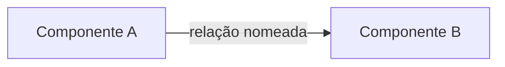

# Título da visão

## Propósito

Qual pergunta arquitetural este documento responde?

## Diagrama

## Descrição textual

Explique toda informação necessária para compreender o diagrama sem renderizá-lo.

## Responsabilidades e invariantes

## Falhas esperadas

## Relação com decisões
